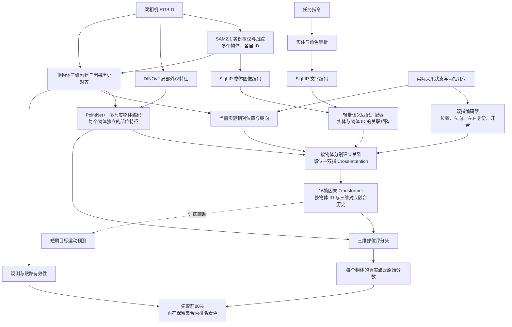

# LCJP002：语义引导的夹爪—物体三维部位评分方案

版本：LCJP002-plan-v1  
日期：2026-10-26  
项目：/mnt/nvme1/drh/D_VLA  
文档目的：固定网络、监督、训练与小规模前置验证的执行依据。

## 1. 任务定义

根据当前实际夹爪与物体的相对位置、朝向、开合状态，以及截至当前的交互历史，为物体的三维部位评分。

- 关注物体特征和夹爪特征两类信息；同一视频允许多个相关物体，各自保留实例身份、三维表示、历史和分数。
- 语义负责关联指令中的实体与图像中的物体，评分主干负责学习物体—夹爪关系。
- 输入实际正在执行的夹爪状态，不生成、搜索或排列候选抓法。
- 部位由多尺度三维邻域表示，不人工定义“上、中、下”；一个部位可以覆盖多个真实观测表面，不局限于触点。
- 接近、建立夹持、搬运、转动、静止保持、释放均纳入过程建模。只有一种抓法的数据，照常学习这一种。
- 不使用人工接触标签、仿真物体位姿/接触/力真值，不恢复抬升、闭合或连续若干帧作为接触正例门槛。只将两根夹指各表面的关系计为夹指支持，排除掌部、腕部、机械臂及物体—环境接触。

## 2. 输入、输出与数据边界

| 项目 | 内容 |
|---|---|
| 视觉输入 | 双相机RGB-D、内外参、时间戳；原始示范只读 |
| 机器人输入 | 实际夹爪位姿、开合量、两指几何及历史 |
| 语义输入 | 任务指令中的物体实体、修饰词及角色 |
| 模型输出 | 按物体ID组织的逐点/部位原始分数、语义关联信息、独立观测有效性 |
| 时间范围 | 评分输入只到当前时刻，历史长度16帧；未来仅进入训练目标 |
| 三维坐标 | 相机标定统一坐标，再按观测估计各物体运动与跨帧对应；不读取仿真物体位姿 |

当前LIBERO-Object划分保持：

| 分区 | 每任务示范编号 | 总段数 | 用途 |
|---|---|---:|---|
| 训练 | demo_0—demo_39 | 400 | 训练、尺度确定及前置验证 |
| 开发 | demo_45—demo_49 | 50 | 按冻结规则选检查点 |
| 留出 | demo_40—demo_44 | 50 | 参数与协议冻结后评估 |

这是自定义划分。前置验证仅用训练分区；最终先评估已登记的 bbq_sauce/demo_40，其他留出继续隔离。已经看过的 demo_45 预览不用于调整规则、阈值或挑选展示配置。

## 3. 完整网络



### 3.1 语义关联

SAM2.1先提供实例掩膜与跟踪ID；每个物体区域用SigLIP图像编码器提取特征，指令实体用同一套SigLIP的文字编码器提取特征，再进行匹配。DINOv2不直接与SigLIP文字向量比较。

“打开抽屉，把杯子放进去”关联抽屉、杯子两个实例，不将所有物体平均成一个向量，也不对整段视频只取一个最高项。多个同类物体仍按实例区分，利用指令修饰信息与几何对应消歧。身份不明确时保留未匹配状态，不用“最近夹爪”替代语义识别。

语义信息控制对象关联与注意力组织，不直接乘到最终分数或主评分损失上。全场景图像可用于提取实例与上下文，评分主干按对象特征组织输入，不把“关注两类特征”实现成整段只保留一个对象。

### 3.2 网络配置

| 模块 | 配置 | 作用 |
|---|---|---|
| 基础视觉与语言 | 固定SAM2.1、SigLIP、DINOv2官方权重 | 提供实例、图文对齐及视觉表征 |
| 语义匹配适配器 | 轻量残差/投影模块 | 适配机器人视角的实体—实例关联 |
| 物体编码 | 每物体约2048个真实点；位置、法向、DINOv2特征；64个空间锚点、192维特征 | 同时表达局部表面与较大三维部位 |
| 双指编码 | 每根夹指约64个表面采样点，编码为192维 | 表达全部有效夹指表面及开合 |
| 关系模块 | 2层交叉注意力，4头，192维 | 结合显式相对几何学习部位与双指关系 |
| 历史模块 | 最近16帧，2层时间Transformer，4头，192维 | 学习关系变化与持续保持 |
| 评分头 | 局部形状与时序关系融合，MLP输出经sigmoid得到逐点分数 | 直接形成三维部位评分 |
| 运动辅助头 | 预测下一观测时刻的目标点/局部运动 | 检查关系特征对运动解释的作用 |

空间锚点定义计算分辨率，不等于人工语义部件。点数不足使用有效性掩码；遮挡记忆标注信息年龄和对应质量，不补造当前真实点。首个可靠观测建立物体参考系；对称物体的朝向歧义保留在对应质量中。

参数量、显存、每步耗时在前置验证中实测，不沿用v001的计数与速度。

## 4. 学习依据与损失

### 4.1 语义匹配监督

冻结图文模型提供高置信实体—实例配对，结合跨帧及双相机一致性筛选，形成匹配适配器的训练目标。教师配对与有效性不由学生匹配分数自行调整。没有可靠配对的样本不强制指定实例。

人工核查仅用于前置评估，不自动进入训练标签。识别适配与评分使用同批示范、各自损失，不能只凭评分误差声称识别分支学会了对象名称。

### 4.2 部位软目标与独立权重

对每个时刻、物体和局部部位记录两个量：

| 量 | 计算依据 | 功能 |
|---|---|---|
| 参考值 y | 局部真实观测点与两指包围空间、指尖/内外侧等表面的空间支持关系 | 定位本次操作对应的三维部位 |
| 权重 w | 可见性、配准误差、轨迹对应、关系持续性 | 决定这条参考值参与训练的程度 |

“软覆盖”在观测点或明确的局部三维表示上计算，不未经重建就使用物体体积重叠率。包围空间不是唯一正支持；未进入两指之间的部位仍检查全部夹指表面的关系。空间位置由几何确定，运动证据用于支持交互；同一刚体共同运动不能区分其上部与下部。

监督分三类：

- 高支持：有观测依据的局部操作关系。
- 低支持：已观测、与当前实际夹指关系明确不相容的部位；表示当前关系的低支持，不补造抓取失败。
- 未知：遮挡、对应失效或证据不足。缺少标签/降低权重，不写成零分。

目标计算包含人为定义的几何表示与连续映射，属于自动软标签监督；它是训练协议的一部分。P4中需登记空间支持函数、误差尺度、权重组合、有效性规则及哈希，再进行P5/P6。仅把计算放到训练时，不改变标签来源。

目标生成不接收评分主干的反向梯度。可学习特征不能通过移动或合并部位来迁就标签；空间锚点和目标计算路径分离。接触预测值、学生语义置信度、学生预测的“未知程度”均不能关闭主评分梯度。

### 4.3 时间组织

| 阶段 | 监督组织 |
|---|---|
| 接近 | 使用随后最多16帧内实际出现的操作部位证据，映射回当前物体；窗口内无证据则不贴最终抓取部位 |
| 建立夹持 | 学习两指与部位形成的空间关系 |
| 搬运、转动 | 每帧持续计算关系与部位参考 |
| 静止保持 | 不因速度或相对位移接近零而过滤 |
| 释放、分离 | 随实际关系变化更新，不延续已经失效的参考 |

各窗口保留真实时间间隔；16帧不默认等于固定秒数。长保持阶段逐帧参与，但训练按视频/窗口平衡，避免时长被当作独立抓取次数。输入侧的跟踪、位姿估计、点云融合、归一化与特征缓存均只能使用截至当前的信息。

### 4.4 优化目标

评分损失先在每段视频内部按有效权重归一化，再对视频等权平均：

```text
L_score = mean_over_videos[ sum(w * (s - y)^2) / (sum(w) + eps) ]
L_total = L_score + λ_match * L_match + λ_motion * L_motion + λ_cons * L_cons
```

- L_match：有可靠配对样本的语义匹配损失。
- L_motion：可见、对应有效的短期运动预测误差。
- L_cons：同一真实三维位置的跨视角/跨帧表示一致性；不跨整段视频强制分数不变。

主项系数固定为1。其他系数、学习率、批量、随机种子、监督窗口和归一化尺度在P4/P5用诊断训练样本检查后，写入独立协议锁；不从正式开发或留出表现反推这些设置。

## 5. 小规模前置验证

所有任务初始状态均为待执行。P0—P4以观测与工程检查为主，P5—P7包含小规模训练及展示检查；结果写入各自报告，不将通过某项等同于整套方法通过。

### 5.1 样本与预算

- 诊断集D0：10个任务各demo_0，共10段。
- 分离检查集D1：10个任务各demo_1，共10段，仍属于原训练分区，不称正式开发集或留出测试。
- P5：从D0固定32个有效历史窗口，最多200次更新。
- P6：完整模型、去历史、去夹爪关系三种配置，每种200次更新、2个固定种子（17、23），共1200次更新；纯几何参考不训练。
- 小规模拟合与短训权重单独保存，不计入正式30轮，不自动作为正式训练初始化。
- 如D0实际没有多对象交互切换，只登记现有行为覆盖；多对象工程测试照常进行，不拼接视频或读取留出集补结果。

### 5.2 每一步做什么，怎样算通过

这里的“通过”只表示这一项检查达标。例如，程序能同时处理两个物体，不等于模型已经学会在两个物体之间切换操作。

#### 第1步：确认拿对了视频（P0）

**做什么：** 从10个任务里，各取demo_0用于调试和短训，各取demo_1检查训练后的表现，总共20段。核对任务名称、视频编号、图像、深度和机器人记录是否对应。

**你会看到：** 一张20段视频的清单，注明每段来自哪里、用于什么。

**通过：** 20段都来自训练分区，图像、深度和机器人状态没有串段或错帧；原始数据没有被修改。拿错分区、缺少关键数据或对应不上，先修正清单和数据读取。

#### 第2步：确认找的是正确物体（P1）

**做什么：** 每段demo_0先均匀抽5帧，再检查实际操作和遮挡附近的画面。把指令对应的物体轮廓、名称和编号画在图上，检查有没有把烧烤酱认成篮子、把不同物体混成一个。

**你会看到：** 原图叠加物体轮廓和名称，以及“找对、找错、看不清”的统计。

**通过：** 抽查的清晰画面能找到正确物体，并得到属于它的点云；后续帧仍跟踪同一个物体。遮挡时允许明确显示“看不清”，但全部回答“看不清”不算通过。认错却继续打分、换了物体却沿用旧编号，都要先修识别与跟踪。

人工看图只用于检查，不把这些检查记录变成接触或评分训练标签。

#### 第3步：确认多个物体不会串线（P2）

**做什么：** 找一帧同时看得到至少两个物体的画面，分别测试：一起处理两个物体、分开处理、交换它们在程序中的排列顺序。所有结果最后按物体编号放回原图。

**你会看到：** 同一物体在这几种处理方式下的点云和分数对照。

**通过：** 分开或一起处理，物体的结果一致；交换排列顺序后，杯子的分数仍属于杯子，不会跑到另一个物体上。微小计算误差按本节末尾的数值约定检查。

这一步查的是程序能否正确处理多个物体。原视频如果没有实际交互对象切换，就登记“未覆盖”，不拼接视频充当真实切换。

#### 第4步：确认网络没有偷看后面的画面（P3）

**做什么：** 从至少3段视频里各选3个时刻。以其中某个时刻为例，先只给程序此前和当前的画面，得到当前分数；再保留完整视频计算同一时刻，最后替换后面的画面再算一次。

**你会看到：** 同一时刻三次计算的输入和分数差异。

**通过：** 后面的画面有没有提供、换成什么，都不影响当前输入和分数。若发生变化，说明分割跟踪、点云整理或历史处理用了未来信息，要先修正。训练参考答案可以利用后续记录，评分网络的输入不可以。

#### 第5步：确认“教网络的答案”没有明显错误（P4）

**做什么：** 把自动生成的参考分数画到原视频和点云上，逐段检查接近、夹持、搬运、停顿和释放。同时查看每条参考答案参与训练的权重。

**你会看到：** 原始操作视频、自动参考分数叠加，以及高支持、低支持、缺少依据各有多少的统计。

**通过：**
- 参考区域属于正确物体，双相机投影对得上；掌部、腕部和机械臂没有混成夹指支持。
- 夹持搬运和停顿中仍保留合理的部位参考，没有因为速度变小就全部丢掉。
- 看不清的部位标为缺少依据，没有被强行教成零分。
- 确实有可供学习的参考值和有效权重，不是全部无效，也不是不加区分地把所有部位都标高分。

出现明显错位、把经过误当成操作、或整段没有有效参考时，先修参考答案的生成方法。数据里没有出现的阶段记为“未覆盖”，不补造标签。生成公式和参数在这一步登记固定，再做后面的训练。

#### 第6步：确认网络真的能学进去（P5）

**做什么：** 从demo_0里固定选32个小片段，每个片段包含当前帧和最多15帧历史。反复用这32个片段训练，最多更新200次，观察网络输出是否越来越接近参考分数。

**你会看到：** 训练前后的分数对比和误差曲线，并与“所有位置永远输出同一个数”的最好结果比较。

**通过：** 在参考分数确实有区别的这批片段上，最后20次更新的平均误差同时低于：
1. 最初20次更新的平均误差；
2. 对所有位置都报同一个固定分数时的最低误差。

程序还要确认参数确实在更新、没有出现无效数值。只看见程序在跑，或者只看见误差略降，都不够。未通过时查输入、参考答案、权重和参数更新过程，不直接靠增加训练轮数解决。

#### 第7步：确认换一段视频后还能用，也确实用到了夹爪信息（P6）

**做什么：** 用demo_0做短训，再检查没有参与这次短训的demo_1。比较三个同样训练预算的模型：完整模型、不看历史的模型、不看夹爪关系的模型；每种重复两次，每次更新200次。另列出直接按几何规则计算的结果。

**你会看到：** 三种模型在新视频上的原始分数和参考误差，以及“拿掉夹爪信息后变差多少”“拿掉历史后变差多少”的对照表。

**通过：** 新视频能正常输出有区别的部位分数；两次重复实验中，完整模型在这10段检查视频上的平均参考误差都低于不看夹爪关系的模型。这样才有证据说明网络用到了任务最核心的夹爪关系。

如果去掉夹爪信息后没有变差，先查模型是否只记住了物体形状或固定位置，不直接进入全量训练。历史是否带来改善单独报告：去掉历史后不变，就记录“目前没有证明历史有帮助”，不能写成历史模块有效。数据只有一种抓法，不因此判失败。

几何规则如果本来就用于生成参考答案，就不要求网络在“与这份答案有多接近”上击败规则本身；这项比较用于看清网络学到了什么。

#### 第8步：确认最后给你看的视频没有画错（P7）

**做什么：** 用短训模型预测完整的bbq_sauce/demo_1，检查整个视频，逐帧核对物体编号、帧号、点云位置和颜色。

**你会看到：** 可以播放、暂停和单步查看的完整双相机评分视频。

**通过：**
- 视频没有漏帧，两个相机显示的是同一时刻；评分点贴在正确物体上，遮挡关系正常。
- 每个物体先保留最高80%的有效评分点，再只在保留的点里重新排名分色。
- 相同分数显示相同颜色，不因程序随机排序闪烁；未知单独灰色。
- 能查看原始分数，也能切换回完整点云；默认没显示的20%仍保留。

画面、帧号或颜色算法不对，先修展示，不把显示错误归因于模型。

**程序比较的数值约定：** 物体编号、对应关系等离散结果应一致；浮点计算沿用绝对容差1e-5、相对容差1e-4。先检查同一输入重复计算的误差，确需调整容差时记录原因，不能为了让检查通过临时放宽。

### 5.3 方法检查的解释规则

- 自动参考值由几何规则生成时，规则本身在其标签误差上具有天然优势；不把“必须击败标签生成器”设为不可能的通过条件。
- P5证明损失路径可训练；P6分别检查参考拟合、真实影像中的部位对应，以及输入信息是否实际被使用。
- 仅改变输入后热图发生变化不算合理性证据；对照应结合真实示范对应关系。
- 高分部位在夹持搬运中保持稳定可以是正确行为，不以颜色持续变化作为成功标准。
- 每次失败只修对应环节并保留失败记录；协议变更重新编号并记录继承，不覆盖已有结果。

## 6. 正式训练与检查点选择

1. 完成前置记录，固定实现、观测协议、软目标函数、损失配置和数据清单的哈希。
2. 训练集400段确定尺度；每轮覆盖全部400段，按过程抽取历史窗口并记录实际覆盖，计划30轮。
3. 每轮保存模型、优化器、随机状态和累计更新数；记录评分梯度、有效目标权重、分数分布及各阶段耗时。
4. 开发指标固定为50段视频等权的有效部位软目标误差；有效性规则固定，不允许模型自行减少评估样本。另报语义覆盖、分数集中程度和对应质量。
5. 在满足工程完整性条件的检查点中选开发主指标最小者，数值相同时取较早轮次。不按视频颜色挑best。
6. 冻结检查点、源、输入和评估协议后，仅按预登记样本进行留出推理；结果报告包含成功现象、低分、未知与失败。

旧v001训练权重与接续状态已删除。新任务使用官方视觉底座、新评分主干及协议兼容的观测缓存，不读取旧网络生成目标作为新监督。

## 7. 展示规则

每个任务相关物体分别处理；语义角色、对象ID、原始评分与观测有效性独立保存。

1. 在当前物体的有效真实评分点中，按原始分数取最高80%；设有效点数为N，保留K=ceil(0.8N)，N=0时展示缺失原因。
2. 截止位置同分时按稳定点ID确定保留顺序，避免预算膨胀或随机闪烁。
3. 只在保留集合内重新计算百分位，同分采用平均名次，保证同分同色；K=1时取中间百分位。
4. 使用下表颜色；未知单独灰色，不参与有效点排名。原始数值不被百分位覆盖。

| 保留集合内部百分位 | 颜色 |
|---|---|
| 95—100 | 红 |
| 90—小于95 | 橙 |
| 80—小于90 | 黄 |
| 50—小于80 | 绿 |
| 0—小于50 | 蓝 |

保留完整点云和未显示的20%；提供完整显示开关。页面同步显示原始分数最小/最大值、分布、对象ID、有效点数与显示点数。全部同分时使用同一颜色并标出无区分，不能强制生成五色。

视频逐帧叠加当前评分并提供帧号、双相机同步与单步播放。推理耗时单独实测，视频播放帧率不替代推理速度。

## 8. 远程组织与交付清单

所有代码、模型、缓存、视频和报告留在服务器：

| 内容 | 远程相对项目路径 |
|---|---|
| 本方案 | docs/LCJP002_语义引导夹爪物体三维部位评分_网络训练与前置验证方案.md |
| 新版实现 | experiments/contact_joint_object/src_v002/ |
| 前置验证清单、协议与结果 | experiments/contact_joint_object/runs/v002/preflight/ |
| 正式训练状态和检查点 | experiments/contact_joint_object/runs/v002/ |
| 新输入缓存 | experiments/contact_joint_object/cache/v002_inputs/<协议hash>/ |
| 原始分数、点云及视频检查资源 | experiments/contact_joint_object/review/v002/ |

前置交付至少包含：样本清单与哈希、P0—P7结果表、语义绑定核查、监督分布与梯度记录、对照结果、完整视频和页面检查记录。每项结果标记完成、失败或未覆盖，并附原因；不以工程smoke代替训练结果。

## 9. 组件依据

- [SigLIP 2官方模型卡：图文匹配、预训练权重](https://huggingface.co/google/siglip2-base-patch16-224)
- [SAM2官方项目：SAM2.1权重、实例分割与视频跟踪](https://github.com/facebookresearch/sam2)
- [DINOv2官方项目：预训练视觉特征](https://github.com/facebookresearch/dinov2)
- [PointNet++论文：多尺度点云编码](https://arxiv.org/abs/1706.02413)

这些来源支持组件能力；本方案的模块组合、自动部位目标与验证任务由当前实验目标确定。


## P1 执行登记｜2026-10-26T15:57:14+08:00

用户要求跳过第一步，直接执行第二步并用页面展示。执行编号 P1_semantics_v1。只检查10个任务的训练集 demo_0；使用已完成的双相机 RGB-D 和 SAM2.1 观测缓存，重新以冻结 SigLIP2 图文编码器绑定指令实体，不继承旧语义或评分。每段取5个均匀帧，并加入夹爪最小开度与末端最大速度时刻的相邻帧。全部候选、失败和未知保留；自动匹配与人工画面核对分别记录。匹配头尚未训练，本次检验预训练特征能否正确找物体。参数和输入哈希保存在 runs/v002/preflight/P1_semantics_v1/protocol.json 与 inputs.json。此步骤不启动打分网络训练。


### P1 实际结果｜2026-10-26T16:08:57+08:00

第二步未通过。10个任务各demo_0，共109个时刻、218个双相机视图和892个候选已完成冻结SigLIP2语义匹配。自动选出43个候选，175个无法确定；助手按全部抽样画面核对，43个中29个找到了实际操作物体的可见部分，14个选错。该核对只判断物体身份及可见轮廓，不是逐像素标注，也不作为后续接触/评分训练标签。篮子结果同时展示，未计入以上主目标核对数。

明确问题：烧烤酱外部视角11帧均把未操作的另一只瓶子作为目标；近距离牛奶/橙汁部分帧可以找到，但外部相机目标候选和语义区分不足；相同物体的旧关联编号多次重建。冻结语义匹配尚不能直接作为稳定物体绑定入口。本次不根据画面调整阈值，也没有训练匹配头或打分网络。

独立核对：3112个引用资产齐全，6333935个有效深度点与原RGB-D一致；最大投影误差0.002573像素、深度误差8.24e-7米、RGB误差0。页面的轮廓错选来自当前候选/语义绑定结果，不能通过改画法解决。页面已验证任务/实体/相机切换、抽样播放帧号、候选轮廓和点云旋转，全部结果保留在P1_semantics_v1与docs/lcjp002_p1_assets。

结果页： [LCJP002 第二步物体识别检查](LCJP002_P1_物体识别检查.html)。


登记时间：2026-10-26T16:47:51+08:00

## 双视角交互物体锁定验证（P1_interaction_v1）
用户授权先分割各物体，再利用夹爪与物体的交互锁定当前操作实例，结合两个视角展示实际效果。只运行识别前端验证，不恢复v001，不启动评分训练。
- 输入：训练集ketchup/demo_0（248帧）、orange_juice/demo_0（126帧）、bbq_sauce/demo_0（134帧），508个时间点、1016个相机画面。原数据只读，不读取预留测试。类别名仅用于页面标题，不参与分割和关联。
- 分割：冻结SAM2.1 tiny，32×32自动提示，每16帧当帧重检测补实例，帧间SAM2视频传播。输入因果保护禁止读取未来图像。去机器人像素和无效深度后不足16像素记录剔除原因，大背景标记保留。
- 双视角：真实RGB-D转世界坐标，结合可见性检查后的投影重叠及三维重叠对应实例。匹配不明确不强行合并；一边不可见不伪造其物体轮廓。
- 交互：只用两根夹指各有效表面计算距离；运动来自可信图像点对应加深度及相机外参，扣除腕部相机自运动，不用点云质心跳动代替运动。掌部、腕部、机械臂不提供正支持。
- 本轮展示几何/运动关联证据与时序身份保持，没有新训练的关系网络，不生成正式接触训练标签。允许空集合和多物体，身份与当前交互状态分离，不设置抬升、闭合、连续5帧门槛。具体数值配置与源hash在protocol及产物中登记，不按结果画面调参。
- 页面完整双视角同步播放，显示全部实例、关联实例、编号、两指距离、运动有效点和失败原因。保留漏检、假锁、未知和遮挡；旧P1页面保留作对照。
- 核对：全部帧数、图像/帧号同步、因果前缀一致、输入/源哈希、投影、夹指距离、相机自运动、无强制top1、静止保持。画面核对只评价，不用于本轮选择或训练。


登记时间：2026-10-26T17:00:49+08:00

### 严格因果读取修复
独立检查发现关联脚本调用的原geometry.finger_geometry会额外读取下一帧夹指位姿，虽然本轮只使用不依赖该读取的sdf距离，仍不符合当前/历史输入约束。修复方式为新增只读前缀视图：传给helper的两组夹指位姿序列长度截止当前帧，任何超过当前帧的索引直接拒绝；原src及距离公式不改。
先保留修复前关联JSON、源文件及所有展示图SHA，再用相同配置重算三段，逐字段比较关联对象、距离、运动、证据值、状态和图像。预期最大差0；若不一致则如实记录和排查。该修复不改分割或阈值，不依据画面好坏调参。


### 双视角交互验证实际结果 2026-10-26T17:05:00+08:00
- 三段全部处理完：508个时间点，1016个相机画面；三个MP4逐帧解码帧数均一致。
- 番茄酱第247帧原先缺失的外部候选已补回：腕部投影的203个共同可见像素中198个被新外部候选覆盖。
- 橙汁第50至119帧连续关联编号8；番茄酱关联编号9、烧烤酱编号3，但两段存在短暂关联中断。
- 抽查番茄酱第143/200帧、橙汁第80帧、烧烤酱第80帧，关联轮廓对应实际被操作物体；没有据此计算全视频准确率。
- 首次静态接触不能新锁定；背景、物体局部重复候选和短暂失锁仍存在。190个关联帧不是正确率，其余318帧也不等于接触失败。
- 因果读取修复后重算三段，全部关联字段与3048张图逐项一致；未来帧输入已由前缀视图阻止。

完整覆盖：番茄酱248帧（73帧关联同一编号9），橙汁126帧（70帧关联同一编号8），烧烤酱134帧（47帧关联同一编号3）。共9083个有效实例掩膜；无空视图仅表示至少存在一个候选，不表示所有物体均分对。

页面：[双视角交互物体锁定](LCJP002_P1_双视角交互物体锁定.html)。页面支持同步逐帧、原图/全部实例/关联物体切换和完整MP4。三段视频逐帧解码248/126/134帧，1024×576，20FPS离线回放。

严格因果修复记录：原辅助函数的未使用finger_displacement读取下一帧位姿，已通过CurrentGeometryView阻断；9个实际帧几何最大差0，7项边界检查通过；三段重算关联字段完全一致、3048张展示图hash一致。协议阈值和原始src未改。相关报告均保存在runs/v002/preflight/P1_interaction_v1。


### 2026-10-26T17:42:59+08:00 扩展动作双视角检查
用户要求增加同视频连续抓取两物体、推/拉抽屉、操作开关。固定选官方 LIBERO 的上述四任务 demo_0；使用完整视频双视角，沿用前轮分割、跟踪与几何运动关联参数，不用任务文本选目标、不训练网络。源文件版本及哈希登记在 P1_interaction_extended_v1/protocol.json，原始示范只读。新结果独立保存，原三段结果不覆盖；开关是否旋转以机构定义和实际画面核对。

- 2026-10-26T17:46:34+08:00 工程修复：扩展入口目录层级变化导致 asset_paths 导入失败，渲染尚未开始。为子进程 PYTHONPATH 加入项目 src；不改原始示范、网络、分割/关联参数。保留失败记录，继续四段回放。


### 2026-10-26T18:01:46+08:00 扩展动作结果
结果页：LCJP002_P1_多物体抽屉开关检查.html。沿用前轮分割、跟踪、双视角融合、关联参数，网络训练更新数 0。四段均为所列官方任务的 demo_0，完整回放；不属于本实验原定留出评估。

| 案例 | 总帧数 | 有关联输出的帧 | 实际观察 |
|---|---:|---:|---|
| 连续抓取字母汤罐、番茄酱罐 | 388 | 118 | 第165帧第一只罐为#12，第331帧第二只罐为#9；存在漏检、额外碎片编号，第33帧异常关联保留。 |
| 拉开中层抽屉 | 138 | 0 | 柜体、面板和把手分割粒度不一致，未建立有效关联。 |
| 推回顶层抽屉 | 71 | 0 | 外部相机有伸出抽屉候选，腕部相机该部件常在边缘或不可见，未建立有效关联。 |
| 旋转炉灶开关 | 80 | 0 | 旋钮存在独立候选，接近时遮挡明显，现有共同运动条件未捕获该操作。 |

这些数量是输出帧数，不是正确率。双物体能在两次搬运时切换对象，但仍不稳定；当前流程不能直接推广到推拉抽屉与旋钮操作。没有为了案例效果降低阈值、扩大夹爪有效表面或修改分割参数。

数据与展示核对：677个时间帧、1354个双视角画面、4062张展示图、15342个掩膜均已核对；掩膜与机器人排除区交叠像素数0，非法深度像素数0，当前/历史读取约束通过，输入与输出哈希匹配。四个MP4全部解码帧数分别388/138/71/80；页面四案例均载入，双相机帧号一致，关键帧跳转可用，逐帧播放器从165推进至375帧，旋钮MP4实际播放至结尾，无浏览器控制台错误。

源数据仅通过HTTP Range读取官方文件的data/demo_0，数据保存在远程raw_demo0并设为只读；源整文件LFS哈希为官方元数据，未冒称对未下载的整文件做全量哈希验证，已计算远程子集文件哈希。来源固定版本147fa5eb607bb696dd922c3518084a90954cd2f3。报告位于runs/v002/preflight/P1_interaction_extended_v1/；新增结果和原三段结果分开保存。临时下载代理隧道已关闭。


### 2026-10-26T18:29:39+08:00 frozen-feature interface repair
72 historical identity entries are occluded placeholders without local_ids. Skip these unavailable observations; do not invent masks or interpolate features. No training or model changes. Previous failure retained.


### 2026-10-26T18:29:42+08:00 冻结特征单视频检查
用户要求先验证现成特征是否反映关系变化。只用双物体视频388帧，DINOv2-S/14冻结，不建优化器、不训练、不生成接触标签、不运行旧关联门槛。所有当前分割实例均提取特征；#12、#9及候选#3额外做去背景裁剪对照。逐视角展示视觉特征变化、物体×夹指特征乘积的变化、视觉相似度及真实RGB-D相对位置；缺观测留空。旧结果仅继承id/local_ids身份映射，不继承关联分数或状态。输出目录P1_frozen_feature_probe，页面LCJP002_单视频冻结特征检查.html。


### 2026-10-26T18:30:30+08:00 frozen-feature preprocessing repair
Existing pretrained preprocessing expects NHWC batch input; the probe supplied HWC. Add the missing batch dimension only. No weights, normalization, architecture or training change.


### 2026-10-26T18:30:33+08:00 冻结特征单视频检查
用户要求先验证现成特征是否反映关系变化。只用双物体视频388帧，DINOv2-S/14冻结，不建优化器、不训练、不生成接触标签、不运行旧关联门槛。所有当前分割实例均提取特征；#12、#9及候选#3额外做去背景裁剪对照。逐视角展示视觉特征变化、物体×夹指特征乘积的变化、视觉相似度及真实RGB-D相对位置；缺观测留空。旧结果仅继承id/local_ids身份映射，不继承关联分数或状态。输出目录P1_frozen_feature_probe，页面LCJP002_单视频冻结特征检查.html。


### 2026-10-26T18:36:24+08:00 单视频冻结特征检查结果

能看到变化，但不是接触开关。第165帧第一只罐正在被搬运：外部视角的物体特征变化为0.0235，静止的第二只罐为0.0022，篮子为0.0008。

简单组合会受到夹指共同变化的影响。同一帧，三个候选的组合特征变化分别为0.0512、0.0422、0.0439，未把正在搬运的罐明显分离出来。整段外部视角中，它们与夹指自身变化的相关系数分别为0.71、0.83、0.89。

大峰值也会来自放下、转动和遮挡。第一只罐在218–223帧的变化明显，画面中它正在落入篮子、外观和可见部分快速改变；这些峰值不能直接标成开始接触。

双视角不能简单取大值。第二只罐腕部视角在140–141帧变化约0.24，当时操作的是第一只罐；外部视角第二只罐在同帧变化较小。腕部相机运动、遮挡和分割变化都可能贡献峰值。

本次验证：冻结特征保留了可观察的变化；尚未得到能直接锁定交互对象的稳定分界。页面保留全部49个候选及缺观测，不把此次分析转换成接触标签。

完整388帧、776个视角画面、8,487条物体观测。训练更新为0；编码器权重前后哈希一致；同一输入重复提取最大差异为0；全部776张画面存在。手动观察帧只用于解释画面，没有生成接触标签或训练目标。

/mnt/nvme1/drh/D_VLA/experiments/contact_joint_object/runs/v002/preflight/P1_frozen_feature_probe/analysis.json
Source SHA256: 45429b176ba43cbbc5bea34f51cce1b3c5a1710c5210af5626ffaa66bbd38f73
Features SHA256: d3319d6e7caf71d8ddb479e6540b9265bcdb4197d69556aa03d86e2d8410008e
Weights SHA256 before/after: 5c020b220b4afcd5298adef191b21be36cac1b7aad9527681163c626d8457591
Identity bookkeeping source SHA256: 6d6c3705ae3ea756ac2073755dfceb69c1d4e790d13d8612121f6f7b8b5ddcae
Page: LCJP002_单视频冻结特征检查.html


2026-10-26T18:37:54+08:00
页面验收：已实际播放并确认帧142→254连续推进，外部/腕部图像帧号与曲线游标一致；已核对141、165、221、331及387帧；对象切换、缺观测留空、最后一帧和固定坐标轴正常。浏览器错误日志为空。第141帧第二只罐在桌上，腕部画面仅露出边缘，外部画面清楚；第165帧第一只罐被搬运，第221帧已落入篮子，第331帧第二只罐被搬运。没有增加接触标签、门槛或训练更新。
Decoded RGB images: 776
Page SHA256: 680e99d2a65bcfd56be57459e8dcb0df4063eb7a7b53c5a73cd8eeb1f6fef28b
