# LCJP003：状态条件三维部位评分与 Drifting VLA 设计方案

> 当前迭代：**R5 / LCJP003-R5-design-v1**（2026-10-28 23:53:54 北京时间）。[跳转R5设计](#lcjp003-r5) · [网络图与具体模块](LCJP003_R5_网络设计.html)。R5模块已开始实现、尚未训练；R4训练已完成且闭环按用户要求停止。R4及更早章节保留为历史记录。

## R5｜单实例目标、连贯三维部位与评分选择动作网络

**版本：LCJP003-R5-design-v1。修订时间：2026-10-28 23:53:54（北京时间）。**  
本节取代 R4 的网络设计与后续修复路线；R4 的训练、权重、失败记录与停止状态保留。当前状态：用户已授权实现并在验证通过后训练；模块实现进展见文末登记，正式更新尚未启动。

### R5.1 设计目标与已确认的断点

推理链路明确为：**双视角图像与指令直接预测目标实例 → 只在该实例真实表面形成部位 → 当前夹爪关系决定部位分数 → 评分选出的部位几何参与动作 → 新观测更新下一步预测。** 目标、部位、动作在同一次联合训练中学习，不要求先单独预训练一个目标、接触或失败判断网络。SAM2.1 的 32×32 搜索只用于离线监督准备。

| R4 已核实问题 | R5 对应修改 | 判断修改是否有效 |
|---|---|---|
| 超过目标阈值的多个误识别区域一起进入点云 | 共享实例槽与任务角色选择；只保留被选实例的可见表面 | 全图检查目标身份、背景误入、机器人污染与漏检；报告未知区覆盖 |
| 掩膜监督和 IoU 只覆盖 mask_weight 非零区 | 实例级掩膜、明确背景与机器人负样本、未知区分开；报告有效监督覆盖率 | 不再把局部弱标签 IoU 当作全图识别准确率 |
| 未来运动支持取 max，孤立支持与多次支持可能同样高 | 按实际操作片段归因、每段示范归一化、置信度加权累积 | 已有抓空及后续成功片段不串标签 |
| 8 个查询混合 64 组，不是真正按分数选部位 | 64 个真实局部部位 → 确定性 Top-8；训练前向与推理相同 | 实际选中索引与坐标可回溯，非选中细部不能另路进入动作头 |
| 网页 point_score 与动作 group_score 分叉 | 唯一部位分数 s，同时控制选择、动作条件与表面着色 | 干预同一份 s 后，选择、动作、显示同步变化 |
| 基础分支携带全图视觉，能绕过评分细几何 | 基础只保留目标整体、状态和目的地粗信息；细部经评分支路 | 原评分相对均匀评分的动作误差及闭环收益 |
| 训练短链 previous-plan，推理数百步递归 | 删除递归计划与旧计划连续性损失；每次由新观测预测 | 同一观测/历史/噪声下训练接口与在线接口一致 |
| 开合评估漏掉评分干预后的输出 | 移动、旋转、开合均做成对干预和分阶段检查 | 不用运动 MAE 代替夹爪错误与抓空判断 |

R4 固定轨迹回放的 12 个观测中，打乱评分的平均运动变化约 0.000446，开合未翻转；这仅说明已检查状态的局部依赖较弱。它不能排除闭环偏差累积，也不能证明视频里的失败源于某一段示范。R4 Object50 已完成 10 次、成功 0 次，下一次中途停止，不将其写成 50 次结果。

### R5.2 论文式网络总图

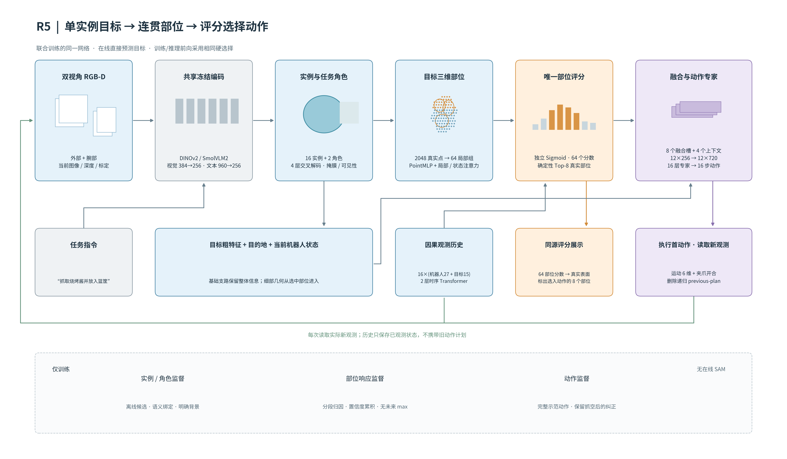

**图 R5-1。** 上方为在线前向数据流，灰色为冻结编码器，蓝色为目标与几何学习，橙色为唯一评分及部位选择，紫色为动作专家。下方为仅训练使用的示范监督。双视角共享目标实例身份，各自预测可见掩膜；目标以外的点不能进入部位分支。16 帧历史全部来自当前及过去观测。箭头表示数据依赖，不表示所有硬索引都可微。

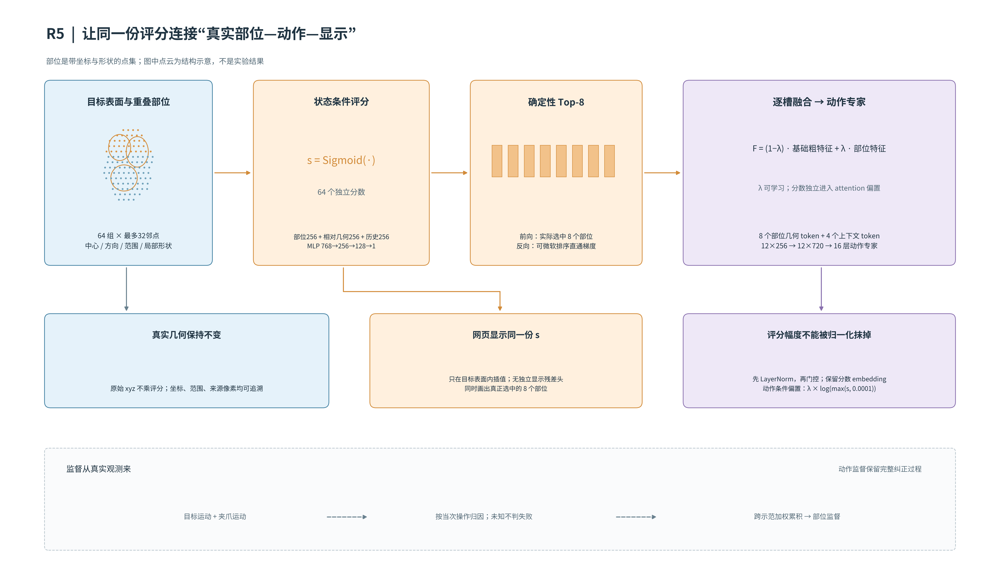

**图 R5-2。** 64 个局部部位具有实际点集和范围；同一份独立分数决定 Top-8、动作注意力与点云着色。保留 8 个独立 token 及其真实几何，不将它们平均成一个全局向量。基础/部位按可学习 λ 融合；图中所示点云是结构示意，不是实验结果。

[打开 R5 图纸与模块表](LCJP003_R5_网络设计.html) · [总图 SVG](LCJP003_R5_design_assets/r5_network.svg) · [总图 PDF](LCJP003_R5_design_assets/r5_network.pdf)

### R5.3 输入与固定张量约定

B 为批量；V=2 为外部/腕部相机；T=16 为因果历史；M=16 为实例槽；R=2 为角色（被操作物、放置目标）；N=2048 为目标真实点预算；G=64 为局部部位；K=8 为送入动作头的部位；H=16 为动作预测长度；D=256 为新增模块维度。R 与 V 数值相同但含义不同。

| 输入 | 形状 | 来源与约束 |
|---|---|---|
| 当前两路 RGB、深度 | B×2×3×256×256；B×2×256×256 | 真实当前观测；无未来帧 |
| 相机内外参、机器人排除掩膜 | B×2×3×3；B×2×4×4；B×2×256×256 | 沿用已验证相机约定；只排除由机器人状态可计算的区域，不读取物体真值 |
| 冻结视觉特征 | B×2×32×32×384 | 沿用 R4 DINOv2 与原预处理；32×32 是特征网格，不是在线 SAM 提示搜索 |
| 指令 token | B×L×960 | 冻结 SmolVLM2 文本编码，缓存固定文本；新增交叉注意力与角色头可训练 |
| 当前两指几何 | B×64×6 | 64 个真实夹指采样点，xyz 与法向；不包括掌部和腕部 |
| 机器人历史 | B×16×27 | 已执行动作、实际机器人状态与夹爪状态 |
| 目标观测历史 | B×16×15 | 中心3、范围3、相邻观测中心位移3、协方差特征值3、双视角可见度2、存在置信度1 |
| 动作噪声 | B×16×6 | 与现有 Drifting 运动生成接口一致，配对验收时噪声固定 |

目标历史由每个过去观测上的**模型预测目标**建立；不以理想掩膜替代训练历史，再在推理时换成预测掩膜。历史编码按时间戳与相机/机器人变换对齐，缺失项有 valid 标记。第一帧左侧补缺失并屏蔽，不能读取未来。动作数据归一化仅来自登记的训练划分。

### R5.4 可直接实现的模块与层规格

| 编号 / 模块 | 层与操作 | 输出 |
|---|---|---|
| A0 冻结编码器 | R4 DINOv2 视觉骨干与 SmolVLM2 文本骨干；保持原输入数值契约 | 图像384维，文字960维 |
| A1 视觉/文字投影 | 视觉 Linear 384→256 + LayerNorm；文字 Linear 960→256 + LayerNorm；加入相机ID与由深度反投影的3D位置编码 | 2048 个图像 token 与 L 个文字 token，均256维 |
| A2 实例—角色解码 | 16个共享实例 query + 2个角色 query；4个解码块；每块 self-attention、图文 cross-attention、FFN；D256、8头、FFN1024、Pre-LN、GELU | 实例 B×16×256；角色 B×2×256 |
| A3 实例掩膜头 | 两路共享卷积权重：3×3 256→128、双线性×2、GELU；3×3 128→64、双线性×2、GELU；像素64维与实例 Linear256→64 点积；插值至256×256 | B×2×16×256×256 logits |
| A4 角色/可见性头 | 角色与实例投影后匹配，附加null；可见性 MLP256→128→2 | 角色 B×2×17；可见性 B×2×16；共享实例ID不等于两路像素硬对应 |
| A5 单实例取点 | 操作角色 argmax（含null）、实例概率>0.5、有效深度、机器人排除；反投影，保留来源相机与像素；N=2048真实点预算 | xyz B×2048×3、局部特征、valid、source_uv |
| B1 点编码 | 视觉256维 + 几何/RGB12维 → PointMLP268→128→256（GELU）；几何含相对xyz3、法向3、RGB3、双视角有效性2、深度质量1 | B×2048×256 |
| B2 连贯局部部位 | 确定性FPS64中心、每组最多32邻点；16个中心各用3尺度重叠邻域（48组），另16组覆盖细部；邻接受目标表面与深度边界约束；局部MLP(256+相对xyz3)259→256→256，再有效点池化 | B×64×256；每组保留实际点集/中心/法向/范围 |
| B3 部位几何交互 | 2层局部 self-attention，D256/8头/FFN1024；邻接掩膜限制跨表面混合；2层状态/文本 cross-attention，规格相同 | B×64×256 |
| C1 状态/历史编码 | 机器人27+目标历史15=42→256；2层因果Transformer，D256/8头/FFN1024；取最后有效token。夹指6→128→256再有效池化；当前状态27→256；当前状态与夹指拼接512→256 | history、finger、state各1×256 |
| C2 条件部位评分 | 每组token256、相对几何embedding256、history256拼接；MLP768→256→128→1，GELU，末端独立sigmoid | 唯一分数 s：B×64；非64组softmax |
| C3 真实部位选择 | 根据s确定性有序Top-8；同分按固定空间索引处理；训练/推理前向均硬选择；反向使用软排序直通估计 | 索引B×8、分数B×8、8组真实几何与token |
| C4 部位token | 组token256+几何16 → Linear272→256+GELU+LayerNorm；再以s门控，并独立加入s的线性embedding | B×8×256；保留原始几何元数据，不把xyz乘s当坐标 |
| D1 基础token | 目标整体语义256+粗几何16 → MLP272→256→256；复制到8个角色槽并加槽embedding；不输入全图细节或64组未选择局部特征 | B×8×256 |
| D2 可学习融合 | 每槽 concat(base256,part256,history256) → MLP768→128→1→sigmoid；λ初始0.5，无强制下限；F=(1−λ)·LN(base)+λ·part | B×8×256 |
| D3 动作条件 | 8融合token + history/text/destination/state各1token；Linear256→720；8个融合token不再池化 | B×12×720 |
| E1 Drifting动作专家 | 保留16层、隐藏720、原头数/注意力结构和rank16 LoRA；运动噪声16×6→720；不接previous-plan | B×16×720 |
| E2 输出头 | 运动MLP720→256→256→6；夹爪MLP720→128→2；删除在线未使用的switch头 | 16×6运动、16×2开合logits |
| E3 在线重规划 | 执行预测首动作，读新RGB-D/机器人状态，更新因果历史再预测 | 每步新观测闭环；没有独立失败/补救网络 |

**B2 的实现约定：**16个多尺度中心从64个确定性FPS候选中固定均匀子选；其余16个细部中心从尚未覆盖区域选取。尺度使用目标大小归一化的邻域半径，初值为目标包围盒对角线的0.08/0.16/0.24，细部半径0.08；每组至多32点、不足用valid屏蔽。这些半径定义局部表面支持域，不用于判断接触或抓取成功。不得用远距离kNN补齐到其他物体，也不跨深度断层扩散。

**双视角融合约定：**两路点先变换到共同三维坐标系，再投影检查另一视角的深度与可见性。同一表面且深度一致的观测按可见性、深度质量加权合并特征；一路遮挡时使用可见一路，不将遮挡侧的背景特征混入。融合的几何有效性参数沿用已验证的相机/深度契约，实施时连同配置哈希登记；共享实例ID不替代深度遮挡检查。

**空目标约定：**null或无有效深度时，N个点均valid=false，部位token使用缺失embedding，坐标不伪造；无效部位不参加Top-8。有效组不足8时以无效槽补齐并attention-mask。目的地独立编码为1个粗token，可提供放置位置，不能被画成操作物的抓取部位。该状态仍交给同一个策略处理，不自动后台调用SAM密集搜索。

### R5.5 评分如何进入动作：唯一变量、真实选择、几何保留

设第g个真实部位为 P_g，编码特征 h_g，几何元数据 d_g，分数 s_g：

s_g = sigmoid(MLP[h_g, Encode(d_g, gripper_t), history_t])。

这里的d_g包含部位相对当前夹爪的中心、表面方向、范围，以及相对目标中心的位置。评分可随当前位姿改变；没有“从上方接近就人工把上部置高”的规则。

1. **前向真正选8个部位。**H为按s排序的8×64硬选择矩阵，S为相同分数的可微软排序矩阵；训练采用 P_ST = stop_gradient(H−S)+S。前向值严格等于H，反向通过S更新分数。软排序温度初值0.5，推理不用温度/采样。稳定排序和有效性掩码与在线完全一致。
2. **8个槽各带真实几何。**d_g的16维为中心3、法向3、范围3、协方差特征值3、相对目标中心3、有效覆盖1；真实xyz和来源像素仅作为原始元数据保存，编码后才参与门控。
3. **避免LayerNorm抹掉分数。**先归一化局部特征，再乘s；独立保留s embedding。动作专家对8个部位条件的cross-attention logits加入 λ_k·log(max(s_k,1e−4))；其余4个上下文token偏置为0。评分不只作为一个会被归一化消除的整体倍率。
4. **只使用一份评分图。**点分数 S_i = Σ_g a_ig·s_g / Σ_g a_ig，其中a_ig≥0，只连接同一目标表面内、包含或邻近该点的有效部位。没有显示专用point_score残差头；无支持点标记未知，不跨物体补色。
5. **保留基础与部位融合。**λ可学习，基础支路承担目标整体/任务与机器人粗状态；细部形状与定位经选中部位输入。结构上的通路约束减少绕过机会，不以λ或梯度大小代替实际收益。
6. **坐标系与泛化。**点与夹指使用统一当前末端参考系，同时保留目标相对坐标与物理尺度；预测控制增量通过已验证适配器转换到控制器约定。训练增强同步变换RGB-D几何、机器人状态、历史和动作，不能只移动点云不改动作标签。仅做同资产位姿测试不声明同类新实例泛化。

### R5.6 目标与评分具体靠什么监督

**目标监督。**离线SAM候选、跨视角几何对应和冻结语义匹配提供不依赖学生评分的观测证据。先按实例建立监督，16个预测实例与高置信参考实例做匈牙利匹配；使用像素BCE/Dice、实例角色CE与可见性损失。明确机器人区域和已确认其他实例可作为目标负样本；不可靠的边缘和未标注区记录为未知。高置信区域内拟合成功，不代表未知区已识别正确，因此同时记录已监督像素占比、机器人污染、非目标误入和全图抽查。语义绑定不依赖评分网络自己给出的高分，避免自我循环。

**交互响应证据。**用双视角RGB-D对应估计目标表面随后发生的运动；比较两种解释的观测残差：

- e_free：物体延续此前可观测运动；
- e_follow：物体随已执行夹爪刚体运动传播。

连续支持 r = sigmoid((e_free−e_follow)/σ)，σ由训练集的对应残差尺度确定并锁定。可信度c由可见性、双向对应误差、深度一致性及运动是否足以区分两种解释构成；不由学生评分预测。两者静止、遮挡或对应无法区分时，c趋零，作为未知。这里只为当前抓取任务构造“响应支持”，不把物体静止一律标失败，也不把该公式当接触真值检测器。

**归因与累积。**利用数据已有的开合指令变化划分实际操作片段；它只是时间归因边界，不是接触成功门槛。每个当前窗口的未来证据最多使用后16帧，遇片段边界截断，不把第二次尝试的成功支持跨回第一次。无法辨认边界的片段降低归因置信度。把可信响应期间的夹爪—物体相对几何软分配到重叠部位，并通过表面邻接汇总；不以固定最近几个点代表整个功能部位。

对几何/语义可对应且夹爪相对状态相近的示范，使用置信度加权均值，而非max：

y_g = Σ_e w_e·c_eg·a_eg·r_eg / (Σ_e w_e·c_eg·a_eg + ε)。

e为独立示范片段；w_e保证一段示范对一个部位的总贡献归一化；a_eg是表面对应与相对状态匹配权重。分母不足的部位记未知，不自动当低分。跨示范只利用可靠的局部形状与视觉对应；不把不同物体的世界坐标直接相加。对应不可靠时仅保留该示范内证据。

**抓空与补救分开学习。**某次选择缺乏可信响应，可贡献低支持或未知；它之后的张开、调整和再接近动作仍进入完整动作监督。示范最终成功不等于所有子动作都应给高部位分数；“抓空在总体中少”也不能替代当前条件下的证据。若现有数据缺失某类闭环偏离状态，该类补救仍需后续针对性数据支持，不能由评分公式凭空生成。

### R5.7 损失、梯度与联合训练边界

L = L_Drifting + L_grip + L_target + 0.5 L_part + 0.02 L_surface + 0.05 L_temporal + 0.1 L_view。

| 损失 | 精确定义/作用 | 监督边界 |
|---|---|---|
| L_Drifting | 保留R4正式实现、16步运动与原温度设置 | 完整示范动作，包括纠正动作 |
| L_grip | 开合2类CE；按指令切换附近/持握/其他分层采样，分层还原总体指标 | 不把少数切换淹没在长持握段 |
| L_target | 高置信实例掩膜BCE+Dice、角色CE、可见性BCE，三个分项各按有效数归一 | 未知不设负标签；机器人区单独负约束 |
| L_part | 有证据部位上的连续标签BCE，按c及每段示范归一化 | 反映局部结果支持；不用future max |
| L_surface | 同表面几何邻接的加权Huber(s_g−s_h)，以观测支持差异衰减权重 | 不跨边界强行涂成同色；不能压过可靠分数差异 |
| L_temporal | 对应表面且相对状态近似不变时的分数一致性 | 夹爪关系变化时不强行分数恒定 |
| L_view | 双视角同一可见三维表面的实例/分数一致性 | 遮挡点不参与互相拉平均 |

这些系数为R5-v1实现配置，修改须另记设计/实验版本。每项先按有效样本数归一，并监测梯度，不能靠某项数量大隐式放大权重。未添加“评分打乱必须更差”的训练损失，也不设置λ最小值制造依赖。

**梯度合同：**

- DINOv2和SmolVLM2冻结；投影、实例/角色解码、点编码、时序编码、评分、融合、动作适配参数共同更新。
- 硬目标角色argmax、像素阈值和FPS索引不可微。目标头由独立掩膜/角色损失学习；动作梯度更新选中点的编码及后续网络，不能宣称穿过这些硬索引教会全部目标选择。
- Top-8部位使用直通软排序传评分梯度；局部几何仍取真实硬选择。离线证据、相机参数、真实xyz不被评分梯度修改。
- 训练与推理均使用模型预测掩膜和因果历史。训练初期识别不准时，目标损失继续学习，动作读取可用粗信息/缺失标志；不强制先通过目标精确识别再开始联合训练。
- 删除previous-plan输入、对应连续性损失及未被在线使用的switch头。恢复由当前观测条件下的同一策略产生。

### R5.8 验收任务与执行顺序

| 顺序 | 做什么 | 通过标准/失败处理 |
|---|---|---|
| 1 接口检查 | 正常目标、双视角单侧遮挡、null、零有效点、少于8组、同分排序；训练/推理前向对照 | 相同输入/噪声下索引与输出在既定数值契约内一致；无NaN、伪点、未来读取；64分数到动作及页面来源一致 |
| 2 监督检查 | 固定已有示范中的首次抓空与后续成功，查看片段边界、物体响应及部位分配 | 不跨尝试串标签；未知可见标识；纠正动作保留。只观察结果，不用网页人为改某一部位分数 |
| 3 联合学习初检 | 正式配置保留前20/50进度测时；250固定窗口评估目标、部位、移动与开合 | 报告每个模块是否学习及未通过项；不能仅凭总损失下降宣布成功 |
| 4 评分作用检查 | 同目标、历史、噪声下原始/均匀/打乱分数，干预发生在唯一s处，并重做Top-8 | 同时比较移动、旋转、开合；区分选择变化与数值门控变化。不仅要求输出变化，还要求正确评分改善动作 |
| 5 小规模成对闭环 | 同初始状态、同噪声，比较评分版与匹配训练的无评分版；当前暂停不自动解除 | 记录抓取、搬运、放置失败与纠正；原始评分应有实际成功收益，不能用λ或热图替代 |
| 6 扩展测试 | 小规模结果支持后再扩展50次；同资产新摆放与新实例分别登记 | 完整报告样本数、不确定性和失败，不混称类别泛化 |

**对照必须分两层：**同一模型的评分干预用于判断即时依赖；去掉评分并按相同数据/预算训练的对照用于判断评分模块是否带来增益。干预造成分布变化时，不能只凭“打乱后更差”证明模块优于基础策略。闭环移动与夹爪开合都必须纳入。

**效率检查：**在线只有共享编码器、直接目标头、目标点云部位编码和动作头；无SAM32、离线轨迹教师或未来监督计算。记录双视角采集/编码、目标、点云、动作和控制的端到端P50/P95；R5部署目标为20Hz控制预算内完成重规划，是否达到以实测为准。不能只报动作专家耗时，也不以降低分割/历史/点数悄然改变正式配置。未达预算先定位瓶颈，再比较数值一致的缓存、批处理与预取优化。

### R5.9 页面与版本记录

主页面只在模型选中的操作物体表面展示评分，同时标出**实际进入动作头的8个部位边界/中心**。沿用用户选择：保留最高80%有效点，再在保留点内排名，95–100红、90–95橙、80–90黄、60–80绿、其余蓝；未知灰。另提供固定绝对色标视图及原始分数范围，避免相对红色被解释为高绝对质量。未选中部位、低分、错误目标及失败均保留在数据中。

相对百分位会固定红点比例，因此“头部应该整体高分”须由绝对分数/连续部位范围验证，不能仅凭排名色图判断。两路投影从同一份三维部位及source_uv产生；只画该路实际可见表面，不把另一视角的遮挡区域画成观测到的目标。

本节所有结构图、源码与QA输出存储在远程 docs/LCJP003_R5_design_assets；方案正文只维护当前这一份Markdown，不另建方案文档。R4及更早章节为历史证据，不能作为R5已实现或已训练的声明。

参考依据：[SmolVLA](https://huggingface.co/blog/smolvla) 的当前观测条件动作序列；[SLAP](https://robotslap.github.io/) 的交互位置与局部动作建模；[GenDP](https://robopil.github.io/GenDP/) 的几何与语义场表示。R5的监督归因、唯一评分接口及融合结构按本节定义，并不将这些论文的性能结果当作本项目结果。

---

## R2｜语义目标、状态条件部位与连续动作的联合设计

**修订时间：2026-10-27T14:56:02+08:00。在原R2方案内更新；后面的v1.0和实验日志原文保留。** 本次纳入渐进目标选择、共享上下文下的互补特征融合、输入相关的可学习λ及独立部位动作监督。原R2制定时间为2026-10-27T13:23:24+08:00。

**阶段状态：仅V0原有核心检查通过；V1候选覆盖未通过；V2联合训练未开始。** 新融合门尚需接口补测，不继承旧V0的验证结论。本次不启动训练、闭环或视频任务，已有停止状态保持。

### R2.1 要改变什么，以及依据是什么

新链路是：**候选物体先保留 → 语义与动作监督逐渐学会选目标 → 相对状态决定部位评分 → 基础/部位条件按可学习λ融合生成动作 → 动作及后续观测反过来更新选择。** 从第一次联合更新起，目标门、评分模块、融合门与动作适配一起学习，不增加单独预训练的接触网络，也不要求训练前就精确锁定对象。

| 这轮已发现的问题 | 证据 | 对应改动 |
|---|---|---|
| 没有明确操作对象门，背景残余点也能作为候选 | 未分割深度残余被包装成对象；所有对象都各自显示红点 | 操作物、放置目标、障碍分开；只有操作物输出部位评分；未分割点保持未知 |
| 评分数值受分组大小支配 | 成功与失败视频均出现单点组，最高权重约0.993 | 重叠局部点集替代互斥单点分组；评分监督与动作注意力归一化分开 |
| 评分变化大，动作收益却小 | 12窗口均匀评分使训练/开发MAE仅增加1.83%/2.16% | 限制视觉信息通路；增加部位条件的动作与结果解释；验收评分干预的实际收益 |
| 相对位置输入已接入，但没有形成可靠部位规律 | relation置零开发MAE仅增加0.11%；不能据此等同真实姿态干预 | 在夹爪坐标系编码局部几何；用实际不同状态的动作和结果监督评分 |
| 少量不良尝试未被区别对待 | 原损失只读取动作，不读取结果；失败闭环未回灌 | 保留整段成功示范，按状态—动作—后续结果评估贡献，恢复动作也参加学习 |
| 动作连续性差 | 示范夹爪每段切换2–4次，6次闭环为90/28/62/143/157/63次 | 动作历史、旧计划条件、短块执行与独立夹爪头；配对验证噪声和执行长度 |
| 小数据同时学习过多能力 | 8段同任务；约1.05亿参数随机初始化；6次闭环2成功 | 真正加载SmolVLA动作骨干；先做正常多任务小规模联合训练，再比较Drifting |

两项归因修正：**图像与语言分别编码本身并不错误**，关键是后续是否形成有效的区域绑定；**每步只执行首动作本身也不错误**，SmolVLA模拟实验采用过这种协议。当前要检验的是它与独立噪声、学习不足及夹爪输出不稳定叠加后的影响。

用户提出的两点纳入主协议：

- 用普通“指令—观测—动作”多任务示范学习语义对应，不要求额外采集“同场景、改指令”的成对训练数据。正常开发集检查目标是否选对，换指令测试只作附加诊断。
- 不良尝试在数据中较少，可以获得较少的统计支持；但要在相似状态下比较动作及后果。一次抓空不能把整个部位判坏，同一部位可能在调整姿态后成功。

### R2.2 从哪些已有工作吸收机制

下表区分可借鉴机制与本项目需要补上的部分，不把论文名称当成现成解决方案。

| 一手资料 | 借鉴的机制 | 本次设计补充 / 使用边界 |
|---|---|---|
| [GenDP，§3.2–3.4](https://arxiv.org/html/2410.17488v1)；[官方实现](https://github.com/WangYixuan12/gendp) | 多视角三维语义场，保留局部特征与XYZ | 官方流程需要人工选择参考特征；本项目改为从动作与结果学习部位，并加入夹爪状态条件 |
| [3D-LOTUS/++，§IV](https://arxiv.org/html/2410.01345v2) | 点—词cross-attention；操作物、目标位置、机器人、障碍角色 | 使用正常多任务数据；额外建立可检查的对象门，不能仅凭attention大小认定定位正确 |
| [GROOT，§3](https://proceedings.mlr.press/v229/zhu23b/zhu23b.pdf) | 对象中心局部三维表示、历史信息、遮蔽增强 | 原方法含首帧人工物体标记；只继承表示方法，不继承人工标记前提 |
| [HAN，§IV-C](https://arxiv.org/pdf/2103.00375) | 用示范动作学习三维关键点，并使其直接参与动作计算 | 自由残差会抵消锚点；本项目保留局部点集并检查通路，不能照搬固定10cm偏移限制 |
| [Transporter Networks](https://proceedings.mlr.press/v155/zeng21a.html) | 空间选择与空间动作共同训练 | 它的pick/place动作位置不等于本项目的部位标签；借鉴空间结构对动作负责 |
| [Interaction Hotspots，§3](https://arxiv.org/pdf/1812.04558) | 用活动视频信息帮助当前物体图像学习交互部位 | 本项目以动作、对象转移监督训练期教师，不使用人类活动分类热图充当机器人真值 |
| [Motion Prediction Reward，§III](https://arxiv.org/html/2602.11393v1) | 预测与观察到的物体运动共同提供反馈 | 不采用“运动越大分越高”；静止保持、接近和搬运都可能有用，刚体运动本身也不能定位部位 |
| [Highway Networks，§2](https://arxiv.org/html/1505.00387v2) | 对齐表示的可学习变换门与互补保留门 | 借鉴(1−λ)基础＋λ部位形式；本项目加入状态条件、独立部位动作监督和固定/自适应门对照，门值不当作可靠性概率 |
| [IQL，§4](https://arxiv.org/pdf/2110.06169) | 从已有转移和奖励学习动作价值，优势加权模仿 | 使用数据已有成功终点；不把帧号当进度，不额外编造每次抓空标签 |
| [SmolVLA](https://arxiv.org/html/2506.01844v1)；[官方base配置](https://huggingface.co/lerobot/smolvla_base/blob/main/config.json) | 视觉语言条件、预训练动作专家、flow动作块 | 官方base与LIBERO的机器人和动作含义不同；必须适配。原论文LIBERO结果不能冒称使用了机器人预训练 |
| [Generative Modeling via Drifting，§3、§5.3](https://arxiv.org/html/2602.04770v1)；[官方仓库](https://github.com/lambertae/drifting) | 训练时演化分布、单次前向生成，论文已有机器人实验 | 公开仓库主要是ImageNet实现；没有可直接替换的SmolVLA机器人检查点 |
| [ACT](https://arxiv.org/pdf/2304.13705)、[Diffusion Policy](https://arxiv.org/html/2303.04137v5)、[RTC](https://arxiv.org/html/2506.07339v1)、[训练期动作条件](https://arxiv.org/html/2512.05964v1) | 重叠动作预测、短块执行、已承诺前缀与训练期条件 | 不平均不同未来时刻的动作，不把flow迭代inpainting直接称作一步Drifting |

**本项目的研究点**是：把渐进对象选择、动作和结果驱动的部位学习、带独立部位监督的互补特征门及动作历史条件组合起来，使目标、部位和动作在同一次训练中逐渐配合，并能分别检查其贡献。组件各有先例；创新应由下面的机制和对照结果支撑，不宣称已有文献从未做过类似组合。

### R2.3 网络总图与信息边界

输入是双视角RGB-D、相机标定、指令、机器人状态及过去动作。历史长度16，预测未来16步。SAM负责候选分割，DINO提取局部视觉；目标绑定、评分和动作适配共同学习，不需要先训练一个接触判断器。

| 模块 | 输入与输出 | 网络与作用 |
|---|---|---|
| A. 双视角对象库 | RGB-D → 候选ID、真实3D点、视角来源、质量 | 延用遮挡/深度融合；跨帧关联身份。未分割残余保留为未知/障碍，不伪装为操作物 |
| B. 渐进语义角色门 | 区域、指令、历史 → 操作物、目标位置、null权重 | SmolVLM2提供区域—短语先验；2层256维、4头cross-attention及角色头联合学习。初期软选择，证据积累后集中，允许纠正 |
| C. 局部三维编码 | 每个候选对象点 → 32个重叠patch | 每patch最多32真实点；点MLP 128→256、2层局部attention；保留坐标、形状、物理尺度和视觉，缺点用mask |
| D. 夹爪关系与历史 | 两指几何、开度、机器人/动作历史 → 256维条件 | 2层因果Transformer、4头；编码夹爪系相对坐标、旋转、两指各表面及历史变化 |
| E. 状态条件部位评分 | patch、夹爪关系、纯文本 → 独立部位分数 | 2层cross-attention＋MLP＋sigmoid；同一部位随当前状态变化，不使用组大小决定分值 |
| F. 部位选择 | 分数、patch → 最多8×4×256的局部token | 保留锚点、尺度及真实点索引。早期软选择，后期前向top-k、反向连续松弛及分数加权；检查训练/推理选择一致 |
| G0. 共享上下文 | 纯文本、机器人历史、目标位置、障碍粗几何 → C | 始终送入专家，不被互补门抹掉；不携带混入全图视觉的语言KV |
| G1. 两种动作条件 | 基础上下文/候选粗几何，或选中部位细节 → 两组32×256表示 | 两分支使用同一组32个query交叉读取，各自投影、归一化，建立对应位置后融合；不平均不同物体坐标 |
| G2. 可学习互补门 | C、两组表示汇总、对象权重、观测比例 → λ | 770→128→1 MLP＋sigmoid；每对象每次预测产生一个门值，可选短预热上限；融合为(1−λ)基础＋λ部位 |
| G3. 专家条件适配 | C及融合表示 → 动作专家条件 | 2层256维适配器接入已核对的专家接口，保留mask和空间信息 |
| H. 动作骨干与输出 | 条件、噪声、计划上下文 → 16×6运动＋16×2开合logits | 共享SmolVLA专家，LIBERO状态/动作接口单独适配；先flow，再比较同输入Drifting |
| I. 训练期解释头 | 候选/部位、真实动作及后续观测 → 软责任与解释误差 | 共享轻量动作/对象转移头及EMA副本；随本次训练更新，未来仅用作训练目标 |
| J. 可选价值头 | 状态、实际动作、下一观测、已有成功终点 → Q/V | 双Q＋V、256维MLP；默认w=1，质量排序通过V5后才有限加权 |

**已完成的V0核对：** 官方动作骨干490/490个目标张量精确加载；原SO100接口10个张量不复用。专家为16层、隐藏宽度720、15个attention heads、5个KV heads；文本前缀宽度960。已验证的是此前V0结构的接口、梯度、归一化和因果性。新增G1/G2/G3的维度、加载映射、梯度和吞吐需补测；旧smoke不作为新门控结构已通过的证据，全模型参数量待实现后实测。

DINOv2保留为基线，DINOv3-S+后续单变量替换。先检查学习通路，再按相同数据、预算和种子比较视觉骨干。

### R2.4 训练时如何把语义绑定到对象

以“拿起酱料瓶，放进篮子”为例，指令本身提供两个角色短语：**操作物=酱料瓶，目标位置=篮子**。解析只处理已有文字，不提供图像中的坐标或物体真值。一般多阶段任务保存多个角色槽，由历史条件选择当前操作角色；搬运时保留被持物身份，不因它已经离开原位置就切换目标。

对每个候选区域，提供“带区域标记的全图＋区域裁剪＋角色短语”给冻结图文模型，计算短语兼容先验。随后对象门综合这一先验、局部特征和机器人历史，输出各候选与null的权重。区域标记必须参与输入；用遮掉/互换候选裁剪的实验检查模型有没有真正看该区域。

训练还使用一个**共享的候选条件动作辅助头**：分别只给它候选A、候选B的局部信息，让它解释同一段示范未来动作。其误差帮助分配责任：

\[
q_o={\rm softmax}_o\{\log(\pi_o+\epsilon)
+\lambda_a\,{\rm sg}(\Delta_o^{\rm action})
+\lambda_f\,{\rm sg}(\Delta_o^{\rm transition})\},\qquad
\Delta_o^k=\bar E_{{\rm null},o}^k-\bar E_o^k.
\]

这里的 \(q_o\) 是训练期软责任，sg表示停止梯度；误差来自明确的辅助重建头，**不是声称Drifting具有可直接计算的动作似然**。语义先验π在候选及null上归一化，动作/转移误差分别按训练尺度、有效维度与时间步归一化。比较的是同一目标、同一噪声下局部输入带来的改善，避免因桌面未来容易预测而偏爱静止背景。未来转移不可见时，候选之间使用共同有效时间/维度；无共同证据则该项对本组全部关闭，不能把缺失误差填0当优势。null是**同一个EMA辅助头**将局部输入替换为训练过的null token，基准头与候选头共享参数；候选随机缺失时，将对应责任转给null，训练缺失处理。

语义先验提示“是谁”，动作/后续观测帮助解释“当前在对谁操作”。先验须保留非零候选支持，不将错误首选固化为硬标签。早期候选各自保持局部条件，软责任逐步集中；集中后仍可根据历史、新观测和训练误差重新分配，**不永久锁定，不把两个对象的坐标或动作直接平均成中间位置**。训练时每候选分别计算动作损失，再以责任加权损失；推理选当前角色下一个操作对象，证据不足保留null。目标门的自信程度不作为正确真值，也不自动决定λ。第50次或其他更新点只用于观察进展，不是切换阶段的规定。

只要正常训练集覆盖多个对象词和动作，就可以开展这项学习。单一指令的8条视频适合检查执行链路，不能承担多对象语义绑定能力的验证。

### R2.5 评分到底学什么，怎样随夹爪状态变化

评分的对象是**当前操作对象上的局部三维点集**。每个patch保留一块有范围的形状，而不是把一个点的权重称为一个部位。

坐标以当前夹爪朝向为参考，保留局部尺度和物理长度两种表示：

\[
u_i=R_g^\top(x_i-p_g),\qquad
r_j=[R_g^\top(c_j-p_g),\,{\rm shape}_j,\,{\rm fingers},\,{\rm history}],
\quad s_j=\sigma(f_\theta(h_j,r_j,L)).
\]

从上方接近和从侧面接近，会产生不同的 \(r_j\)；网络依据这种关系预测各部位对本次操作的用途。**不写“上方输入→上方必高分”的人工标签**。如果训练中的有效上方抓取依赖上部区域，动作/后续结果会把学习信号传给这些区域；瓶口、瓶身、把手等选择由实际示范决定。

仅把softmax换成sigmoid不够：若后续又归一化，整体数值仍可能任意漂移。因此设置一个与自身热图无关的辅助解释目标。同一个共享辅助头在匹配上下文/噪声下分别读取某个patch或训练过的null token，预测真实未来末端轨迹及目标对象的未来局部特征；以动作与转移误差的**相对改善**形成软目标：

\[
\Delta_j=E_{\rm null}-E_j,\qquad
\widetilde{s}_j=\sigma({\rm sg}(\Delta_j)/\tau_u),\qquad
L_{\rm part}={\rm BCE}(s_j,\widetilde{s}_j).
\]

- \(E_j=L_{\rm pose}+\lambda_{\rm grip}L_{\rm grip}+\lambda_{\rm future}L_{\rm future}\)。各项按训练集尺度归一化；温度由训练误差尺度登记。
- \(L_{\rm pose}\)监督示范末端位置/旋转序列，\(L_{\rm grip}\)监督原开合指令；这不是把末端位置贴成接触点。
- \(L_{\rm future}\)在t+1、t+4、t+16预测当前可关联真实点的三维位移及冻结DINO特征；监督来自RGB-D回投影和观测对应，不用仿真物体位姿。字段含point ID、时间偏移、位移/特征、可见性与对应质量；只比较共同有效位置，固定目标编码器。无法可靠对应时不构造错误负例；不以移动量大小或时间先后直接给分。
- 教师是共享辅助头的EMA副本，同一次训练中更新；教师侧停止梯度，不能靠改软目标来躲避学生误差。辅助头在同一次联合训练内，以均匀/随机patch覆盖开始学习；EMA解释信号具备区分能力后才启用相应蒸馏。目标、评分、门控和动作适配从联合训练首个更新起已有动作监督，R2.6的独立部位动作损失持续生效；这不是另行预训练或先等待教师完成。
- 辅助头只接局部信息，不接全部对象视觉。必须优于仅机器人状态/文字的null头；否则说明这项教师不能提供可信部位信号，应停在该验证点。
- Δ=0时软目标为0.5，这是“相对null没有改善”的中性值；不能把0.5当作已有部位用途证据。全部接近中性时显示原始范围及“缺乏部位区分证据”，相对红色仍不代表绝对有效；V2不通过则不能推进为有效评分模型。
- 多个patch可以同时高分。重叠patch回写同一点时按归一化覆盖权重平均；不按覆盖次数累加，不因为点少自动获得1分。

这定义的是**“在这个状态下，这个部位有多能帮助解释有效操作”**。它兼顾坐标、形状和局部视觉，服务于部位选择。仅靠刚体同动无法辨认抓取部位，所以未来运动项不能单独使用。

上述相对误差目标是本项目待检验的机制：辅助头可能选择容易预测但不关键的区域。以跨示范验证、部位干预及闭环收益约束它，不把教师输出当成事实标签。

### R2.6 基础特征与评分部位特征怎样共同引导动作

**共享上下文始终保留，只有两种可替代的动作条件做互补融合。** 指令、机器人状态与16帧历史、目标位置、必要的障碍粗几何组成共享上下文 \(C_t\)，不随 \(\lambda\) 增大而消失。全图图文模型用于对象选择；动作支路使用独立纯文本编码，不能把混入全图视觉的语言KV当成旁路。

对每个候选对象 \(o\)，建立两条条件分支：

- **基础分支**：读取共享上下文及候选的粗位置、尺度、可见性，提供接近、搬运、避障与已有动作模式所需的条件。它不读取该物体完整的细粒度视觉。预训练专家提供动作先验，LIBERO接口仍通过本次联合训练适配。
- **评分部位分支**：读取该对象内评分选出的最多8个patch、每patch4个token，以及其真实坐标、形状、尺度与夹爪相对关系。评分改变选入的信息及权重，不能只在动作预测后画一张热图。

两条分支使用**同一组32个动作条件query**，各自交叉读取输入，再投影、归一化为32×256的表示。对应位置含义一致后，才逐位置融合：

\[
\bar u_{\mathrm{base},t,i}^{o}=\mathrm{LN}(P_b(u_{\mathrm{base},t,i}^{o})),\qquad
\bar u_{\mathrm{part},t,i}^{o}=\mathrm{LN}(P_p(u_{\mathrm{part},t,i}^{o})),
\]
\[
u_{t,i}^{o}=(1-\lambda_{k,t,o})\bar u_{\mathrm{base},t,i}^{o}
+\lambda_{k,t,o}\bar u_{\mathrm{part},t,i}^{o},\qquad
A^o=\mathrm{Expert}_{\phi}(C_t,U_t^o,z).
\]

这里混合的是**同一对象、同一动作条件位置的表示**，不把两个物体坐标、未经对齐的token或不同抓法的动作求平均。两条路径共享一个动作专家，不各建一套大模型；输入投影和归一化用于控制量纲，不能单凭维数相同就认为语义已对齐。

**\(\lambda\) 根据当前输入学习，不设成全数据共用的一个常数：**

\[
\lambda_{k,t,o}=c(k)\,\sigma\!\left(g_\theta[
\operatorname{pool}(C_t),\operatorname{pool}(\bar U_{\rm base}^{o}),
\operatorname{pool}(\bar U_{\rm part}^{o}),p_o,v_o]\right).
\]

三个汇总向量均投影到256维；\(p_o\)为当前对象权重，\(v_o\)为有效观测比例。门网络为770→128→1的MLP，每个当前对象、每次动作块预测产生一个标量。它与对象门、评分头、动作适配一起训练。无有效部位输入时使用显式缺失mask并令该分支不参与融合，不能用填充点制造证据。

\(c(k)\)只用于短预热时限制最大影响，可取 \(c_0+(1-c_0)\min(k/K_{\rm warm},1)\)，其中 \(0<c_0<1\)；不用预热时为1。启用方式、初值及预热长度在V2配置中登记。门初始化为小正值，避免从零切断混合路径的评分梯度。**上限放开不要求实际 \(\lambda\) 变大**：不同对象、遮挡和操作阶段可以取不同值，也允许下降；不规定第50次更新一定锁定目标或提高权重。

**防止评分分支一直“吃不到梯度”：** 同一训练批次再做一次仅使用部位条件及共享上下文的动作预测，与真实示范动作计算 \(L_{\rm act}^{\rm part}\)。它和混合预测共享专家权重、动作目标、有效维度及匹配的噪声/flow时间条件，只关闭基础条件输入，不另预训练一个网络。总损失包含：

\[
L=L_{\rm act}^{\rm mix}+\beta_{\rm pa}L_{\rm act}^{\rm part}
+\beta_{\rm role}L_{\rm role}+\beta_u L_{\rm part}+\beta_{\rm expl}L_{\rm expl}+\cdots,
\qquad \beta_{\rm pa}>0.
\]

\(L_{\rm act}^{\rm part}\)的系数**不乘 \(\lambda\)**，也不同于R2.5的部位实用性BCE \(L_{\rm part}\)。候选保持独立，通过停止梯度的软责任分配训练权重；早期保留候选覆盖，不能过早只更新当前排名第一的对象。门主要由混合动作损失学习“何时该使用哪种条件”。辅助预测仍可能依赖机器人状态，所以非零梯度本身不算部位有效，须通过null和部位干预检查。

推理参数固定，只根据当前观测和历史重新计算对象权重、评分及 \(\lambda\)；不读取示范未来动作、误差或教师责任，也不在线更新参数。中途检查点沿用其保存的预热上限，不能训练时上限较小、预览时擅自改成1。

验证保留正常、均匀、打乱评分及等面积高/低分部位删除。每项同时检查：①固定正常预测的 \(\lambda\)，看评分内容本身是否有用；②允许门重新计算，检查它是否用基础分支补偿。分别报告固定选择集合的权重置乱与重新选择的置乱；重叠patch删除须去掉同一真实点的全部副本。**\(\lambda\)大不等于评分贡献大**，不能把它解释成动作贡献百分比，更不能训练一个“打乱评分必须变差”的损失来制造验收结果。

### R2.7 抓空、纠正、保持和搬运怎样进入学习

所有成功示范的完整序列都保留，包括第一次抓空、调整、重新抓取和夹持搬运。首先按实际出现频率学习；不把偶然片段扩增成大量部位正标签，也不按视频总成功给每一帧相同的“正确接触”标签。

**结果加权为后续可选分支，默认关闭。** 只有成功尾标签时，Q/V可能主要学到“离结束多远”，不能仅凭回报拟合正确就启用。在开发数据中已有自然重试、且能独立检查质量排序时，才使用已有终点成功标记，在训练数据内学习Q/V。采用IQL形式的时序目标，比较**同状态下某动作相对于一般动作的价值**，形成有上下限的权重：

\[
A_t=\min(Q_1,Q_2)(h_t,a_t)-V(h_t),\qquad
w_t={\rm clip}(\exp({\rm sg}(A_t)/T_A),0.2,5).
\]

Q用真实下一观测和终点奖励做Bellman目标；V用数据内Q的expectile回归。折扣、expectile、温度只在训练/开发协议中登记。先令 \(w_t=1\)，当固定开发重试片段的质量排序及有效恢复动作保持均通过V5后才启用；权重按批归一化并停止梯度。动作块权重由块内有效步权重平均得到，不把一个低分帧整段删除。

效果应是：相似条件下经常产生有效结果的操作贡献大；无效尝试贡献小；从失误中恢复并最终成功的动作仍有价值。**频次低与价值低是两回事**：罕见但正确的恢复动作不能因为少就一律压低；同一部位因夹爪错位抓空，也不代表该部位在正确姿态下不好。

成功终点能提供延迟信号，却不能保证从少量轨迹唯一分辨每次尝试的好坏。若Q/V在开发示范上不可靠，保持均匀权重作为主结果，结果加权分支单列失败；不偷偷用人工接触区间补齐。

搬运过程持续输入夹持对象、夹爪关系及历史，继续训练部位和动作。静止保持不自动判为无效，整物体移动不自动判为正确接触。

### R2.8 动作骨干、损失和Drifting分支

**先建立同输入的flow基线，再评价Drifting的增益。** 加载完整官方SmolVLA策略中的动作专家注意力/MLP骨干，锁定版本与哈希；适配LIBERO的7维控制含义、状态投影、归一化及3D条件接口。官方SO100的6维动作不能只补一维就当作LIBERO末端增量动作。

首阶段冻结视觉/语言骨干；目标门、几何/评分、基础/部位对齐模块、λ门、条件适配器及动作投影在V2中共同训练，专家骨干用LoRA rank16适配。通过小规模学习检查后，才比较扩大可训练层数。报告每模块加载率、冻结/可训练参数、内存和吞吐，并增加同预算随机初始化专家对照；不再把“加载了SmolVLM2”写成“继承了SmolVLA动作预训练”。

主训练损失按作用拆开：

| 项 | 数据从哪里来 | 更新哪些模块 |
|---|---|---|
| 混合路径flow运动损失＋开合交叉熵 | 原示范动作、有效窗口、训练归一化 | 共享专家适配、两分支、λ门、部位评分及对象门 |
| 独立部位路径动作损失 | 同一批示范，仅部位条件＋共享上下文；匹配噪声及flow时间 | 共享专家及部位通路；系数不乘λ，防止小门值压制学习 |
| 角色责任蒸馏 | 文字区域先验＋同头候选相对null解释改善 | 当前/历史对象角色门；教师责任停止梯度 |
| 部位实用性BCE | EMA局部解释头相对null的改善 | 当前/历史部位评分 |
| 辅助动作/对象转移预测 | 真实动作及训练未来观测 | 共享局部编码与解释头；未来目标编码器固定 |
| Q/V损失 | 已有转移及终点奖励 | 训练期价值头；不借权重分支反向逃避动作损失 |
| 同对象跨视角/遮蔽一致性 | 已验证的几何对应、有效可见点 | 视觉适配/局部表示；遮挡未知点不强制一致 |
| 动作计划条件训练 | 已执行历史、旧计划参考及mask | 动作分支与开合头 |

新增辅助项的初始系数依据训练小批量的梯度尺度登记，避免任何单项压倒动作监督；只在训练/开发范围按登记的调参预算调整，不能用最终留出反馈调整。不同模块启用必须独立记录，不能同时改完全部结构再把收益归于某一项。

**Drifting实现分支：**

- 从已经适配上述3D输入、LIBERO动作及开合头的flow模型出发，另建一步生成头。flow速度场输出与Drifting最终动作输出不同，不能仅把flow步数设成1。
- teacher连同其语义门、评分、两分支对齐、λ门、预热上限及归一化完整冻结；teacher与student接收同一原始观测并独立编码，不让冻结teacher暗中依赖不断变化的student特征。两边采用相同的开合决策协议。
- 同一当前条件采多个噪声与flow动作样本，初始化/蒸馏Drifting生成器；随后使用专家动作的条件漂移目标，并保留可单独关闭的同条件teacher分布约束。
- 一个精确观测通常只有一条专家未来动作。必须报告“单正样本专家Drifting”与“专家＋teacher分布约束”的差别；teacher样本不算新增真实数据，不保证其多样性正确。
- 不同图像/状态的动作不能仅因文字相同就混作同条件正样本。原论文里的生成“负样本”不等于错误示范。
- 开合由共享条件下的独立分类头预测，运动Drifting为6维连续控制；因此命名为“Drifting运动＋开合分类”分支，不能声称严格复现原论文全部7维动作生成。
- 使用相同输入、数据、种子和执行协议比较准确性、闭环成功、推理耗时。flow可用而Drifting退化时保留flow结果，不牺牲执行来追求一步生成。

### R2.9 连续动作：让新计划知道上一刻发生了什么

动作条件分成三部分，绝不混淆：

- **已执行历史**：过去16步真实机器人状态和实际发送动作。
- **已承诺未来前缀**：异步推理期间确实会执行、不可修改的动作。首版同步闭环这一长度为0。
- **旧计划剩余部分**：尚未执行的软参考，可以根据新观测纠正，不能硬锁成已承诺前缀。

预测16步，初始对照执行长度1与2步，记录chunk边界跳变；4步仅作为后续反馈频率对照。训练随机遮掉旧计划参考，并逐步加入模型自己生成的旧计划，避免训练只见完美专家前缀、推理却接错误旧计划。

一步Drifting通过输入已承诺前缀、软参考及mask来生成后缀；不使用不存在的迭代inpainting。同步模式首版只用历史与软参考。每个动作块共享计划上下文，固定/相关噪声与独立噪声做配对比较，不预先断言固定噪声最好。λ由当前16帧历史条件产生，在本次预测的动作块内共享；下一次观测可以重新计算，不为每个未来步独立生成剧烈跳动的门值。V6同步记录对象切换、λ变化与动作块边界跳变，区分感知切换和计划不连续。

夹爪分类头读取同一动作专家的逐时刻隐藏特征，以及部位、历史开度、过去实际指令和计划状态，和运动共同规划。实现前核对原动作是否确为开/闭两值；若有中间控制量，保留连续头，不擅自二值化。记录开闭错误、反复切换和切换时刻偏差。首版不加人为接触门槛或滞回把错误藏掉；也不把开合指令与平移一起平均。若做ACT对照，只融合**同一未来时刻**的重叠预测，并检查多模态平均的问题。

### R2.10 数据、泛化与评分展示

小规模联合训练采用全部10个LIBERO-Object任务，每任务demo0–7，共80段；开发每任务45–46，共20段。这是在原训练/开发范围内扩大语义覆盖，**没有新采集特殊配对数据**。后续扩展仍为demo0–39训练400，45–49开发50；40–44留出50继续隔离。LIBERO-PRO仅在最终泛化阶段按单独锁定协议使用。R2闭环初筛固定为10任务各训练demo0、demo1，共20个初始状态，各分支配对同状态同种子；它与旧bbq单任务20次协议分开登记，不能直接相减称提升。

按任务和示范平衡抽样，连续窗口覆盖接近、尝试、保持、搬运、释放，避免按帧采样让长静止片段压倒短操作。这里不以人工接触阶段标签采样；采用均匀时间覆盖及完整窗口，阶段名称用于结果解释。

泛化的网络依据是：对象局部形状、夹爪相对坐标、共享局部网络、预训练视觉语义和多任务文字绑定；数据增强使用双视角随机缺失、颜色/纹理变化及一致的几何坐标变换。机器人与对象几何、动作变换必须同步。物体尺寸变化不能只缩点云却保持物理动作不变；先保留物理尺度，最终用真实新实例测量。

展示保留用户确认规则：**只对当前操作对象，保留最高80%的真实点，再在这80%内部重新排名**。95–100%红、90–95%橙、80–90%黄、60–80%绿、其余蓝。目标位置/障碍不套用该评分配色；未知灰色。显示对象权重、身份、原分数分布、有效点数、可见性、排名图例、λ及当前预热上限，标注训练更新数；完整低分数据继续保存。λ仅是融合系数，颜色和门值都不作为质量证明。

### R2.11 小规模前置验证：每一步做什么、怎样算过

**当前进度：V0核心与新增融合接口检查通过，V1本轮分割及输入检查完成并保留残留问题；不再追求每帧、每视角零漏分。V2未启动，正式联合训练更新数为0。**

| 项目 | 真实状态 | 接下来处理 |
|---|---|---|
| V0原有接口、加载、归一化、梯度与因果检查 | 已通过 | 保留原结果，不重做已通过项目 |
| 本次新增两分支对齐和λ门接口 | 18/18工程检查通过，0次更新 | 包含21个SAM32候选及53个并集候选接入官方动作专家；端点、mask、因果历史、保存恢复和非零梯度已验证，不代表已学到评分作用 |
| V1候选覆盖 | 本轮检查完成，有残留问题 | 100帧200视角已完成；并集164独立候选/10漏分/6分离不完整/20遮挡不确定，保留真实失败，不再逐视角追求零遗漏 |
| V2–V7 | 未开始 | V1及新增接口补测通过后，V2才真正开始联合训练 |

下面保留原登记的推进门槛；本次增加门控的接口和贡献检查，不把新设计写成实验结果。本节下方记录V0/V1实际执行；后续联合训练尚未启动。

| 任务 | 具体做什么 | 怎样算通过 / 不通过怎么办 |
|---|---|---|
| V0 接口与信息检查 | 保留已通过结果；补测同query的两组32×256表示、mask、λ端点行为、双路径共享参数、预热状态保存/恢复 | λ=0/1分别恢复对应表示；一般λ融合结果与公式一致。部位路径在小λ下仍有有限非零动作梯度，混合动作损失可更新门；无未来信息。原有归一化≤1e-6等要求不变，新增检查通过后方可训练 |
| V1 训练前输入检查 | 固定10任务100帧，复核真实目标是否进入候选，双视角融合/裁剪是否正确；记录区域先验响应与全部失败 | 只验候选覆盖和输入可用；冻结先验暂时选错不阻止联合学习，不要求训练前目标识别达到90%。漏分须量化并保留失败；按用户最新反馈，不将每帧每视角零漏分作为一票否决条件，持续多视角缺失与无效输入须单独说明 |
| V2 开始联合训练，检查是否学到对象与局部信息 | 从第1次更新训练目标门、评分、两分支、λ门和动作适配，共享解释头同步学习。定期看目标选择及门值，保留进度；按示范留一检查局部输入相对null的动作/未来预测改善 | 原目标选择≥90%、角色互换≤5%的门槛在训练后验收，不要求第50次满足。跨示范配对改善95%bootstrap区间下界>0；同物理区域重采样排名相关中位数≥0.8。不优于null则不启用部位蒸馏，不编造标签或宣布评分有效 |
| V3 评分是否随状态变化 | 用开发示范实际出现的夹爪关系，比较完整关系与移除关系的训练对照；原始状态配对干预用于诊断 | 自然匹配窗口中误差改善≥5%，区间下界>0。缺少上方/侧方数据时报告覆盖，不要求凭空学会未见抓法 |
| V4 评分和融合是否帮助动作 | 原评分、均匀、打乱、等面积删除；分别固定正常λ与允许门重新响应。加同预算基础分支对照，检查部位/门是否被绕过 | 原评分较均匀/打乱主要误差改善≥5%且区间下界>0；删除高分信息损失应大于等量低分，并报告替代部位。固定门与自适应门分开解释；不以λ变大、非零梯度或漂亮颜色代替贡献证据。未过不扩大训练 |
| V5 重试加权是否可靠 | 固定自然重试片段，比较w=1和价值加权；观察尝试、有效纠正、保持与搬运 | 无效动作/有效纠正的排序可复现，恢复段误差不能恶化>5%；证据不足继续w=1，不强制少见即低分 |
| V6 短闭环与连续性 | 同20个训练初始状态、同种子比较执行1/2步、噪声和计划历史；同时记录对象切换、λ变化与动作跳变 | 20次至少14成功；夹爪切换中位数≤对应示范2倍，不能靠永不闭合减少切换。门值平稳只是诊断，不另造通过门槛。旧v001结果不拼入新统计 |
| V7 Drifting与泛化 | flow通过后比较一步分支，最后使用锁定留出与LIBERO-PRO | 成功率比flow低>5个百分点或误差高>5%时不替换；20次仅初筛，增加配对重复与区间。单独报告新资产、尺寸及外观变化 |

V6另报任务分项和二项比例区间；V2–V5以整段示范bootstrap，不把相邻帧当独立样本。目标/重试审核只用于固定开发评估，不反哺像素、接触或部位标签。新增独立部位动作损失的系数、候选责任覆盖、门初始化及可选预热参数，在V2执行前登记；不能用最终留出反馈修改。

执行顺序：**完成V1候选覆盖 → 补测新增融合接口 → V2联合训练 → V3/V4检查关系和贡献 → V6连续性闭环 → V7**。V5仅在有可靠结果证据时单独比较，否则关闭。每阶段保留可用进度和对照，不恢复旧训练，不把首轮先验错误当作无法训练的结论。

**V1继续执行登记（2026-10-27T15:12:26+08:00）：** 用户授权继续候选漏分修复，并补测新增融合接口；正式更新数仍为0，不启动V2、旧训练、闭环或视频。原8×8 SAM提示网格漏掉可见牛奶盒；此前仅改32×32的2帧双视角试验找回，尚不能代表100帧通过。现在沿用原sampling_lock全部100帧/200视图，同一原始RGB重算8/32网格，明确读取每例登记帧号；不直接套用只读首帧的旧2帧probe。权重、SAM阈值、机器人排除及仅SAM作用域math SDPA保持不变，不加入语义或接触硬规则。原缓存和示范只读，新对比掩膜另存；全量可视复核目标独立候选、遮挡、重复与背景，候选数增加不当作召回率。

融合补测复用旧V0真实输入和官方SmolVLA专家，在fusion_interface子目录实现同32query对齐、共享上下文、770→128→1门、缺失mask与预热状态。先CPU核对代数和屏蔽，再错峰GPU核对专家前后向、共享参数、独立部位梯度、无优化器更新和状态恢复；旧V0源码与结果保留。全部结果更新原检查页，旧历史后缀逐字保留。

**工程定位（2026-10-27T15:18:51+08:00）：** 融合CPU检查首跑在读取项目相对manifest时发生FileNotFoundError（v0_corrected_check.py:21 / check_cpu.py:28），此前尚未前后向。仅修正启动工作目录为项目根目录，保留cpu_failure.json，不改网络或数据。分割已开始原100帧单变量对比；导出器定位到新掩膜位于实验目录而非图像目录，已修正可视化读取位置，不影响SAM计算结果。

**工程报告器修复（2026-10-27T15:20:59+08:00）：** 融合CPU接口断言已运行至报告保存，但history_indices为numpy数组导致JSON序列化TypeError（check_cpu.py:107→10）。仅将报告元数据转为Python list，计算与判据不变；旧错误保留，修复后重新确认完整报告。

**补充集成与漏分定位登记（2026-10-27T15:26:34+08:00）：** 新融合接口在旧V0真实fixture上16/16项通过，但不等于新分割输入已经接通。补充将固定开发BBQ demo45首帧（case10）的新32网格双视角候选，按原几何/特征协议接入同一融合模块做一次集成前后向，0更新。100帧对比完成后，视觉复核仍发现alphabet soup case2腕部可见罐盖无独立候选，robot_mask未覆盖；将固定该例及BBQ case14追踪SAM生成、质量过滤与NMS各层，不先改变阈值或将候选增加当作覆盖通过。精确掩膜展示采用原布尔mask的RLE，已核对2551候选与NPZ差0像素，保留机器人孔洞。

#### 2026-10-27 15:38:30+08:00｜V1分割稳定性过滤后的单变量多尺度诊断

已在固定alphabet soup case2腕部确认：3072个原始候选中698个覆盖可见罐盖内部检查点，291个先被predicted-IoU过滤，剩余407个全部因stability低于0.95被过滤，最高0.931661；它们未进入NMS。插桩后的正式输出与原grid32缓存逐像素一致，case6/9正对照保留候选稳定性为0.964161/0.966096。原图复核显示case2候选trace1946覆盖罐盖主体，少量边缘仍待检查；内部点与粗ROI只用于输入工程诊断，不作为训练标签或目标真值。

本次只将crop_n_layers从0改为1，保持points_per_side=32、points_per_batch=64、pred_iou_thresh=0.8、stability_score_thresh=0.95、box_nms_thresh=0.7、crop_nms_thresh=0.7及其他默认值不变，使用同一SAM2.1 tiny冻结权重和同一精度/后端。先固定5个视角：case2/6/9腕部、case73腕部、case1外部。逐图核对原始RGB hash与基线相同，保存精确NPZ、候选元数据、耗时和原图/32基线/crop1对照。所有旧输出保留；不改训练、损失、融合协议，不启动正式训练。根目录segmentation_diagnostic内独立记录本次脚本和结果，由页面视觉复核后再决定是否扩展全量。

#### 2026-10-27 15:41:07+08:00｜5视角crop1诊断结果

五张图的只读RGB与页面原图逐像素及SHA256一致；原配置crop0重算均与已有grid32 NPZ完全一致。只增加一层裁剪后，case2/6/9腕部、case73腕部、case1外部的非空候选数依次为4→6、9→11、6→7、4→7、11→15。case2与case73已确认可见部位的内部检查点仍未被任何候选覆盖；case6/9正对照的内部点继续被覆盖。因此本轮不能将候选数量增加解释为漏分修复，未扩展全100帧。

同次运行crop0均值0.704082秒/图，crop1均值3.195450秒/图（4.538倍耗时；仅这5视角工程测时）。原始/新精确NPZ及候选质量元数据保存segmentation_diagnostic/crop1_result.json所列路径；对照图为docs/LCJP003_R2_V01_assets/coverage32/crop1_five_views_comparison.jpg。保留所有旧输出、全部阈值与训练协议，optimizer更新为0；候选边界质量和case1外部效果留待原图复核。

#### 2026-10-27 15:41:59+08:00｜V1第二个单变量：SAM官方mask-to-mask细化

前一个crop_n_layers=1单变量未覆盖case2及case73的可见部位内部点，保留负结果，不全量推广。已只读核对SAM2官方automatic_mask_generator.py：use_m2m默认False；开启时，将第一次预测的low_res_masks与原网格点及正点标签送入同一个predictor，作为mask_input自动细化一次（multimask_output=False），再执行原predicted-IoU与stability过滤。该分支只按批量循环，不训练，不需要新增模型或人工输入。

本轮恢复crop_n_layers=0，保持points_per_side=32、points_per_batch=64、pred_iou_thresh=0.8、stability_score_thresh=0.95、box_nms_thresh=0.7和全部其他原参数、精度及冻结权重，仅改变use_m2m=False→True。固定同五视角case2/6/9腕部、case73腕部、case1外部。逐图重新核对同raw hash、原配置输出一致性、候选质量、内部检查点及耗时，保存独立NPZ与原图/32基线/m2m对照图；不覆盖crop试验或旧结果，不改训练协议。内部点仅作已有漏分工程验证，不作为训练标签。结果待原图边界复核，不按候选数量宣称目标召回通过。

#### 2026-10-27 15:46:02+08:00｜m2m五视角结果与固定100帧全量复核登记

同五视角m2m运行完成，原RGB与页面PNG一致，原配置重算与旧NPZ全部0差异。case2腕部内点由无候选变为候选5/6/12覆盖；case73腕部由无候选变为候选7覆盖；case6/9正常覆盖保留。case1外部罐体内点(64,120)由无候选变为候选11覆盖，bbox[55,110,74,133]，面积394，predicted-IoU 0.940804、stability 0.953202，机器人掩膜未覆盖内点。已放大查看精确填色，case1未混入前方牛奶盒，case2罐盖主体和case73盒体有独立候选；边缘仍作为质量复核项。五视角结果保留于segmentation_diagnostic/m2m_result.json及原assets的m2m对照图。

按同固定采样锁扩展100帧×双视角=200视角，只运行32网格、crop0、原阈值下的m2m=True，不重复计算旧baseline。保存m2m独立候选和旧32+m2m候选集合并集：旧候选全部保留、新候选逐个追加，不进行相邻物体硬合并；精确重复仍保留并标记来源与duplicate_of。每视角核对RGB和页面PNG的SHA256与逐像素一致性，启动时核对原source_lock全部18项、采样锁、原分割脚本及SAM官方源码/权重hash，结束再次核对。独立输出置于segmentation_diagnostic/m2m_all，页面数据m2m_comparison.json与旧comparison.json分开，旧输出不覆盖。

全量结果须复核原21个漏分、6个碎片案例及正常对照，不以新增候选数量或内点命中替代物体边界质量判断。crop1负结果保留；未读取留出数据，optimizer更新为0，未启动V2或正式训练。

#### 2026-10-27 15:46:25 北京时间 · V1全量加密分割与新增融合接口的实测结果

- 固定100帧、200个视角的8×8/32×32对照已完成400/400。只改变提示网格，原图按登记帧读取，权重/阈值/精度后端不变；全量平均每视角0.203秒与2.200秒，属于本次共享GPU环境测时。
- 32网格的200个视角人工可视审核：153个可见独立目标候选、21个可见目标未形成独立候选、6个分离不完整、20个因遮挡无法确认。这是审核状态分布，不是像素召回率；case93/98的两视角同时漏掉可见罐身。
- 根因实例：case2腕部698个原始候选含罐盖内部核查点；291个被IoU过滤，余下407个均被稳定性过滤，最高0.93166低于0.95。不是机器人掩膜删除、NMS或页面漏绘。所有2551个已展示候选的RLE恢复与NPZ逐像素差0，机器人孔洞保留。
- 新增融合接口17/17通过，参数更新0。新SAM32真实输入12+9=21个候选，点特征[21,32,32,396]，专家前缀[21,82,960]；混合动作损失对评分/对象权重/门的梯度范数0.001522/0.053036/0.110829，独立部位分支评分梯度0.067179。填充扰动差0、部位缺失时λ=0、参数哈希不变。数据来自已登记开发帧，未读留出；仅为接口与梯度连通证明。
- 保留32基线与全部失败证据。局部裁剪crop1未补回case2/73，记录为负结果，不推广。官方一次mask-to-mask细化保持质量阈值，已在case1外部、case2/73腕部补出独立目标候选；全量扩展与复核结果另行登记，不能由这3例宣布V1通过。

#### 2026-10-27 15:57:08 北京时间 · V1批量输入检查的末帧适配

固定100帧含示范末帧，原V0训练样本入口强制未来16步动作标签，因此仅检查候选输入时在case4末帧触发标签长度断言。修复范围仅独立CPU审计脚本：以AST复用原RGBD、历史、部位输入构造段，在未来动作标签读取前返回；不修改原训练源码，不补造标签，不改变网络或输入数值。已完成前4例证据保留并接续；仍须对输入段与原函数可运行帧逐项比对后出结论。另case72外部的旧“分离不完整”经精确掩膜核对修正为漏分（背景绕物体边界造成可视误判），基线审核计数修正为153独立/22漏分/5不完整/20遮挡；此修正仅用于结果复核。

#### 2026-10-27 16:04:45 北京时间 · V1本轮结果与用户反馈后的范围纠正

用户指出“有遗漏很正常”，并要求解释耗时及跨场景适用性。本轮在单帧完美分割上投入过多，停止追加修补、阈值搜索或分割实验；偶发漏分、遮挡和极小碎片按真实情况保留，不再以全部200视角无遗漏作为推进前提。该调整是用户反馈后的验收范围纠正，不修改已测结果，也不据此宣布评分和动作模型已有效。

- 修复方法：提示网格8→32；保持同一SAM2.1权重和IoU/稳定性门槛，启用官方一次mask-to-mask细化。保留原32候选和新候选，记录来源与重复。局部裁剪试验无改善，未推广。没有按物体类别、固定位置、人工内点生成掩膜；内点只用于事后审核。
- 全量200视角细化完成，总流程521.332秒，生成均值2.561秒/视角。23项源/权重/采样hash与200份旧NPZ首尾一致，原始RGB逐像素一致；旧1694候选原样保留，新增2785，并集4479，71个精确重复标记保留。原始示范和旧缓存未覆盖，参数更新0。
- 最终人工可视状态：原32为153独立/22漏分/5不完整/20遮挡；并集为164独立/10漏分/6不完整/20遮挡。10个原漏分视角和1个原合并视角补出了独立目标；另外两项只补回局部或连到篮子，仍列不完整。这些计数不是像素准确率。
- 新融合接口17项原检查通过，随后使用case002的53个真实并集候选（双相机34+19）补充接入官方动作专家，前后向通过、参数未更新。CPU100帧200视角检查：4479候选中4477进入实际部位输入，两个1像素退化候选不进入；这是记录的退化输入，不因这两个碎片继续阻塞或追加修补。RGBD登记帧、K、外参、机器人排除、特征和padding检查保留在fusion_interface/candidate_audit。
- 泛化范围：本轮方法不绑定LIBERO物体ID或固定画面位置，可以直接用于其他场景；实际验证仍限于这批LIBERO任务的开发示范。不能把同场景修复结果称为跨场景或同类形状泛化证明。评分、语义选物及动作引导的学习效果应由后续联合训练及预登记对照检验。
- 结果沿用原页面 `LCJP003_R2_V0_V1检查.html`，提供原网格、细化与并集切换、双视角、实际帧号、单候选真实掩膜和失败清单；没有新建方案文件，没有启动V2。

### R2 V2 实现与启动登记（北京时间 2026-10-27 16:28:45）

用户已接受32×32分割并授权补齐R2后直接训练。本次不重复分割验收，不使用m2m/并集替换基线。执行目录 experiments/lcjp003/r2/v2/v001；旧P1与闭环保持停止。补齐可训练语义角色、状态条件独立部位评分、共享查询双分支、可学习lambda、官方动作专家LoRA16、共享解释头/EMA、因果历史与剩余计划。VLM视觉语言及DINO冻结；先flow，不启用Drifting或价值加权。

沿用10任务各demo0–7训练80、45–46开发20；不读40–44或PRO。登记3000更新，有效批量8，FP32/策略TF32关闭，AdamW1e-4、wd0.01、梯度裁剪1；lambda初值0.05、cap从0.2在500更新内升至1，实际lambda由学习决定。损失及采样详见同run/config.json；动作归一化仅80段训练。共享解释头从本次更新起训练，局部效用蒸馏须跨示范配对验证后启用，不因颜色或分割先验正确与否决定开始训练。独立部位动作损失不乘lambda。

当前为实现阶段，尚无V2正式参数更新。数据采用确定性按需缓存以避免完整重做观测后才训练；保留真实mask与未知，不进行新的分割调参。接口、梯度、未来信息隔离和断点恢复检查通过后启动；前20/50次真实更新保留并实测ETA。

### V2 执行记录 2026-10-27T16:41:56.918537+08:00

实现检查发现候选索引接口错误（IndexError，inputs.py:93）：旧几何适配器编号为2×proposal_index+camera_id，新缓存误当列表下标。已用原AST对0/3/20编号、两相机共6组精确验证编码。修复只解码编号并断言相机一致，不改变32×32分割、几何或训练样本。正式更新仍为0。

### V2 执行记录 2026-10-27T16:46:15.520387+08:00

R2工程接口修正：官方Flow接口需要设备上的标量Tensor。数值探针确认既有插值为t×noise+(1−t)×action（t=0.2时输出0.8），因此训练速度目标统一为noise−action，推理从t=1积分到0。原例程0.5单点测试不能区分方向，此次增加非中点检验；正式更新0。补充按需缓存不消耗训练RNG、基线评估恢复权重使用深拷贝，确保真实更新可恢复。

### V2 执行记录 2026-10-27T16:47:19.879901+08:00

LoRA适配接口补充：官方动作专家会读取投影层weight.dtype进行精度检查，包装器仅实现forward导致AttributeError（官方模块222行）。检查全部weight读取均属于dtype检查；添加只读weight/bias属性代理到底层冻结Linear，计算仍经LoRA forward，不改官方专家源。正式更新0。

### V2 执行记录 2026-10-27T16:49:27.207145+08:00

首轮完整实现验证通过：可训练参数8,553,160，角色/评分/lambda/解释头/LoRA梯度均非零且有限；padding扰动差0，lambda两端公式精确，保存恢复后下一次更新参数最大差0。启动前补充独立部位分支防绕过约束：其损失只在真实物体候选上归一化，不允许null概率把该分支整体关掉；缺失部位仍通过显式mask处理。此调整落实已约定的独立部位监督，不改变分割。

### V2 执行记录 2026-10-27T16:51:51.850585+08:00

V2网络最终验证通过：目标角色梯度0.37937、评分0.00783055、lambda0.15298、解释头0.89104、LoRA1.35950；冻结专家无梯度；保存恢复参数差0、padding差0、缺失部位lambda=0。可训练8,553,160参数。现在启动锁定版本的正式3000更新；分割保持32×32，仅按需生成训练输入，无额外分割验收。基线step0000于首次250更新评估时单独恢复测量，训练状态深拷贝恢复，正式进度不丢弃。

### V2 执行记录 2026-10-27T16:52:05.644384+08:00

R2 V2联合训练启动，工程验证通过；从0更新接续，正式初始化与工程优化器练习隔离。登记3000更新，80训练示范；不恢复旧P1。

### V2 执行记录 2026-10-27T16:55:01.147412+08:00

已核对/proc实际命令：V2 pipeline PID2273861、训练PID2273893均为本run入口；正式更新已达到3，无failure。首次更新有效批量8，57.246秒，其中取数/首次32×32输入缓存56.095秒、前向0.526秒、反向0.564秒、优化器0.056秒；该值含冷缓存，不外推为最终ETA。20/50更新自动保存耗时估计，250更新在固定80窗口评估。分割质量检查未重启，旧P1/闭环未重启。

### V2 执行记录 2026-10-27T17:09:13.020103+08:00

前20次正式更新已保存，实测耗时：{"time": "2026-10-27T17:09:13.019464+08:00", "completed_updates": 20, "mean_update_seconds": 51.3540098659927, "median_update_seconds": 51.03121327399276, "observed_cache_hit_fraction": 0.00625, "remaining_training_hours_at_observed_rate": 42.509708166849514, "range_hours_at_observed_p10_p90": [40.208120614406006, 46.22959255293154], "baseline_and_periodic_evaluation_not_included": true, "cold_cache_preparation_included": true, "shared_GPU_load_may_change": true, "mean_stage_seconds": {"data_h2d": 50.34626155671431, "forward": 0.47425926955183967, "backward": 0.5114100227598101, "optimizer": 0.016063139482866973}}。

### V2 执行记录 2026-10-27T17:34:43.781252+08:00

前50次正式更新已保存，实测耗时：{"time": "2026-10-27T17:34:43.780563+08:00", "completed_updates": 50, "mean_update_seconds": 50.0159089443041, "median_update_seconds": 50.46019218699075, "observed_cache_hit_fraction": 0.04375, "remaining_training_hours_at_observed_rate": 40.98525871824919, "range_hours_at_observed_p10_p90": [36.559395153396245, 45.19557018204456], "baseline_and_periodic_evaluation_not_included": true, "cold_cache_preparation_included": true, "shared_GPU_load_may_change": true, "mean_stage_seconds": {"data_h2d": 49.015425288432745, "forward": 0.4711528033367358, "backward": 0.5093673380673863, "optimizer": 0.013900737569201738}}。

### V2 执行记录 2026-10-27T18:20:09.051560+08:00

用户授权输入准备工程优化：32×32分割、网络、损失、精度、有效批量8及采样协议不变，保留当前训练进度。先独立记录分割/冻结语义匹配/几何/未来观测目标/IO的实际耗时，再验证批处理与异步预取；所有工程源写入engineering/input_optimization，不覆盖锁定src。对照期间共享GPU负载单独标注，不将该阶段计入正式提速。

### V2 执行记录 2026-10-27T18:27:14.912812+08:00

细分测时已定位：单帧原流程8.765秒（与训练共享GPU），SmolVLM2匹配5.278秒，其中CPU图像预处理3.458秒、重复resize2.744秒；双视角SAM2.519秒，几何0.573秒。拟采用4线程并行准备原有8样本VLM批次，并对完全相同图像/缩放参数做确定性LRU缓存；VLM前向批次及padding/顺序不变，SAM仍32×32、每批64提示点。跨8任务验证输入与正式缓存逐张量精确一致后才接入。

### V2 执行记录 2026-10-27T18:37:12.866950+08:00

工程输入优化资格全部通过；在第120个完整更新检查点接续。新一轮尚无optimizer更新，已备份完整model/LoRA/EMA/optimizer/全部RNG及累计更新数。3个独立输入准备进程、每个4线程预处理，提前按原Python RNG采样顺序准备缓存并异步预读；原网络、损失、32×32与有效批量8不变。原src未覆盖，继承哈希见engineering/input_optimization/source_engineering_lock.json。

### V2 执行记录 2026-10-27T18:37:25.004719+08:00

R2 V2联合训练启动，工程验证通过；从120更新接续，正式初始化与工程优化器练习隔离。登记3000更新，80训练示范；不恢复旧P1。

### V2 执行记录 2026-10-27T18:45:18.614463+08:00

输入准备优化正式接续20更新实测：{"time": "2026-10-27T18:45:18.613859+08:00", "baseline_updates": [83, 102], "optimized_updates": [121, 140], "baseline": {"mean_update_seconds": 51.20623502940871, "mean_stage_seconds": {"data_h2d": 50.18764984095469, "forward": 0.4815973939257674, "backward": 0.5170155526255258, "optimizer": 0.014188257663045078}, "training_thread_cache_hit_fraction": 0.075}, "optimized": {"mean_update_seconds": 23.517219901899807, "mean_stage_seconds": {"data_h2d": 20.562375818833242, "forward": 1.0624015375855378, "backward": 1.0083496505743823, "optimizer": 0.8675519267097116}, "training_thread_cache_hit_fraction": 0.4375}, "observed_training_speedup": 2.177393214121882, "handoff_inclusive_seconds": 482.634023, "handoff_inclusive_speedup": 2.1219488303421454, "workers": 3, "preprocessing_threads_per_worker": 4, "input_max_difference": 0, "loss_gradient_optimizer_max_difference": 0, "source_network_loss_unchanged": true, "qualification_cold_start_cost_included_in_separate_input_test": true, "conditions": "Real consecutive updates, input preparation runs concurrently; cache reuse fraction changes naturally. Baseline before qualification jobs. Handoff-inclusive number includes model/worker startup."}。所有更新连续、原网络损失分割配置未变；不把预取后的单次缓存读取加速当作端到端提速。

### V2 执行记录 2026-10-27T19:37:52.738227+08:00

V2完成250次真实更新；固定80窗口/固定噪声动作评估：{"train": {"normalized_motion_mae": 0.7581437364220619, "translation_action_mae": 0.22257071349040958, "rotation_action_mae": 0.03433172006475143, "gripper_error": 0.09375, "lambda_mean": 0.16095260605216027, "score_mean": 0.4813870742917061, "score_std": 0.007687888364307583, "null_probability": 0.02178172974381596}, "dev": {"normalized_motion_mae": 0.7406980939209461, "translation_action_mae": 0.1999216524077104, "rotation_action_mae": 0.035385399549146344, "gripper_error": 0.05, "lambda_mean": 0.16088602617383002, "score_mean": 0.4811991646885872, "score_std": 0.008054340665694326, "null_probability": 0.02020189231261611}}。局部解释头跨20开发示范配对资格：{"episodes": 20, "mean_local_over_null": 0.040306218013574834, "ci95": [0.027061933144650538, 0.05428559900632535], "passed": true, "unit": "heldout development episode; paired common observed dimensions"}。该检查不代替目标识别准确率或评分作用对照。

### V2 执行记录 2026-10-27T20:53:03.735713+08:00

进度与ETA更新：北京时间2026-10-27 20:52核查，已完成383/3000更新，训练进程仍运行。第250次固定80窗口评估于19:37:52完成；训练归一化动作MAE 1.126886→0.758144（下降32.72%），开发1.171656→0.740698（下降36.78%）。近期20次/50次更新均值37.94/48.65秒，较此前121–140次23.52秒变慢；GPU当前约79.6GB占用、97%利用率，共享负载已变化。按当前38–49秒/更新，余下训练与既有评估耗时线性估计北京时间10月29日00:35–08:35完成；若恢复23.52秒则约10月28日14:03。ETA不是完成承诺，不含后续闭环测试。

### V2 执行记录 2026-10-27T21:00:20.766919+08:00

工程竞争诊断与受控并发试验：2026-10-27 20:56确认yja进程2468160/2469795分别于19:50:59/19:52:08启动，各19520MiB且持续GPU计算；drh没有跨账号信号权限，不终止他人作业。最近20更新36.37秒，其中data_h2d31.07秒，CPU约69%空闲、磁盘等待0。原三准备worker单帧从7–9秒增长至16–18秒。用户授权GPU抢占：新增一个独立、限时20正式更新的第四缓存生产进程，保留原模型批量和全部输入数学计算；只复用原forecast/worker/FastInputs，逐文件锁避免重复写入，启动时复核一个已验样本逐项一致。余量要求至少12000MiB，1200秒或20更新后自动退出，不修改原运行源锁、网络、损失、训练进度。根据实测吞吐决定是否保留，不自动长期加进程。

### V2 执行记录 2026-10-27T21:02:27.416820+08:00

第四生产者工程试验第一次在独立验证目录缺失时退出：FileNotFoundError，four_worker_trial.py:15；正式训练不受影响，未生成新优化结论。修复仅在隔离root切换前创建cache父目录。保留第一次launch/result/failure与脚本。另复核120检查点预取forecast与121–397所有正式采样窗口逐项一致；19:40–19:50已有40.26秒/更新，因此新yja作业不是全部变慢的唯一原因，需以并发受控试验量化。

### V2 执行记录 2026-10-27T21:05:09.268169+08:00

第四worker一致性断言定位：生成文件的全部10项输入张量maxdiff=0，候选ID/episode/frame/history_indices/input_protocol也一致；唯一不同为cache_seconds计时元数据。验证器误将计时作为输入比较。修复仅排除cache_seconds，所有真实输入继续严格逐项相等，保留失败证据；不修改训练输入定义、源锁或正式训练。

### V2 执行记录 2026-10-27T21:17:52.523314+08:00

GPU竞争与第四worker实测结论：yja两个作业各19520MiB，10次pmon采样SM活动均值11.0%及30.2%；drh旧REJOIN-VLA三个进程共5510MiB但采样SM=0，不因显存占用误判计算占用。CPU空闲约69%、磁盘等待0、GPU未报告降频。第四worker实际输入张量及全部非计时元数据严格一致，正式403–422共20更新平均34.5801秒；诊断前干净368–387窗口36.3729秒，观察吞吐1.052倍/耗时降低4.93%。紧邻383–402窗口39.2701秒包含验证任务干扰，不能用1.136倍作为可信收益。外部GPU负载未控制且新增约8286MiB，收益不足以确认稳定有效，因此额外worker正常退出，保留原3worker。训练连续无重跑，网络/损失/32x32/源锁不变。跨账号信号及免密sudo均不可用；暂停或限制作业2468160/2469795需其所有者或管理员执行，不强制终止、不索要聊天凭据。已保存gpu_contention_report.json及完整试验证据。

### V2 执行记录 2026-10-27T22:07:59.780737+08:00

V2完成500次真实更新；固定80窗口/固定噪声动作评估：{"train": {"normalized_motion_mae": 0.7300611659884453, "translation_action_mae": 0.20807383925554115, "rotation_action_mae": 0.0336825019589273, "gripper_error": 0.0796875, "lambda_mean": 0.43061432987451553, "score_mean": 0.5023088693618775, "score_std": 0.003817724733380601, "null_probability": 0.015068229474127292}, "dev": {"normalized_motion_mae": 0.7381213039159775, "translation_action_mae": 0.18127249512232263, "rotation_action_mae": 0.03724313841137057, "gripper_error": 0.0515625, "lambda_mean": 0.4216126874089241, "score_mean": 0.49906451627612114, "score_std": 0.003762373502831906, "null_probability": 0.013661302160471678}}。局部解释头跨20开发示范配对资格：{"episodes": 20, "mean_local_over_null": 0.02600780388165731, "ci95": [0.011822634833515621, 0.040633924453722985], "passed": true, "unit": "heldout development episode; paired common observed dimensions"}。该检查不代替目标识别准确率或评分作用对照。

### V2 执行记录 2026-10-28T00:30:09.367540+08:00

V2完成750次真实更新；固定80窗口/固定噪声动作评估：{"train": {"normalized_motion_mae": 0.6747227814048529, "translation_action_mae": 0.1865300204575861, "rotation_action_mae": 0.0315200172198888, "gripper_error": 0.078125, "lambda_mean": 0.5810481131076812, "score_mean": 0.5112725138664246, "score_std": 0.0030839293322060257, "null_probability": 0.007170426874654368}, "dev": {"normalized_motion_mae": 0.6779670998454094, "translation_action_mae": 0.15844529247773606, "rotation_action_mae": 0.03464026209025478, "gripper_error": 0.0515625, "lambda_mean": 0.5733931109309196, "score_mean": 0.5091109678149224, "score_std": 0.0028692188556306065, "null_probability": 0.006004698749165982}}。局部解释头跨20开发示范配对资格：{"episodes": 20, "mean_local_over_null": 0.021211606918950566, "ci95": [0.006996534581485321, 0.03649944329459683], "passed": true, "unit": "heldout development episode; paired common observed dimensions"}。该检查不代替目标识别准确率或评分作用对照。

### V2 执行记录 2026-10-28T02:03:33.615679+08:00

V2完成1000次真实更新；固定80窗口/固定噪声动作评估：{"train": {"normalized_motion_mae": 0.6686406672000885, "translation_action_mae": 0.1755155241142568, "rotation_action_mae": 0.03134009342948773, "gripper_error": 0.0734375, "lambda_mean": 0.7088497474789619, "score_mean": 0.4999410390853882, "score_std": 0.0029109297087416054, "null_probability": 0.007774416991742328}, "dev": {"normalized_motion_mae": 0.6510182075202465, "translation_action_mae": 0.15501357174145053, "rotation_action_mae": 0.032886558524937784, "gripper_error": 0.0625, "lambda_mean": 0.6999213472008705, "score_mean": 0.4985327981412411, "score_std": 0.0027659784333081915, "null_probability": 0.006261623621685431}}。局部解释头跨20开发示范配对资格：{"episodes": 20, "mean_local_over_null": 0.015462514304817886, "ci95": [0.0025378721231936654, 0.0284173187709348], "passed": true, "unit": "heldout development episode; paired common observed dimensions"}。该检查不代替目标识别准确率或评分作用对照。

### V2 执行记录 2026-10-28T02:47:03.032370+08:00

V2完成1250次真实更新；固定80窗口/固定噪声动作评估：{"train": {"normalized_motion_mae": 0.6146076649427414, "translation_action_mae": 0.1550264589741613, "rotation_action_mae": 0.03032811197655627, "gripper_error": 0.078125, "lambda_mean": 0.704135537147522, "score_mean": 0.5051208518445491, "score_std": 0.003178491647122428, "null_probability": 0.007229465845739469}, "dev": {"normalized_motion_mae": 0.595551123097539, "translation_action_mae": 0.13953997516864952, "rotation_action_mae": 0.0302180335511091, "gripper_error": 0.0453125, "lambda_mean": 0.7107960373163223, "score_mean": 0.5026272721588612, "score_std": 0.0030885959684383126, "null_probability": 0.005934526340570301}}。局部解释头跨20开发示范配对资格：{"episodes": 20, "mean_local_over_null": 0.0048784421262098475, "ci95": [-0.012141322837996994, 0.022137811554712228], "passed": false, "unit": "heldout development episode; paired common observed dimensions"}。该检查不代替目标识别准确率或评分作用对照。

### V2 执行记录 2026-10-28T03:22:56.036280+08:00

V2完成1500次真实更新；固定80窗口/固定噪声动作评估：{"train": {"normalized_motion_mae": 0.6070564303547143, "translation_action_mae": 0.16265420439302822, "rotation_action_mae": 0.02877040412082508, "gripper_error": 0.0671875, "lambda_mean": 0.8434646055102348, "score_mean": 0.5065853610634804, "score_std": 0.003507617278955877, "null_probability": 0.006178536097286269}, "dev": {"normalized_motion_mae": 0.6454108729958534, "translation_action_mae": 0.14956443927823693, "rotation_action_mae": 0.03313180137152341, "gripper_error": 0.06875, "lambda_mean": 0.8326827630400657, "score_mean": 0.5055874682962894, "score_std": 0.003454378677997738, "null_probability": 0.006400740600656718}}。局部解释头跨20开发示范配对资格：{"episodes": 20, "mean_local_over_null": 0.0071590353094507005, "ci95": [-0.020535493373608917, 0.037273171870474464], "passed": false, "unit": "heldout development episode; paired common observed dimensions"}。该检查不代替目标识别准确率或评分作用对照。

### V2 执行记录 2026-10-28T03:52:31.158694+08:00

V2完成1750次真实更新；固定80窗口/固定噪声动作评估：{"train": {"normalized_motion_mae": 0.6316677413880825, "translation_action_mae": 0.16966114453581405, "rotation_action_mae": 0.030119125494560993, "gripper_error": 0.0640625, "lambda_mean": 0.8384268045425415, "score_mean": 0.513639273494482, "score_std": 0.003443807631265372, "null_probability": 0.0031701361906016244}, "dev": {"normalized_motion_mae": 0.6144171945750714, "translation_action_mae": 0.14663974886388004, "rotation_action_mae": 0.03157888148479843, "gripper_error": 0.0796875, "lambda_mean": 0.8273442551493645, "score_mean": 0.5128719255328178, "score_std": 0.0035013950313441456, "null_probability": 0.0027114089840324595}}。局部解释头跨20开发示范配对资格：{"episodes": 20, "mean_local_over_null": 0.00174781468740548, "ci95": [-0.03010026021191152, 0.0317855444876659], "passed": false, "unit": "heldout development episode; paired common observed dimensions"}。该检查不代替目标识别准确率或评分作用对照。

### V2 执行记录 2026-10-28T04:17:20.806478+08:00

V2完成2000次真实更新；固定80窗口/固定噪声动作评估：{"train": {"normalized_motion_mae": 0.5879457138478756, "translation_action_mae": 0.14653357567907888, "rotation_action_mae": 0.029009047002244704, "gripper_error": 0.075, "lambda_mean": 0.7896729201078415, "score_mean": 0.5098235853016376, "score_std": 0.0032821156084537504, "null_probability": 0.005307418020674959}, "dev": {"normalized_motion_mae": 0.6010264903306961, "translation_action_mae": 0.13636958478753008, "rotation_action_mae": 0.031337175212341604, "gripper_error": 0.0453125, "lambda_mean": 0.7551536291837693, "score_mean": 0.5075774170458317, "score_std": 0.0032605859742034227, "null_probability": 0.004813744258717634}}。局部解释头跨20开发示范配对资格：{"episodes": 20, "mean_local_over_null": 0.011693092953646556, "ci95": [-0.029878757699625565, 0.06056502874809664], "passed": false, "unit": "heldout development episode; paired common observed dimensions"}。该检查不代替目标识别准确率或评分作用对照。

### V2 执行记录 2026-10-28T04:36:22.062681+08:00

V2完成2250次真实更新；固定80窗口/固定噪声动作评估：{"train": {"normalized_motion_mae": 0.5816820785403252, "translation_action_mae": 0.14792243611446684, "rotation_action_mae": 0.02825619329510759, "gripper_error": 0.0640625, "lambda_mean": 0.8263623058795929, "score_mean": 0.5112476155161858, "score_std": 0.0029417019948596137, "null_probability": 0.004999384257826023}, "dev": {"normalized_motion_mae": 0.6289486490190029, "translation_action_mae": 0.14157225124765935, "rotation_action_mae": 0.03295603166706925, "gripper_error": 0.065625, "lambda_mean": 0.8299852162599564, "score_mean": 0.5080958247184754, "score_std": 0.0029271852981764823, "null_probability": 0.004780665674479679}}。局部解释头跨20开发示范配对资格：{"episodes": 20, "mean_local_over_null": -0.007537161491927691, "ci95": [-0.05165717161464272, 0.037204329084124674], "passed": false, "unit": "heldout development episode; paired common observed dimensions"}。该检查不代替目标识别准确率或评分作用对照。

### V2 执行记录 2026-10-28T04:53:07.044479+08:00

V2完成2500次真实更新；固定80窗口/固定噪声动作评估：{"train": {"normalized_motion_mae": 0.5703989915549755, "translation_action_mae": 0.15208768339390227, "rotation_action_mae": 0.027069577350214986, "gripper_error": 0.0671875, "lambda_mean": 0.8251107290387154, "score_mean": 0.5110743694007397, "score_std": 0.003331817110301927, "null_probability": 0.004311121767386794}, "dev": {"normalized_motion_mae": 0.5783402487635613, "translation_action_mae": 0.12559752267959134, "rotation_action_mae": 0.030642863945432298, "gripper_error": 0.046875, "lambda_mean": 0.8053093671798706, "score_mean": 0.5093308314681053, "score_std": 0.0033237284689676015, "null_probability": 0.0040303685353137554}}。局部解释头跨20开发示范配对资格：{"episodes": 20, "mean_local_over_null": 0.013881421496807888, "ci95": [-0.014368602346808075, 0.04408935312942501], "passed": false, "unit": "heldout development episode; paired common observed dimensions"}。该检查不代替目标识别准确率或评分作用对照。

### V2 执行记录 2026-10-28T05:08:37.489238+08:00

V2完成2750次真实更新；固定80窗口/固定噪声动作评估：{"train": {"normalized_motion_mae": 0.5723125092685223, "translation_action_mae": 0.15170425813809713, "rotation_action_mae": 0.02716558266139222, "gripper_error": 0.0609375, "lambda_mean": 0.8777289807796478, "score_mean": 0.5103820115327835, "score_std": 0.003903283638646826, "null_probability": 0.0039138644860940985}, "dev": {"normalized_motion_mae": 0.5616171166300774, "translation_action_mae": 0.12810159820043285, "rotation_action_mae": 0.028646014071493576, "gripper_error": 0.046875, "lambda_mean": 0.8758502215147018, "score_mean": 0.5083157323300839, "score_std": 0.004000573774101212, "null_probability": 0.00334369643824175}}。局部解释头跨20开发示范配对资格：{"episodes": 20, "mean_local_over_null": 0.0183325425372459, "ci95": [-0.010235431548790074, 0.04888024906627833], "passed": false, "unit": "heldout development episode; paired common observed dimensions"}。该检查不代替目标识别准确率或评分作用对照。

### V2 执行记录 2026-10-28T05:17:40.633426+08:00

V2完成3000次真实更新；固定80窗口/固定噪声动作评估：{"train": {"normalized_motion_mae": 0.5555415771901607, "translation_action_mae": 0.14304646901114476, "rotation_action_mae": 0.026838748206559425, "gripper_error": 0.0640625, "lambda_mean": 0.873869614303112, "score_mean": 0.514289665967226, "score_std": 0.0035875263682100924, "null_probability": 0.003493552879081108}, "dev": {"normalized_motion_mae": 0.5616113640367985, "translation_action_mae": 0.12475586159458155, "rotation_action_mae": 0.029666968429046668, "gripper_error": 0.046875, "lambda_mean": 0.8706707984209061, "score_mean": 0.5129639849066734, "score_std": 0.0037495820433832705, "null_probability": 0.003152440724079497}}。局部解释头跨20开发示范配对资格：{"episodes": 20, "mean_local_over_null": 0.021565241316238826, "ci95": [0.00021903960045165156, 0.044732345449563116], "passed": true, "unit": "heldout development episode; paired common observed dimensions"}。该检查不代替目标识别准确率或评分作用对照。

### R2.12 这版设计回答的四个问题

- **一开始没选对目标，怎样继续学？** 候选保留，语义先验与动作/后续观测共同修正软责任；随训练逐渐集中，选错仍能改，不设“先精准识别才能训练”的前提。
- **分数怎样随夹爪状态变化？** 局部三维形状与夹爪相对关系共同输入评分头；动作监督和局部解释信号更新评分，而非人工指定上方或侧方。
- **评分没学好时，动作怎么办？** 共享上下文始终保留，基础与部位条件用输入相关的λ互补融合；部位分支另有不受λ压制的动作监督，边学边用。
- **偶尔抓空怎样处理？** 正常采样保留其较小占比，但不把同一位置所有状态一律判低分；少见的有效纠正也不能被删除。先用w=1，只有结果价值排序经V5验证后才调整权重。

接下来需要防范：候选漏掉真实物体、教师或动作专家依赖状态捷径、λ长期压低导致部位通路闲置、λ很大但换评分仍无影响，以及角色/门值跳动引起动作不连续。冻结语义先验暂时选错属于联合训练要解决的问题，不是V1的识别准确率门槛。

**当前仅V0原有核心检查通过，V1未通过，V2尚未开始。** 下一步先完成候选覆盖修正及复核，再补测新增融合门接口；这些检查通过后，才进入V2的目标、评分、门控与动作联合训练。

---
## 历史版本与实验记录（原文保留）

以下v1.0方案、P0/P1日志和停止后分析用于追溯；与R2冲突的未来设计以R2为准。原实验结果和统计不因本次修订而修改。

- 版本：v1.0
- 创建时间：2026-10-26T19:58:53+08:00
- 基础框架：SmolVLA / LeRobot；视觉语言初始化采用 SmolVLM2。
- 动作生成方法：原论文《Generative Modeling via Drifting》。
- 训练数据：LIBERO 的观测、机器人状态、指令与示范动作。
- 后续泛化评测：LIBERO-PRO；针对新实例、部位几何与尺寸的测试可采用 LIBERO-Pro2.0 对应子项。
- 方法定位：利用动作监督，联合学习动态三维部位选择与动作生成。

## 1. 要解决什么问题

输入当前和历史的双相机 RGB-D、任务指令、机器人状态，网络为物体上的真实三维点输出重要性权重。权重随夹爪位置、朝向、开口和操作阶段变化，用于选择当前操作需要的部位；选中部位的坐标、形状和局部语义仍然保留，交给动作网络预测未来动作序列。

例如，同一个物体，从上方接近和从侧面接近时可以出现不同的高分部位。这种关系由示范动作训练得到，不写成“上方就高分”“离夹爪近就高分”的规则。

整个模型使用一条训练闭环：

> 当前观测与历史 → 三维物体特征 → 状态条件部位权重 → 带几何的部位表示 → Drifting 动作序列 → 示范动作损失反向更新。

模型输入实际夹爪状态，不枚举候选抓法。不单独预训练接触判断器，不先生成接触标签，也不使用接触点数量、闭合、抬升或连续帧数门槛决定操作对象。

成功示范提供的是“当时怎样行动”的监督。未被示范使用的部位不直接标成失败部位。

## 2. 与 SmolVLA 的关系

采用 SmolVLA 的结构和工程基础，新增三维、历史和评分模块，修改动作专家的条件接口与生成目标。复用视觉语言预训练能力，减少有限机器人数据用于学习基本视觉语义的负担。

| 部分 | 本方案处理 | 作用 |
|---|---|---|
| SmolVLM2 视觉语言参数 | 复用；首轮实验冻结 | 提供图像局部特征和指令理解能力 |
| LeRobot 数据、训练、检查点、执行框架 | 复用并适配 LIBERO | 管理数据、优化与闭环执行 |
| 三维局部特征编码 | 新增 | 把外观与真实空间结构结合 |
| 夹爪关系与因果历史编码 | 新增 | 表达“现在从哪里、朝哪个方向操作” |
| 状态条件评分与部位汇聚 | 新增 | 根据当前条件选择有用部位 |
| 动作专家条件接口 | 修改 | 读取部位位置、几何、语义和权重 |
| 动作生成目标 | 按 Drifting 实现 | 一次前向生成动作块，联合训练前置模块 |

SmolVLA 原始动作头使用 flow matching。改为 Drifting 要更换生成目标、训练采样与推理流程，不能仅减少采样步数。

LIBERO 上优先采用“预训练 VLM 初始化＋任务数据训练新增模块和动作专家”。来自其他机械臂的动作权重只作为可比较的初始化，不默认兼容当前动作定义。

## 3. 完整网络设计

### 3.1 总体结构图

实线表示前向数据流，虚线表示训练梯度。灰框内的基础特征可在满足因果性和增强条件时缓存。

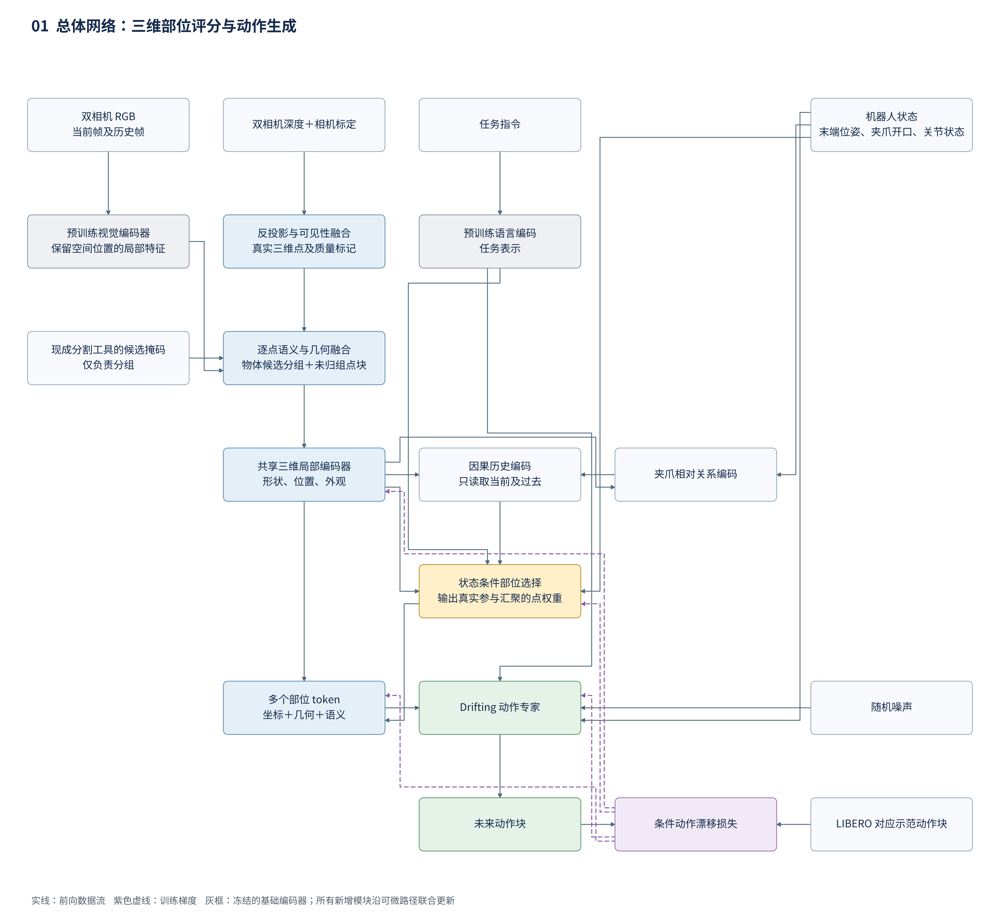

动作专家不再直接读取原版完整的、未经评分处理的视觉 token，也不另接一条完整未加权点云通路。指令和机器人状态可以独立输入。

放置目标、后续操作物体等也进入共享的三维对象表示，不把整段视频永久锁定为“第一次碰到的物体”。如果后续确需增加粗场景通路处理障碍，单独登记并增加消融，核查是否绕过评分。

### 3.2 各模块的输入、输出与职责

| 模块 | 输入 | 输出 | 具体做什么 |
|---|---|---|---|
| M1 空间视觉编码 | 每个相机的 RGB | 带二维位置的局部语义特征 | 从 SmolVLM2 的视觉编码器提取压缩前的空间特征；保留图像变换与像素映射 |
| M2 RGB-D 三维融合 | 局部视觉特征、深度、内外参 | 三维点、逐点特征、相机可见性与质量 | 将同一空间部位的双视角观测融合；被遮挡或无有效深度的观测不伪造为有效点 |
| M3 对象分组与局部编码 | 候选掩码、融合点云 | 每点局部形状特征与对象上下文 | 所有候选共享编码器；漏分割点保留为未归组点块，不因识别失败提前丢掉 |
| M4 机器人关系编码 | 三维点、机器人状态 | 逐点夹爪相对关系特征 | 描述点在夹爪坐标系的位置、两指几何、开口和相对朝向 |
| M5 因果历史编码 | 近期对象特征与机器人状态 | 当前时刻的历史上下文 | 区分接近、保持、搬运、离开等观测变化；不预先给阶段贴标签 |
| M6 动态部位选择 | M3、M4、M5 与指令 | 多个部位的点权重及可视化评分 | 用任务和实际机器人状态查询三维特征，学习当前需要关注的位置 |
| M7 部位表示构造 | 点权重、坐标、几何与语义 | 多个带空间结构的部位 token | 将权重真正用于信息汇聚，避免仅输出一张附属热图 |
| M8 Drifting 动作专家 | 部位 token、指令、机器人状态、噪声 | 未来动作序列 | 按原论文漂移目标学习条件动作分布 |

**空间特征取用位置：**三维分支取自视觉编码器中仍与图像网格对应的特征，经过可训练适配器变成逐点特征。SmolVLA 压缩后的整图 token 用于整体语义时，不能被当成精细的逐点描述符。

**分割只提供候选：**首版可复用 SAM2.1 的类别无关候选。候选编号不作为训练标签，不按指令字符串或人为接触事件提前排除对象。掩码错误仍会影响分组质量，因此保留未归组点块，并在页面中显式展示漏分、合并与遮挡。

### 3.3 几何关系如何表达

对每个物体点同时保留两组几何：

1. **物体内部形状：**以当前观测点集的中心与尺度构造归一化坐标，学习不同大小物体的相似局部结构。
2. **实际操作关系：**保留米制坐标、尺寸估计、夹爪开口，以及点相对于夹爪的位置和朝向关系。

夹爪相对坐标采用：

\[
x_i^{g}=R_g^\top(p_i-t_g)
\]

其中 \(p_i\) 是观测到的点，\(t_g,R_g\) 来自机器人实际末端状态与标定。该变换只描述位置关系，不直接生成高低分。

可见点集中心与尺度只是观测表示，不冒称物体真实位姿或完整尺寸；携带可见性与估计质量，避免局部遮挡造成的中心跳动被当成真实物体运动。不依赖仿真物体位姿、接触或力真值。

机器人基座、重力方向与真实尺度信息继续保留，避免归一化把可达范围、上下方向和夹爪实际能力一并抹掉。

### 3.4 评分怎样控制部位选择

首版采用“局部点组内选择＋部位组间选择”的可微结构，评分来自真正用于构造动作条件的权重，不另设一个只负责显示的评分头。

先按候选归属和三维邻域建立局部点组。分组只组织空间数据，不使用指令、夹爪距离、接触事件或人工部位名称；同一组不跨候选。覆盖全部有效候选，未归组点另建空间组。相同点组同时用于均匀权重基线与学习版本。

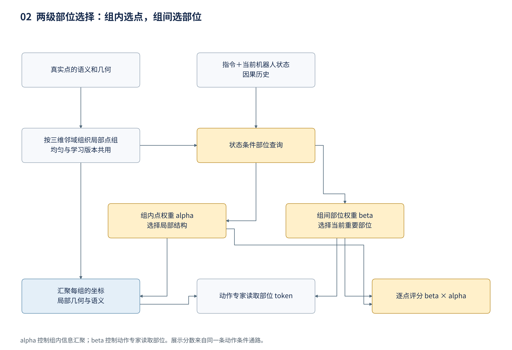

组内权重描述“这个局部组里哪些点重要”，组间权重描述“当前更需要哪个部位”。对组 \(k\) 内有效点 \(i\)：

\[
\alpha_{k,i}=\operatorname{softmax}_{i\in G_k}(u_{k,i}/\tau),\qquad
\beta_k=\operatorname{softmax}_{k}(v_k/\tau),\qquad
s_i=\beta_{k(i)}\alpha_{k(i),i}.
\]

匹配值 \(u_{k,i}\) 和部位值 \(v_k\) 由共享网络计算，输入包含局部语义、几何、夹爪相对关系、机器人状态、因果历史和指令。

- 组内权重 \(\alpha\) 直接构造部位 token；组间权重 \(\beta\) 以对数权重先验加入动作专家读取部位 token 的交叉注意力。
- \(s_i\) 是两级选择合成的点重要性权重，来自实际动作条件通路。
- 无效点和空组通过掩码排除。归一化固定总权重，避免以全部趋零关闭视觉路径；均匀选择仍须通过消融排查。
- 温度 \(\tau\) 首版固定并登记，不根据展示是否好看临时调整。
- 点数和组数变化会影响权重大小，因此展示采用明确的候选内排名，并同时报告采样覆盖。

每个部位 token 保留：

- 经过组内权重汇聚的局部语义与三维编码特征；
- 加权部位中心的米制坐标与夹爪相对坐标；
- 部位空间范围或二阶几何统计；
- 有效观测质量。

局部三维编码先于汇聚完成，以多个局部 token 保留空间结构。坐标保持真实单位，组间重要性用于读取权重，不把坐标数值乘小后冒充位置改变。

所有候选共享参数，模型可随阶段改变关注对象。三维分组造成的覆盖、点数差异与对称性另做诊断，不能把分组边界当作学到的功能部位边界。

无有效观测点时不执行空集合 softmax，不生成虚假部位；输出未知并记录样本失败，闭环结果按固定评测协议计入，不能悄悄丢弃。

首版不给高分点人工接触标签，也不增加“接近夹爪必须高分”的辅助目标。权重是否形成稳定、有用的功能部位，由动作干预与新实例评测检验。

### 3.5 首版配置与训练参数范围

以下配置用于实现和小规模验证的共同起点，所有对照保持一致；扩规模前固定配置版本。

| 项目 | 首版设置 |
|---|---|
| 相机 | 外部相机＋腕部相机 |
| 历史长度 \(T\) | 16 个观测时刻；早期不足部分用有效性掩码 |
| 未来动作块 \(H\) | 16 步；实际时间跨度按数据控制频率换算 |
| 三维采样预算 | 每帧最多 2048 个真实观测点；分组分配并记录各组覆盖 |
| 三维编码器 | PointNet++ 局部编码及特征传播，公共特征宽度 256 |
| 历史模块 | 2 层、宽度 256、4 头的因果 Transformer |
| 局部部位组数 \(K\) | 目标 16；候选较多时增加，保证每个有效候选至少一组；使用掩码处理变长 |
| 部位查询温度 | \(\tau=1\) |
| Drifting 同条件生成样本数 | 训练起点 \(G=8\)，显存不足用等价分组计算并核对梯度 |
| 动作专家 | 复用 SmolVLA Transformer 结构；投影到原配置的隐藏维度 |
| 冻结 | SmolVLM2 基础参数、现成分割工具 |
| 联合训练 | 三维适配器、局部编码、关系与历史编码、部位查询、动作专家 |

逐点语义及几何由相同 RGB-D 观测产生。采样不使用真实物体身份、接触真值或未来信息。完整观测点云继续保留；展示未直接评分点时，只允许在同一候选内部进行明确标注的几何插值，不能跨物体传播。直接评分覆盖率与插值覆盖率分别统计；无可靠对应处保持未知。

### 3.6 逐层网络结构：特征尺寸与实际连接

B 是批量，T=16 是历史长度，N≤2048 是当前真实点数，O 是候选对象数，K 是局部部位组数，L 是指令 token 数，d_a 是数据动作维数。所有变长维度另带有效性掩码。

**读图顺序：图5得到逐点特征 → 图6算出评分 → 图7用评分影响动作。**

#### A. 三维编码器内部

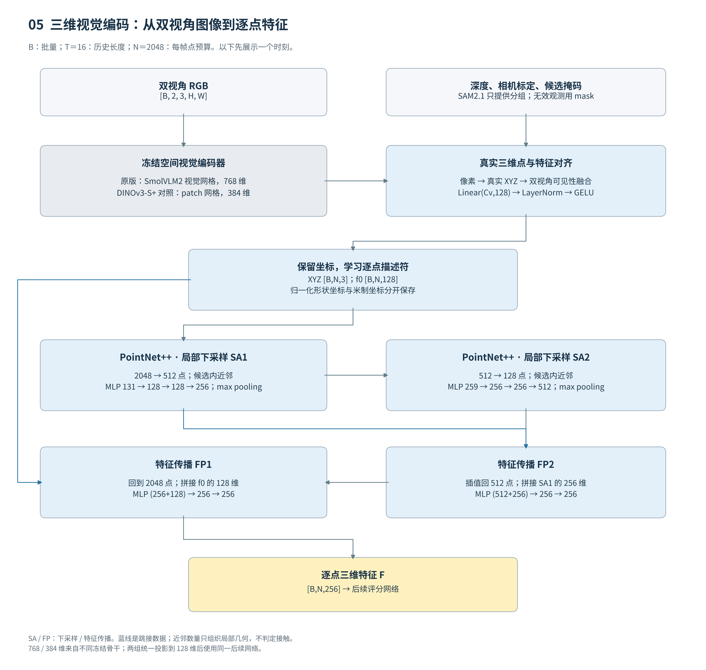

| 层 | 实际运算 | 输出 |
|---|---|---|
| 冻结视觉骨干 | 原版取 SmolVLM2 压缩前空间特征；保留 resize、padding 和像素映射 | 每个网格位置768维 |
| 逐点适配 | 按真实点的像素位置取特征，双视角按可见性融合；Linear(768,128)＋LayerNorm＋GELU | B×T×N×128 |
| SA1 | 候选内部采样中心，聚合“相对XYZ 3维＋特征128维”；MLP 131→128→128→256，邻域 max pooling | 典型 B×T×512×256 |
| SA2 | 同样操作；MLP 259→256→256→512 | 典型 B×T×128×512 |
| FP2 | 几何插值回 SA1 的点，拼接 SA1 跳接特征；MLP 768→256→256 | B×T×512×256 |
| FP1 | 插值回输入点，拼接原来的128维特征；MLP 384→256→256 | B×T×N×256 |

SA 是“减少点数、扩大局部感受范围”，FP 是“把学到的形状信息传回每个输入点”。各候选分别建立邻域，共享网络参数。512/128是典型采样预算；候选数超过预算时提高相应预算并记录，保证有效候选有代表点。首版邻域最多32点，归一化形状半径为0.1/0.2，不足点用掩码汇聚，不跨候选借邻居。这些设置只组织局部几何，不生成接触标签。

新增 MLP 的隐藏层采用 Linear＋LayerNorm＋GELU，标量评分输出层不加 sigmoid。PointNet++ 邻域可以重叠；评分使用的局部组则给每个点唯一归属，保证 α×β 的定义明确。

#### B. 机器人关系、历史与评分网络内部

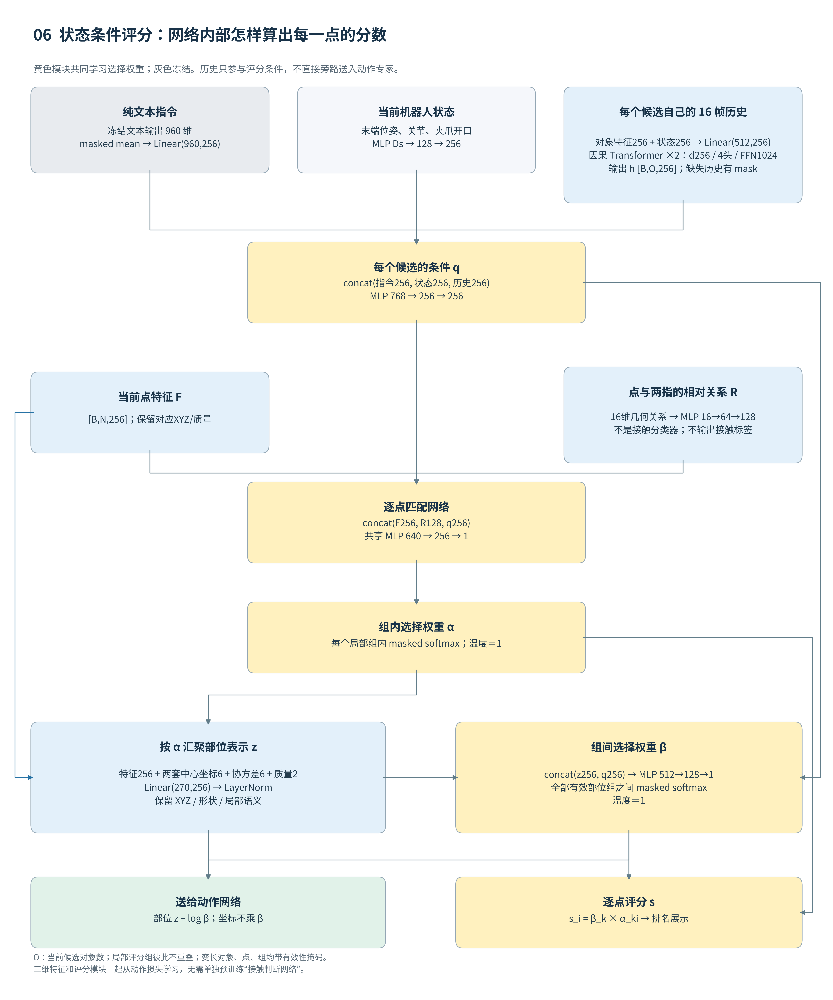

| 分支 | 输入与层结构 | 输出与用途 |
|---|---|---|
| 两指关系 | 每点16维 → MLP 16→64→128 | B×N×128，描述点与实际夹爪的关系 |
| 机器人状态 | 实际状态D_s → MLP D_s→128→256 | 当前状态256维，状态字段随数据适配器锁定 |
| 指令 | 冻结文本分支仅输入指令；960维 token 按有效位置求均值，再投影到256 | 指令条件256维 |
| 对象历史 | 每时刻对象点特征均值256＋状态256 → Linear(512,256)，加入时间间隔编码；2层因果 Transformer | 每层4头、隐藏256、FFN1024；历史为 B×O×16×256，取当前位置输出 |
| 条件查询 | 指令256＋当前状态256＋该对象历史256 → MLP 768→256→256 | 每对象一个条件向量 q |
| 组内评分 | 点特征256＋关系128＋对应对象q256 → MLP 640→256→1；组内 masked softmax | 点权重 α |
| 部位构造 | 按 α 汇聚局部特征与几何；Linear(270,256)＋LayerNorm | 部位 token z：B×K×256 |
| 组间评分 | z256＋对应对象q256 → MLP 512→128→1；组间 masked softmax | 部位权重 β |
| 展示输出 | 每点所属组的 β 乘该点 α | s_i=β_k α_ki，再按页面规则排名 |

**16维关系向量：**点在夹爪、左指、右指坐标系的位置各3维，夹爪系观测法向3维，夹爪开口1维，观测对象尺度1维，法向有效标记1维，双视角共同观测标记1维。法向缺失时置零并保留无效标记。这些量来自 RGB-D、标定和机器人状态，不由距离阈值转为“已接触”。

**270维部位向量：**加权点特征256维，基座系中心3维，夹爪系中心3维，米制位置协方差6个独立分量，法向有效比例和双视角共同观测比例2维。真实几何字段也保留在输出记录中。

对象历史只用过去和当前的候选关联；关联中断后重建并打掩码，不能把每帧候选序号当作稳定身份。历史只进入评分查询，动作专家不能直接读取未经部位选择的对象历史。文本分支也只输入指令，避免已经融合全图信息的 token 绕开评分。

#### C. 动作专家内部与反向学习路径

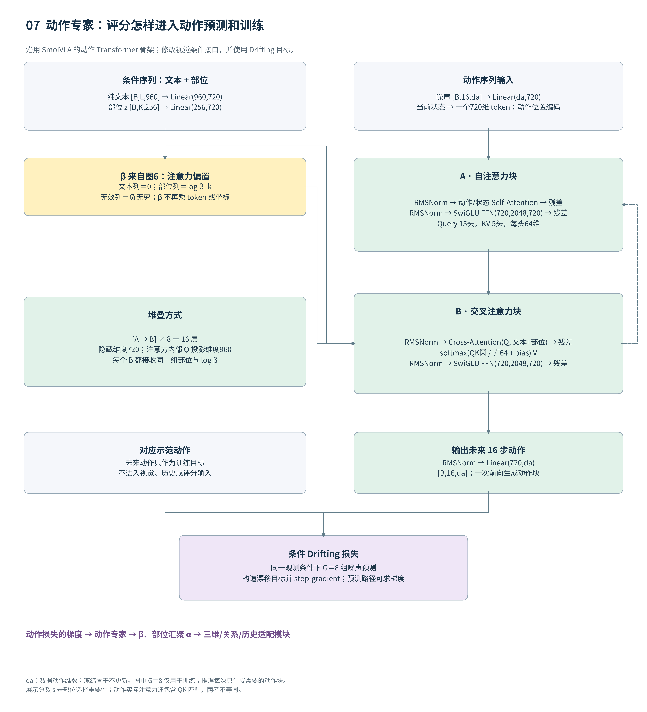

动作专家采用 **16层、隐藏720维**：自注意力块A与交叉注意力块B交替，[A→B]×8。每块都有归一化、注意力残差和前馈残差；SwiGLU前馈宽度720→2048→720。注意力有15个Query头、5个KV头、每头64维，所以内部Query投影总宽度960，残差主干仍为720维。该骨架按 SmolVLA 配置展开。[SmolVLA配置](https://huggingface.co/lerobot/smolvla_base/blob/main/config.json)、[骨干配置](https://huggingface.co/HuggingFaceTB/SmolVLM2-500M-Video-Instruct/blob/main/config.json)、[官方动作专家构造](https://github.com/huggingface/lerobot/blob/main/src/lerobot/policies/smolvla/smolvlm_with_expert.py)

- **动作端：**当前状态投影成一个720维token；16步噪声各投影成720维，并加入动作位置编码。Drifting 不使用原 flow matching 的迭代去噪时间步。
- **条件端：**纯文本从960投影到720，部位从256投影到720。新增条件投影及K/V适配与动作专家一起训练。
- **A块：**动作与状态token自注意力，协调动作块内部各步。
- **B块：**动作查询读取拼接的“纯文本＋部位”。文本列偏置为0，部位列为 log β，无效列屏蔽，做一次softmax。
- **输出：**归一化后 Linear(720,d_a)，得到 B×16×d_a，再按训练集统计还原单位。
- **反向训练：**动作损失通过注意力中的 log β 和部位内容，更新 β、α、三维适配器、关系编码、历史编码；冻结骨干不更新。

β只作为读取先验，不再乘一次token或坐标。动作实际注意力还包括Query-Key匹配与文本竞争，展示的α×β不能等同于动作最终贡献比例。

均匀对照也保留同一接口，只固定α=1/组内有效点数、β=1/有效组数。梯度检查选至少两个有效组、每组至少两个点，避免把单元素softmax必然为零的梯度误判为链路故障。

## 4. 训练信号与 Drifting

### 4.1 一个训练样本包含什么

- **输入：**截至当前时刻的双相机观测、机器人状态和指令。
- **监督：**与当前状态定义正确对齐的未来 \(H\) 步示范动作。
- **有效性信息：**相机缺失、深度无效、历史不足与片段末尾动作不足的掩码。

先核对数据采集代码中“观测在执行动作之前还是之后”的定义，再确定动作切片起点，不能凭数组下标假定它们同一时刻。

原始示范只读。训练中不输入未来视频帧、未来夹爪状态或未来动作；未来动作仅用于损失。分割、历史缓存和任何追踪工具也必须满足相同因果边界。跨帧候选关联只读取过去和当前观测；关联用于组织历史，不用于判定接触。候选身份断裂时显式标记缺失或重建历史，不用后续帧倒填当前输入。

### 4.2 条件漂移目标

对同一个观测条件 \(c_t\)，使用不同噪声生成 \(G\) 个动作块：

\[
\widehat A^{(g)}=F_\theta(\epsilon^{(g)},c_t),\quad g=1,\ldots,G.
\]

真实示范动作块作为该条件下的正样本，生成样本间的作用参与构造漂移场。首版在按训练集统计归一化的动作表示上计算，不额外预训练图像生成论文中的特征模型。

核心训练形式为：

\[
\mathcal L_{\mathrm{drift}}=
\frac1G\sum_g
\left\|
\widehat A^{(g)}
-\operatorname{stopgrad}
\left(\widehat A^{(g)}+V^{(g)}\right)
\right\|^2.
\]

这给出训练目标形式；漂移场核函数、归一化与数值实现按原论文锁定版本核对，不用上述简式替代完整算法。

明确以下实现约束：

- 在相同观测条件内构造生成样本与示范的关系；不把不同指令、不同机器人状态的动作随意混成同一个目标分布。
- 一个观测条件只有一个示范动作块时，如实使用该正样本；复制同一动作不算增加独立正样本。
- 生成样本间的排斥不表示抓取失败标签。
- stop-gradient 只冻结右侧构造的目标，左侧预测路径仍更新动作头和部位模块。
- 末尾无效动作维度不进入距离、核计算、归一化或损失。
- 机器人动作各维的缩放统计仅来自训练集，推理时按同一配置还原。

### 4.3 联合训练流程图

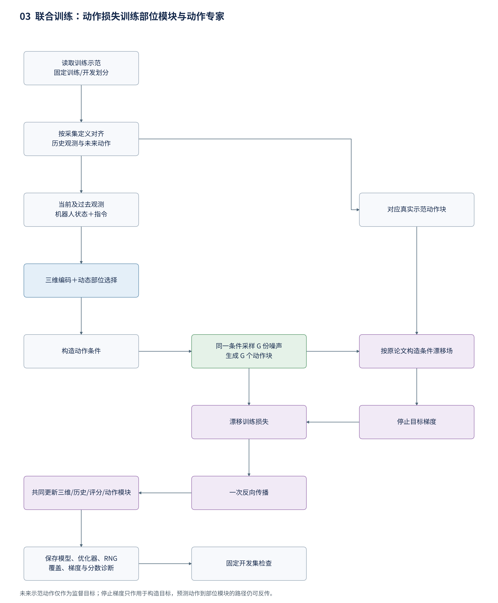

一致性辅助训练只使用观测自身提供的信息：

- 同一时刻、可确认对应的三维部位，在双视角下的表示应相容；
- 不改变任务含义的外观增强，应保持相容的部位选择；
- 不把机器人状态已变化的前后帧强制拉成同一评分；
- 不把不可靠对应当成负例。

首个动作监督基线仅使用动作损失。加入一致性项时单列版本与消融，避免无法辨认是哪一项改变了结果。

### 4.4 缓存与优化边界

可缓存冻结视觉编码器在确定输入上的基础特征、相机标定和确定性反投影结果。启用图像增强时重新编码，或缓存与增强一一对应的版本。

不可离线固定评分、部位 token、历史编码器输出或随训练更新的特征。工程缓存不得截断动作损失到评分模块的梯度。

## 5. 推理与结果展示

### 5.1 推理流程图

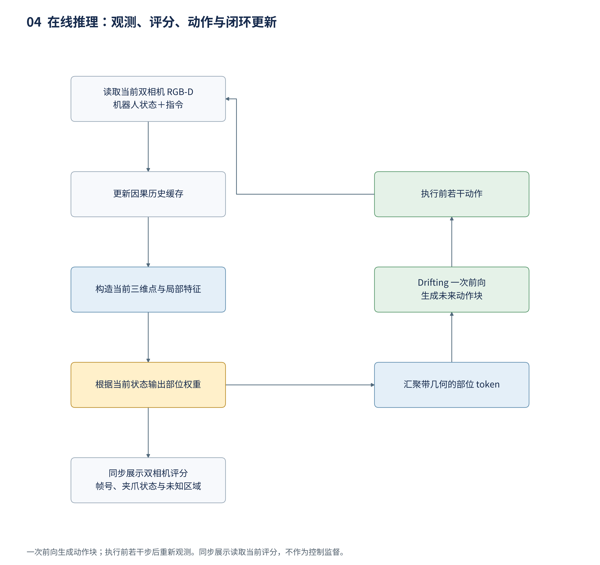

先采用同步闭环：每执行一步重新观测并更新评分，动作块长度不等于一次必须全部执行的长度。后续若调整执行步数或使用异步推理，单独评估响应速度和成功率。

一次前向指动作生成器的调用次数。整条系统延迟仍包括分割、视觉编码、三维融合、历史编码和部位汇聚，分别测时。

### 5.2 页面必须展示的内容

- 双相机同步视频、当前帧号、时间戳；
- 夹爪真实位置、朝向和开口；
- 对象候选及当前部位评分，可切换完整点云、低分点和未知；
- 原始模型权重与排名统计，直接评分/插值/未知覆盖率；
- 展示的是示范回放还是模型闭环执行，二者分开；
- 若为离线逐帧推理，标明推理耗时，不将同步播放速度当成在线推理速度。

颜色严格使用用户已选定的方案：

1. 在每个当前物体候选内，保留得分最高的 80% 有效真实点。
2. 在保留的这批点内重新计算百分位。
3. 百分位 95–100、90–95、80–90、60–80、0–60 分别使用不同颜色。
4. 未知使用灰色。未展示的后 20% 可切换查看，不从结果数据中删除。
5. 阈值边界与并列分数采用固定规则；同时显示原始分数范围和标准差。若原分数几乎相同，页面明确标出“分数差异很小”，不能靠排名配色掩盖塌缩。

双相机投影使用各自深度进行可见性检查。背面点不透过前景绘制；腕部相机移动不改变世界坐标中的点身份。

## 6. 泛化如何落实到网络与数据

| 需要适应的变化 | 设计措施 | 不能遗漏的条件 |
|---|---|---|
| 物体位置变化 | 夹爪相对坐标＋局部结构编码 | 保留基座与可达范围信息 |
| 颜色、纹理、光照变化 | 预训练语义＋几何；外观一致性 | 颜色被指令用于区分目标时，增强必须保持语言含义 |
| 同类物体大小变化 | 归一化形状＋米制尺度双通路 | 不丢掉真实距离和夹爪开口 |
| 同类局部形状变化 | 共享局部几何编码与部位查询 | 所有物体共享参数，不为资产编号学习固定分数表 |
| 相机视角与遮挡变化 | 双视角三维融合、有效性标记、因果历史 | 不用缺失的零特征冒充低分观测 |
| 机器人状态变化 | 当前状态与历史共同查询物体特征 | 不施加跨不同机器人状态的固定评分一致性 |

外观增强与几何增强分别管理。坐标系变换必须同时变换点云、机器人状态、动作与重力表达。改变真实物体尺寸或形状后，需要对应的有效动作示范，不能直接沿用不再适合的动作标签。

LIBERO 先验证机制；LIBERO-PRO 的测试变化不参与训练或逐轮调参。使用 Pro2.0 时分别报告 S06 实例替换、S07 功能部位几何、S08 尺寸/长宽比等子项，固定代码版本、任务清单与测试种子。

## 7. 数据划分与实验对照

### 7.1 数据范围

首轮延续现有 LIBERO-Object 自定义划分：

- 10 个任务各 demo 0–39：训练，共 400 段；
- 各 demo 45–49：开发，共 50 段；
- 各 demo 40–44：留出，共 50 段。

这是本项目划分，不称为 LIBERO 官方划分。首个前置验证只读取其中明确列出的训练与开发样本。

后续若扩展 LIBERO 的长任务或其他套件，先登记新增任务与划分；物体、动作、深度和指令对齐遵守同一协议。LIBERO-PRO/Pro2.0 保持独立评测，不用于挑选配置。

### 7.2 对照必须区分三维、评分和生成器的贡献

| 组别 | 视觉输入与选择方式 | 动作头 | 回答的问题 |
|---|---|---|---|
| B0 | 原 SmolVLA 输入 | Flow matching | 原框架在相同数据上的表现 |
| B1 | 新三维特征与部位接口，固定均匀汇聚 | Flow matching | 三维信息本身带来多少收益 |
| B2 | 与 B1 相同三维输入，学习动态权重 | Flow matching | 动态评分有没有额外价值 |
| B3 | 与 B1 相同输入，固定均匀汇聚 | Drifting | Drifting 的作用是否依赖评分 |
| B4 | 学习动态权重 | Drifting | 完整方案 |

B1–B4 使用相同点预算、部位组、特征尺寸、机器人状态、历史、动作块长度与有效数据。固定版本令组内权重为组内有效点数的倒数、组间权重为有效组数的倒数；学习版本只将这两级权重改为网络输出。实现时锁定分组定义，避免比较中混入不同几何覆盖。

对完整模型还做同模型干预：常数权重、组内打乱权重、移除高分部位、移除等量随机部位。训练对照与推理干预分开解释。

## 8. 小规模前置验证：每一步做什么，怎样算通过

以下是扩规模前的执行顺序。数值标准是工程推进门槛，不作为接触判定规则或最终研究结论；在首次运行前登记，不能看结果后移动门槛。

### P0：确认输入和训练链路接对了

**做什么：**取训练区 2 段示范，各抽取接近、夹取、搬运附近的若干连续帧；这里只用帧范围组织检查，不给阶段标签。核对时间对齐、双相机几何、历史边界、动作归一化，运行完整前向、反向和一次参数更新。

**通过标准：**

- 样本和相机帧索引对应，观测与动作前后关系有明确记录；
- 修改未来观测不会改变当前评分和动作条件；
- 有效数据、输出、损失、梯度均无 NaN/Inf；
- 评分、三维适配器、历史模块和动作专家均有有限有效梯度，一次更新后对应参数确实变化；用固定小批量检查两级权重对动作损失的链式梯度；
- 冻结骨干参数不变化；失效观测不会成为高分零填充点；
- 当前帧自投影的像素误差中位数不超过 1 像素、95 分位不超过 2 像素；另外检查相机坐标约定与跨视角可见部位，不能用自投影检查替代双相机标定检查。

失败时先修数据、掩码或梯度链路，不扩大训练。

### P1：确认这套网络能从少量示范学到动作

**做什么：**使用 bbq_sauce 训练 demo 0–7，共 8 段；开发 demo 45–46，共 2 段。联合训练部位模块与动作头，保存初始化、训练曲线和固定噪声下的动作预测。P1 首次预算固定为 3000 次优化更新、每 250 次评估一次，批量 8 个条件；AdamW 学习率起点为 1e-4。其余漂移与优化参数在执行前按原论文实现登记，失败后的配置改变另起版本。

**通过标准：**

- 固定评估样本和噪声下，训练动作归一化 MAE 比初始化至少下降 50%；
- 同时报告平移、旋转、夹爪控制误差；不能靠一个量纲或单一分量解释全部下降；
- 固定来自这 8 段训练示范的起始状态，分配动作噪声种子进行 20 次闭环测试，至少成功 14 次；逐项报告起始状态与重复次数，确认模型不仅能拟合录像；
- 有效权重保持数值稳定，点权重分布、查询重复程度和梯度都有记录。

开发结果全部报告，不拿这 2 段预览中的人工判断制造新标签。达到本项只表示小任务可学习，不代表泛化或评分模块已经有效。

### P2：确认评分真的帮到了动作

**做什么：**用 3 个训练种子比较 B3 与 B4，采用 bbq_sauce 开发 demo 45–49 的 5 个起始状态，每个状态 4 个固定动作噪声种子，共 20 次闭环执行。动作头、输入点和训练预算保持一致，首轮沿用 P1 的 3000 次更新预算；再做打乱评分、高分删除与等量随机删除。

**通过标准：**

- B4 至少在 2/3 个种子上优于 B3，汇总闭环成功率至少提高 10 个百分点；
- 打乱权重或移除高分部位造成的性能损失，至少在 2/3 个种子上大于相应对照；
- 未出现“权重变化明显，但动作和执行结果基本不变”的情况。

同时报告每个训练种子、每个起始状态的原始成功次数和不确定性；相同起始状态的重复执行不冒充独立物体实例。若小样本结果无法区分收益，结论为“评分作用尚未证明”，先检查绕过、均匀权重和重复部位，再决定增加样本量；不靠改配色推进。

### P3：给出能看懂的完整评分与执行页面

**做什么：**完整推理开发 demo 45，双视角同步展示当前状态、部位分数和动作预测；另录制一段模型闭环执行。

**通过标准：**

- 全视频可播放、拖动和逐帧定位，帧号与状态严格同步；
- 分数随实际输入计算，无手写阶段切换，无人工指定高分部位；
- 两相机投影与遮挡正确，未知独立显示；
- 前 80% 内重新排名的颜色、原始分数统计、直接/插值覆盖均可查；
- 示范回放和实际闭环执行分别标明，保存失败案例。

页面正确不等于方法有效；方法是否值得扩规模主要看 P1、P2。

### P4：核对 Drifting 的收益

**做什么：**在同样的评分与三维接口下比较 B2、B4，并结合 B1、B3 判断生成器与评分的交互。

**通过标准：**

- 同时报闭环成功率、动作误差、动作块生成延迟、端到端延迟和训练成本；
- 进入默认 Drifting 路线的工程门槛：动作生成延迟降低至少 20%，成功率下降不超过 5 个百分点；
- 若成功率区间过宽，补充固定协议的评测次数，不把不确定结果记为通过；
- 延迟测试使用同一硬件、精度、批量和预热方式，不把缓存条件不同造成的差异归给生成方法。

### P5：扩展训练与泛化评测

P0–P3 满足推进条件后，再进行完整训练与 B0–B4 对照；P4 决定动作头的默认选择。完整训练预算、开发集选 best 规则和停止规则在启动前固定，方法修改用独立版本。

最终先冻结模型和配置，再运行留出及 LIBERO-PRO/Pro2.0 对应子项。主要指标为闭环任务成功率及泛化变化下的下降幅度；动作误差、部位权重和时延作为解释指标。评分本身的可视化观感不用于选 best。

## 9. 记录与交付

实现和实验使用独立目录，建议为 experiments/contact_joint_object/lcjp003；旧实验不作为本方法训练初始化或正式结果。

每个 run 保存：

- 数据清单、时间对齐协议、相机与动作定义；
- 源码、配置、输入和检查点哈希；
- 参数冻结清单、优化器状态、随机数状态、累计更新数；
- 样本覆盖、各模块梯度、点权重分布、查询重复和有效覆盖；
- 真实训练历史、开发指标、完整成功与失败视频；
- 采样点、完整观测点云、直接预测与插值的来源标记；
- 生成头和完整系统的独立计时。

方案、代码、数据与实验产物保存在远程项目 /mnt/nvme1/drh/D_VLA。原始示范只读，旧方案保留用于追溯。各阶段结果写入本方案的后续实验记录；只将真实结果与已核对的链接交付用户。

## 10. 相关工作与本方案的区别

| 工作 | 可以借鉴的部分 | 本方案重点 |
|---|---|---|
| GenDP | 三维语义场、类别对应与生成式策略 | 用动作监督学习状态条件部位权重，替代人工参考部位选择 |
| SKIL | 自动语义关键点与几何表示 | 部位选择由动作损失更新，而非仅靠固定参考特征聚类 |
| ATK | 用动作监督联合训练关键点选择与策略 | 面向动态机器人状态、三维局部结构和多阶段对象关系 |
| Seeker | 从动作监督学习随状态变化的关注区域 | 让部位表示与最终动作专家共同训练，并保留局部三维几何 |
| SmolVLA | 预训练视觉语言骨干、动作专家与工程框架 | 新增三维与状态条件部位模块，修改条件接口 |
| Generative Modeling via Drifting | 条件生成与训练期漂移、机器人动作实验 | 用同一动作监督反传到部位选择模块 |

研究贡献通过“评分是否被实际使用、是否提高新实例上的闭环表现”建立；自动选部位或采用 Drifting 本身不单独作为首次提出的结论。

## 11. 原始资料

1. [GenDP: 3D Semantic Fields for Category-Level Generalizable Diffusion Policy](https://arxiv.org/html/2410.17488v1)
2. [SKIL: Semantic Keypoint Imitation Learning for Generalizable Data-efficient Manipulation](https://arxiv.org/html/2501.14400v2)
3. [ATK: Automatic Task-driven Keypoint Selection for Robust Policy Learning](https://arxiv.org/html/2506.13867v2)
4. [Seeker: Attention from Action, for Action](https://arxiv.org/html/2608.13422v1)
5. [SmolVLA 官方论文](https://arxiv.org/html/2506.01844v1)
6. [SmolVLA 官方文档](https://huggingface.co/docs/lerobot/smolvla)
7. [LeRobot SmolVLA 实现](https://github.com/huggingface/lerobot/tree/main/src/lerobot/policies/smolvla)
8. [Generative Modeling via Drifting](https://arxiv.org/html/2602.04770v2)
9. [LIBERO 官方数据生成实现](https://github.com/Lifelong-Robot-Learning/LIBERO/blob/master/scripts/create_dataset.py)
10. [LIBERO-PRO 官方仓库](https://github.com/Zxy-MLlab/LIBERO-PRO)
11. [LIBERO-Pro2.0 论文与扰动目录](https://arxiv.org/html/2610.24587v1)

## 12. DINOv3 是否有帮助，以及放在网络哪里

**建议优先测试冻结 DINOv3-S+/16 替换三维分支的空间特征，保留 SmolVLA 的纯语言分支。**它有望改善部位描述与对应，不替代状态条件评分，也不要求另外训练接触判断网络。

### 12.1 为什么值得试

本任务需要区分“两个视角下哪个位置是同一处”“换了颜色和尺寸后哪个局部结构相似”。DINOv3 的密集特征与这些需求相符；其 Gram anchoring 针对长时间预训练中的密集特征退化。将它用于本项目是基于能力匹配的推断，实际收益由动作对照决定。[官方研究介绍](https://ai.meta.com/research/publications/dinov3/)

| 骨干 | NAVI：跨视角对应 | SPair：同类实例对应 | DAVIS：视频跟踪 |
|---|---:|---:|---:|
| DINOv2-S | 53.4 | 51.6 | 73.6 |
| DINOv3-S | 56.3 | 50.4 | 72.7 |
| DINOv3-S+ | 57.1 | 55.2 | 75.5 |

三项均越高越好。v3-S在后两项没有超过v2-S，所以不能只按版本号选择；S+更值得作为本次候选。S+的容量也更大，不能把差异全部归因于训练方法。以上是论文公开基准，不是LIBERO机器人成功率。[原论文Table14](https://arxiv.org/html/2508.10104v1#S7.T14)

### 12.2 接入位置与代价

图5标出了替换位置：DINOv3-S+ 的384维patch特征，经可训练Linear(384,128)接入同一RGB-D映射与PointNet++；原版是SmolVLM2的768维特征接Linear(768,128)。其余评分、历史、动作专家及Drifting目标一致。基础DINOv3不负责理解指令，视觉与指令的任务关联由后续联合训练学习。[官方模型卡](https://github.com/facebookresearch/dinov3/blob/main/MODEL_CARD.md)

先不堆两个视觉编码器。只有替换对照显示二者互补，再增加融合版本；融合视觉内容仍经过部位选择。

S+有29M参数，论文给出的单图256/512分辨率算量约16/79 GFLOPs；B版有86M参数，相应约47/216 GFLOPs。这里的算量不能代替本机时延。16帧滑窗可缓存冻结骨干的历史输出，每次补新帧；会随训练变化的适配器输出不能跨优化器更新复用。[官方模型列表](https://github.com/facebookresearch/dinov3)、[原论文Fig.16](https://arxiv.org/html/2508.10104v1#S7.F16)

### 12.3 小规模对照任务与采用标准

| 任务 | 怎么做 | 用什么判断 |
|---|---|---|
| 局部对应 | 固定训练/开发视频、图像分辨率、点数和候选，对比原空间特征、DINOv2-S、DINOv3-S+ | 用有效RGB-D投影检验双视角匹配误差；小把手/开关、稳定表面、遮挡分别统计 |
| 等预算动作训练 | 后续网络、优化器更新数、数据划分一致，条件允许用3个随机种子 | 开发动作误差、闭环成功数/总数、推理时延和峰值显存 |
| 评分干预 | 按原方案均匀化、置乱或局部干预评分 | 学到的权重是否相对无选择/错误选择稳定改善动作 |
| 后续同类泛化 | 独立LIBERO-Pro评测，区分新实例、外观和尺寸变化 | 闭环表现；同资产重复轨迹不算新形状验证 |

采用条件：相同动作训练预算下收益能跨种子复现，并满足实测时延和显存预算。只有特征匹配或热图改善，先保留对照结果，不直接替换主方案；测试集不参与选择。

要检查的两项限制：patch16在256×256图像上只有16×16网格，插值不能创造小开关细节；更换骨干也不能修复深度投影错误、评分被绕过、监督目标允许退化或动作数据单一。v001的接触潜变量趋零不能仅归因于缺少DINOv3。

官方有现成预训练权重 facebook/dinov3-vits16plus-pretrain-lvd1689m，不需要自己从头预训练。实际获取按官方访问条件核验；此前401只说明当时获取未成功。[官方权重页](https://huggingface.co/facebook/dinov3-vits16plus-pretrain-lvd1689m)

## 13. P0 执行记录

### 2026-10-26 21:14:15 +08:00｜启动P0

按第8节P0范围执行，使用训练区bbq_sauce/demo_0与alphabet_soup/demo_0的连续历史窗口；单次参数更新仅用于链路验证，另存P0产物。正式训练和旧v001保持暂停。数据、代码、权重和报告存于experiments/lcjp003。

Drifting动作损失按原论文v2算法2与附录A.6实现：同条件G=8、双向softmax核、排除负样本自身、距离与漂移归一化，温度0.02/0.05/0.2。未来动作只进入监督；不添加接触标签或新的成功/失败标签。DINOv3-S+下载与访问检查并行进行，模型来源在结果中明确区分。

### 2026-10-26 21:23:27+08:00 P0 data/action time alignment

Two authorized training demo_0 episodes were checked without altering raw data or existing caches. The cached RGB-D frame t and cached robot state t precede action[t]. The original HDF5 obs[t] is recorded after action[t]; therefore P0 does not combine original obs[t] with cached image t. Across all valid adjacent frames in both demos, joint-state median differences between cache[t] and original obs[t-1] are below 1e-7, while same-index differences are about 0.03. Producer line references and all-frame percentiles are retained in `experiments/lcjp003/p0/data_audit.json`.

The P0 adapter now uses cached same-frame robot geometry, past/current 16-frame inputs, and action[t:t+16] only as supervision. Six ordinary windows and four boundary windows are saved remotely. Action normalization uses only the two P0 training episodes (282 actions), with no clipping. Existing current-frame SAM2 masks and previous-only association are reused; full-video tracks, old contact labels, old descriptor features, development data and held-out data are not read. Per-camera visibility masks prevent averaging features from occluded surfaces. This is input and engineering verification; no scoring-model performance is inferred from these checks.

### 2026-10-26 21:29:39+0800 DINOv3-S+ 官方邮件授权下载

用户提供 Meta 官方授权邮件，改用邮件内 S+ 官方直链；不再需要为本次权重下载另行 Hugging Face 登录。权重仅保存远程，签名 URL 未写入报告或日志。文件 dinov3_vits16plus_pretrain_lvd1689m-4057cbaa.pth，大小 114924783 bytes，SHA256 4057cbaaad8c16657adb09d6815f28d4164eeba30532fde23f0d17313124caea，已匹配官方文件名前缀4057cbaa。下载成功，官方源码加载和冻结特征前向仍待检查。原 Hugging Face 401 仅保留为历史访问记录。

### 2026-10-26 21:35:14+0800 P0 深度采样坐标修复登记

独立 EGL/MuJoCo 4x MSAA 查询确认深度 sample0=(0.375,0.125)，垂直翻转后为(0.375,0.875)；原整数像素反投影存在毫米级偏差。独立倾斜平面核验已在 pixel_sampling_probe.json 保存。修复 LCJP003 数据适配的像素坐标约定，保留原示范、旧回放缓存及修复前样本/特征/诊断。本次仅为 P0 工程输入修复，不修改网络、动作监督或损失；在已启动检查尚处逐窗前向、没有优化器更新时结束该检查，修复后用新输入版本重做。

### 2026-10-26 21:38:32+0800 DINOv3-S+ 官方模型可用性核验

官方源码 commit 6876159a11b4df116f30f667f8c9888617df0751；权重严格加载缺失键0、多余键0。参数28,697,472全部冻结，当前双相机RGB输入2x3x256x256，输出patch特征2x256x384，patch尺寸16，12层，4个storage token。全部输出有限，重复前向最大差异0；未执行优化器更新。输入RGB、源码版本、权重hash及详细schema见 experiments/lcjp003/p0/dinov3_probe.json。

### 2026-10-26 21:49:29+0800 P0 实测结果（采样修复后，非整体通过）

本次使用两个训练demo的10个窗口（6个完整窗口、4个起止边界窗口），完整16帧、2048点、16层动作专家，8组动作噪声；执行一次AdamW更新。未读取留出视频，未启动P1或恢复旧v001训练。

| 检查 | 实际结果 |
|---|---|
| DINOv3-S+ | 官方115MB权重SHA匹配，严格加载无缺失/多余键，双相机当前图像输出有限 |
| 时间与因果 | 使用RGB-D同帧pre-action状态；114个条件输入数组在未来哨兵/未来动作扰动检查中逐项一致 |
| 渲染采样坐标 | 根据EGL实测4xMSAA sample0修复；源相机重投影P95约1.71e-5像素，RGB采样检查最大误差1.53e-5像素 |
| 冻结特征 | 修复后10窗全部重新提取；权重前后哈希相同、零梯度 |
| 完整网络 | 10窗输出与动作损失均有限；无效历史/点填NaN后的输出差异0 |
| 评分梯度 | 点内权重alpha L2=0.047547027468681335；部位权重beta L2=0.14879140257835388；均由动作Drifting损失反传 |
| 一次更新 | 12个模块均有有限非零梯度，参数实际改变，更新后全部参数有限 |
| 跨视角可见性 | 4517个允许融合对应中749个未通过2像素循环一致性检查（16.58%）；中位0.0058像素，P95=13.52像素。未通过 |

跨视角异常约85.98%位于深度不连续边缘；仍有平滑区异常，因此不能只用整体中位数宣布通过，也不把所有异常直接等同为错误物体匹配。当前剩余工作是遮挡/边缘处副视角特征的可见性处理；完整点云、源视角观测、失败对应及修复前记录均保留。该项修复和复验前不进入P1。

网络检查总耗时6.32分钟，峰值本进程GPU分配7.21GiB。完整数值、输入/源码/权重/检查点SHA见 experiments/lcjp003/p0/result.json；P0检查点 one_update_engineering_only.pt 只记录这一次工程更新，不作为正式训练初始化。

### 2026-10-26 22:00:08+0800 双视角融合问题定位与修复方案

本轮只读分析；冻结的数据适配器、特征提取器、样本、评分网络与动作损失未改动，未启动训练。

确认的原因：
1. 当前可见性用最近深度及 max(5mm, 2%深度) 容差。105个“平滑区”异常的深度偏差中位8.41mm、范围2.96–19.48mm，102个的目标四邻深度全在源点前方；104个在最近深度和双线性深度两种检查下都失败。容差中位19.09mm，过宽容差确实放行了前景遮挡风险。“平滑”仅说明邻域自身变化小，并不说明源点可见。
2. 可见性使用最近深度，原验收使用双线性深度，边缘会混合前后表面。749/4517是循环检查异常数，不能直接当成749个错误物体匹配。改用最近深度检查后194个原异常消失，却新增261个异常；换检查方式不能解决问题或证明质量提升。
3. 被放行的两路patch特征直接等权平均，错误副视角有机会污染源特征。
4. 独立的特征边界缺陷：32x32常量特征网格全为1时，合法RGB边中心用zeros填充得到0.5625，角点0.31640625；border延拓均为1。此项影响特征幅值，不是上述749个几何异常的原因。

建议修复顺序：
- 固定并统一物理像素、RGB索引与深度取样约定；只在连续同表面内估计投影位置深度，禁止在深度台阶上混合前后表面，也不能挑更接近源点的背景深度绕过前景遮挡。
- 把副视角观测分为可靠同表面、明确遮挡、无法确认。深度容差从相机采样与测量误差验证中确定，不继续以远近统一的2%作为放行依据。只有可靠副视角参与融合；其余保留源视角特征、全部真实点及原副视角记录。
- 对图像范围内合法点的patch网格边界使用border延拓；图像外仍由有效性mask排除。它不延拓深度，不扩大相机视野。
- 先修观测和采样，再决定是否需要学习视角权重；不增加单独预训练的接触网络。接触/部位评分仍由动作监督学习。

验收：固定同一批原始点，保留全量失败分母，同时报告源点保留率、副视角参与率、遮挡/未知率、边缘与平滑区误差、米制与像素误差。用已知双平面、深度台阶、薄物体的独立工程几何参考检验遮挡误接受/漏接受，并在本轮6帧以外的已授权P0窗口复核。不能先按2px筛点再用相同2px标准宣布独立通过。修复后重跑真实前向、评分梯度和一次更新。

证据：experiments/lcjp003/p0/diagnostics/visibility_mechanisms.json、visibility_mechanisms_points.json、feature_boundary_sampling.json。

### 2026-10-26 22:07:28+0800 用户授权执行双视角融合修复

先归档修复前src与P0到 experiments/lcjp003/p0_versions/before_visibility_v3，原始示范/回放只读。修复采用4x4局部逆深度平面连续性检查，禁止跨深度台阶混合；误差基准为此前独立EGL平面P95 2.998019933762154e-05m，单视角安全界限固定5倍，双视角10倍，先固定再做新合成验证，不依据示范通过率调参。源视角/全部真实点保留，副视角记录可靠/遮挡/不确定；修复patch图边缘zeros填充。网络、动作损失与数据划分不变。独立合成参考要求错误接纳率≤0.1%、可见内部点副视角保留≥30%；真实固定点集报告全量分母与覆盖，并在4个未参与诊断的P0边界窗口复核。完成后重跑10窗前向和一次工程更新，不恢复旧训练、不启动P1。

### 2026-10-26 22:18:02+0800 特征输入快照版本对齐

特征任务在任何样本完成之前由SHA断言拦截：仍绑定v2不可变features_input_manifest，而样本已为v3。保留旧清单与失败记录，建立v3输入快照后接续；不跳过哈希校验，不改特征/网络/损失。

## P0 遮挡边缘融合修复与复验完成（2026-10-26 22:29:30+0800）

本次结论：P0 的双视角几何与网络学习链路检查通过。范围为两个训练 demo_0、10 个窗口、一次工程参数更新。网络结构、动作损失、数据划分保持不变；P1 和正式训练尚未启动，旧 v001 继续暂停。

### 修复了什么

- 副视角深度使用局部连续表面估计，不跨前景/背景深度断层插值。容差由独立 EGL 平面误差测量固定：单视角0.149901毫米、双视角0.299802毫米；没有按本次视频挑阈值。
- 将副视角区分为可靠、遮挡、不确定和不可用。只有可靠副视角进入融合；来源相机点及特征保留，不删除遮挡边缘点，不生成接触或评分标签。
- 有效图像边缘的特征取样改为边界延拓，修复零填充造成的特征衰减。图像外点仍由可见性条件排除。
- 旧输入、失败结果和源文件已归档于 experiments/lcjp003/p0_versions/before_visibility_v3。新输入协议为 p0_surface_visibility_v3。

### 几何结果与覆盖代价

| 检查 | 修复前 | 修复后 |
|---|---:|---:|
| 原6个诊断帧副视角参与数 |4517|2013|
| 其中回投误差大于2像素 |749|0|
| 参与融合对应的回投误差P95 |13.5244像素|0.004898像素|
| 另4个边界帧副视角参与数 |2760|979|
| 其中回投误差大于2像素 |541|0|
| 参与融合对应的回投误差P95 |14.0455像素|0.005003像素|
| 来源点保留 |20480|20480|

回投检查保持原独立的双线性深度检查方式；新选择器没有按回投误差筛点。新的P95描述筛选后参与融合的对应，不能解读为所有旧对应均被校正。副视角参与合计7277降至2992，部分可用副视角也会被保守拒绝；这些点继续使用来源视角。

独立解析几何包括斜平面、深度台阶、薄片和球面：接纳22618个副视角对应，错误接纳0个；可见内部点总覆盖95.50%。其中球面前景仅511/1576（32.42%）使用副视角，其余回退来源视角。95.50%包含大量平面区域，不能代表曲面覆盖率。后续曲面融合改进应同时看错误接纳与覆盖率，不能只放宽阈值。当前容差适用于本次模拟深度；真实传感器需重新测量噪声。

### 网络与输入复验

- 10/10真实窗口前向和动作损失有限；无效点及补齐历史注入NaN后，有效输出最大差异0。
- 动作损失传回点内权重alpha、部位权重beta：梯度L2分别为0.046482645、0.14611968，均有限且非零。
- 12/12模块梯度有限且非零，一次AdamW更新后均有参数变化、参数仍有限。该更新仅为P0工程检查。
- 6个历史窗口、每个27个数组通过禁止读取未来观测检查；改变未来动作只改变监督，不改变条件输入。
- 有效边缘常量特征保持1；来源特征1、副视角99但不可见时输出仍为1，两者都可见时输出50。
- 冻结视觉/语言骨干前后摘要一致、无梯度；当前基线仍使用SmolVLM2冻结特征。DINOv3官方权重已下载并单独验证，没有在此复验中替换基线。
- 全部10份样本、10份特征、源文件、可见性配置、输入锁及检查点SHA256复核一致。模型与Drifting损失源码hash保持原值。
- 本次完整网络复验耗时496.1秒，峰值GPU分配7.208 GiB。没有读取开发集或留出集。

详细数值记录：experiments/lcjp003/p0/result.json；几何记录 visibility_v3_synthetic.json、visibility_v3_real.json；输入/边缘检查 visibility_v3_contracts.json；网络检查 network_check_result.json。此前失败结论保留为历史，本节及visibility_v3结果为当前P0状态。

## 2026-10-26T22:40:05.224563+08:00 P1 v001 启动登记

用户授权最高效率运行，前20–50次更新保留并测时，第250次更新报告阶段结果。训练bbq_sauce demo0–7，开发45–46，3000次更新、有效批量8、G=8、每250次评估。FP32起步，AdamW lr=1e-4、weight_decay=.01、betas=(.9,.999)、eps=1e-8，常数学习率、不裁剪梯度；Drifting温度(.02,.05,.2)及实现继承P0。初始化使用固定seed新模型，不继承P0工程更新。动作归一化仅由本次8段训练动作统计。冻结逐帧特征和确定性几何索引可缓存；输出/损失/梯度一致性验证后启用几何缓存。按正式有效批量比较分批2/4/8吞吐，选择最快且显存可承受者。每10次保存完整续训状态，20/50/250次保留里程碑。固定每段8个等距帧、固定8组噪声评估初始化与各里程碑，报告原始与归一化平移/旋转/夹爪MAE，不用预览观感选权重。训练末20次闭环使用训练demo0–7起始状态循环，重复次数3/3/3/3/2/2/2/2；逐试次保存成功与失败。所有输入/代码/冻结权重哈希锁定，开发与留出不参与归一化或更新。具体配置保存在experiments/lcjp003/p1/v001/config.json。

### 2026-10-26T22:44:37.589016+08:00 P1 启动路径修复
源快照内可见性模块按相对路径读取P0校准配置，独立run中尚未放置该文件，导入时报FileNotFoundError，未读取样本、未更新参数。将已锁定的原校准配置原样复制到run相对路径，源模块不修改；动作标准差下限同步原适配器1e-6（本次各动作标准差均高于1e-3，不改变数值）。

### 2026-10-26T22:48:54.578089+08:00 P1 缓存与精度核对
逐帧缓存几何、状态、原始动作及有效性与P0同窗口逐数组一致。同精度下冻结特征缓存与直接重算最大差异0。发现P0提取默认允许cuDNN TF32卷积，P1正式配置显式关闭TF32；同一帧对P0冻结特征最大差异0.0590649，重新开启cuDNN TF32后差异归零，已定位为精度设置而非缓存时序污染。P1统一使用已登记FP32/TF32关闭生成的冻结特征，输入与初始化评估同协议；不声称与P0旧特征逐位一致。分批测速先预热同一组几何索引，计时不含梯度比较，避免将缓存冷启动误当分批性能。

### 2026-10-26 23:56:28+0800 P1 前20/50次更新实测与ETA

当前完成94次正式更新。step0020.pt与step0050.pt均完整保留，继续训练，无重置。20次窗口均值25.76秒/更新，50次窗口均值28.69秒/更新；最近30次为16.51秒/更新。共享GPU与缓存热度使速度波动，不能只用单次最快值外推。

最近30次分阶段均值：{"data_h2d_s": 1.8816261316572005, "encode_s": 10.631602632720023, "action_forward_loss_s": 0.0629729812576746, "backward_s": 3.8261588925107692, "optimizer_check_s": 0.028341106922986605}。数据读取及传输较21–50次的14.27秒下降，编码约10.5秒仍为主要开销；动作头及损失前向约0.06秒，反向约3.8秒。无缓存/有缓存的单条件编码48.23→10.99秒为局部对照，不冒充完整训练提速倍数。有效批量8的分批2/4/8实测86.52/89.44/72.35秒，选择整批8；几何缓存损失/梯度差异0，分批8相对2的梯度相对L2差异2.41e-7。

第250次更新及其评估预计北京时间10-27 00:55至10-27 01:26；剩余3000更新及定期评估约16.5–26.3小时，不含最终20次闭环。评估时间目前采用初始化80窗口实测944.8秒；后续随实测更新。训练评分梯度非零，尚未完成第250次固定评估，不据训练漂移损失涨跌判定任务效果。

### 2026-10-27 00:27:12+0800 P1 共享资源降速与ETA变更
第70–110次约16秒/更新；第111次起已完成区间均值69.0秒。取数/传输、编码与反向同时变慢。GPU温度60°C、SM时钟2835MHz，未见降频证据；同卡存在多项活跃计算/渲染任务，采样部分并发进程分别占32%、21%、10%、21% SM。训练进程无交换占用、无failure，资源竞争有证据支持但未单独量化各因素。保持本方训练与检查点，不操作其他作业。若当前负载持续，第250次含评估预计约2026-10-27T02:57:31.523353+08:00，此前00:55–01:30预测需修订；负载恢复会重新缩短。

### 2026-10-27T01:37:38.229833+08:00 P1 第250次更新阶段结果

{
  "train": {
    "normalized_mae": 0.7522395676933229,
    "translation_mae": 0.2531930956756696,
    "rotation_mae": 0.028653338231379166,
    "gripper_mae": 0.7761507383547723,
    "alpha_std": 0.02470710946363397,
    "beta_std": 0.13968650522292592,
    "beta_entropy": 1.4217036115005612,
    "mae_reduction_vs_init": 0.2080726793407779
  },
  "dev": {
    "normalized_mae": 0.7909642998129129,
    "translation_mae": 0.27640887163579464,
    "rotation_mae": 0.029523474164307117,
    "gripper_mae": 0.8557288469746709,
    "alpha_std": 0.02426496980478987,
    "beta_std": 0.13981798975146376,
    "beta_entropy": 1.4401589967310429,
    "mae_reduction_vs_init": 0.20005652840072052
  }
}

固定噪声和同一80个评估窗口；完整逐样本结果在p1/v001/eval0250.json。此处为动作拟合与评分数值阶段检查，闭环成功率待独立执行。训练继续，未读取留出。

### 2026-10-27T01:56:10.215232+08:00 第250次评估独立复核与阶段判断

固定80窗口和相同噪声：训练归一化MAE 0.94988→0.75224（下降20.81%），开发0.98878→0.79096（下降20.01%）。原始控制量分量误差均下降：训练平移22.03%、旋转9.46%、夹爪21.61%；开发平移17.37%、旋转14.99%、夹爪12.92%。原始动作量是控制器输入，不称实际末端位置/角度误差。

评分数值均有限：部位beta最大权重均值0.0792→0.5361，80评估窗口无beta最大值超过.95；组内alpha归一化熵0.99845→0.97167，仍较分散。已有部位偏好，但不能据此认定选中正确部位或证明评分对动作有效。尚未达到P1训练MAE下降50%的门槛，也未完成闭环20次评测；当前结论是小任务动作拟合开始改善，继续已登记训练。

step0250模型/配置/源锁核对一致，优化器步数全部250，模型参数有限；从保存预测重算80窗口逐维指标最大差异1.1920928955078125e-06。完整校验记录experiments/lcjp003/p1/v001/milestone250_verified.json。

### 2026-10-27T04:25:44.009705+08:00 P1 第500次例行固定评估
训练归一化MAE为0.711745，较初始化下降25.07%；开发为0.741460，下降25.01%。较第250次继续改善，但仍未达到训练下降50%的P1门槛。原始控制量训练平移/旋转/夹爪MAE为0.227097/0.029231/0.650006，开发为0.242643/0.029687/0.712537；旋转误差较第250次略有上升，不表述为所有分量持续改善。闭环尚未执行，训练继续。完整80窗口结果见experiments/lcjp003/p1/v001/eval0500.json。

### 2026-10-27T05:55:18.595920+08:00 P1 第750次例行固定评估
训练归一化MAE 0.677769，较初始化下降28.65%；开发0.747470，下降24.40%。训练继续改善，开发较第500次0.741460略回升，未形成持续改善证据，不调整既定配置。原始控制量训练平移/旋转/夹爪MAE为0.210479/0.027000/0.610488，开发为0.225678/0.030963/0.641237；开发旋转较第500次上升。未达到P1训练下降50%门槛，闭环未执行，继续登记训练。完整结果见experiments/lcjp003/p1/v001/eval0750.json。

### 2026-10-27T06:55:20.774548+08:00 P1 第1000次例行固定评估
训练归一化MAE 0.714064，较初始化下降24.83%；开发0.817840，下降17.29%。相较750次，训练和开发误差均回升，不能称持续改善，也不能只据这一次回升认定过拟合。原始控制量训练平移/旋转/夹爪MAE为0.236366/0.027771/0.641347，开发为0.250990/0.034276/0.695541。继续既定3000更新协议，未改配置或选择预览调参；尚未达到P1门槛，闭环未执行。完整80窗口结果见experiments/lcjp003/p1/v001/eval1000.json。

### 2026-10-27T07:55:34+08:00 P1 第1250次更新固定窗口评估

沿用80个固定窗口及固定噪声。训练/开发归一化MAE为 0.632378 / 0.739276，较初始化下降 33.43% / 25.23%。训练平移、旋转、夹爪原尺度MAE为 0.206744 / 0.026019 / 0.476991；开发为 0.238010 / 0.030968 / 0.535305（均为控制器输入单位）。本次较1000次评估回升，但开发较500次仅小幅改善，尚未达到训练MAE下降50%的阶段标准。alpha标准差为 0.025713 / 0.025374，beta熵为 1.170776 / 1.174365；这些分布不证明部位选择正确。评估耗时 96.15 秒，闭环尚未评估。训练按原配置继续，不据此调参。

### 2026-10-27T08:55:29+08:00 P1 第1500次更新固定窗口评估

沿用80个固定窗口及固定噪声。训练/开发归一化MAE 0.547819 / 0.651884，较初始化下降 42.33% / 34.07%。训练平移、旋转、夹爪原尺度MAE 0.182037 / 0.022127 / 0.408834；开发 0.201127 / 0.028574 / 0.432944（控制器输入单位）。两组各项误差均较1250次降低；训练MAE尚未达到下降50%的阶段标准。训练/开发alpha标准差 0.025691 / 0.025497，beta熵 1.147165 / 1.198908；不据此认定评分部位正确或评分模块有效。评估耗时 101.89 秒，闭环尚未执行。继续已登记3000次更新，配置不变。

### 2026-10-27T09:51:27+08:00 P1 第1750次评估及进度答复

固定80窗口、固定噪声：训练/开发归一化MAE 0.550624 / 0.751777，较初始化下降 42.03% / 23.97%。训练平移、旋转、夹爪MAE 0.185477 / 0.022206 / 0.426293；开发 0.228880 / 0.031884 / 0.630971（控制器输入单位）。相较1500次，训练基本持平，开发归一化MAE恶化约15.3%，改善尚不稳定，不能报告持续提升或认定泛化通过。训练/开发alpha标准差 0.026072 / 0.025973，beta熵 1.196842 / 1.223817。闭环尚未执行，执行器尚待接入。09:51已完成1883次，最近50次平均4.65秒；若维持该速度，余下训练加定期评估约1.5小时，若回到先前约14.6秒则约4.7小时。以上不含闭环执行器接入、验证及20次测试时间。

### 2026-10-27T10:04:45+08:00 闭环执行器接入登记

独立closed_loop目录接入，不修改训练源、权重、优化器或数据。复用原渲染及逐帧SAM2/DINO关联处理，保留原分割与关联参数；去除本评分网络未使用的离线CoTracker步骤。直接调用锁定P1数据适配器、Smol特征与网络。先CPU双线程验证授权训练demo_0初始状态、观测结构、动作还原及真实env.step后的新观测，禁止读取未来示范状态作为策略输入。CPU/GPU浮点差异单独记录，不放宽现有训练断言。20次正式闭环仅用3000次检查点，初始状态及噪声种子沿用evaluation_lock；动作每次只执行预测序列第一个动作，之后重新观测。视频保留双相机完整动作过程、步号及失败。

### 2026-10-27T10:09:02+08:00 闭环CPU验证与GPU接续前置检查

CPU连续3次预测动作已实际env.step并重新分割/观测，未读取未来示范状态；耗时后两步13.18/13.18秒。初始双相机RGB/深度/K/外参/机器人掩膜与训练缓存最大差异均0；同观测缓存的几何/历史组装逐项一致，动作归一化往返最大误差5.96e-8。CPU与历史GPU提议掩膜最小IoU为0.98561，导致FPS采样次序改变，实时输入不宣称逐项一致。原观测SAM/DINO使用默认cuDNN TF32，闭环该段恢复原精度，Smol与评分动作网络仍P1 FP32/TF32关闭，作用域分离。正式训练结束后，独立GPU检查相同demo0初始图像的掩膜、几何及特征；检查未通过不得报告执行器数值验证通过。正式3000次模型20试验，按预登记初始状态/种子，每步采样一条动作序列、执行首个动作，再观测；补登记最长500控制步，成功或环境终止即结束，无额外外部裁剪，控制器保持原内置动作限幅；不因结果改变此上限。首个视频立即编码发布，随后继续余下19次。

### 2026-10-27T10:21:39+08:00 闭环历史窗口适配修复

新增t0/3/15/20窗口一致性检查在t0发现仅semantic字段不一致，其余几何、状态、有效标记、分组、文本全部一致。根因是新适配器自行重复首帧语义特征补齐历史，未复用原common.Dataset.window的完整补齐逻辑。修复仅闭环适配器：直接调用锁定训练window，frame接口仅提供已观测的带语义特征帧，缺失/未来帧不可读取；不改训练网络/源/缓存。保留断言失败记录，修复后重跑窗口与真实env.step视频验证。

### 2026-10-27T10:22:34+08:00 闭环窗口复测通过与验证输出隔离

t0/3/15/20共4个窗口的11个网络输入字段已逐项一致，且无未来帧读取。视频复测因重复使用旧工程输出目录遇到HDF5 group已存在（观测生成器第57行）；这是验证输出目录冲突，不是训练或模型故障。每次工程验证改用独立时间戳目录，保留旧视频和异常记录后再运行。

### 2026-10-27T10:24:18+08:00 闭环执行器工程验证完成并部署接续

修复后的4步真实模型→仿真→新观测闭环复测完成，双相机评分H264视频全4帧解码成功；只属于工程验证，不作为正式成功率。t0/3/15/20的11个网络输入字段在相同观测下逐项一致且无未来帧读取。训练源哈希全部未变。只替换了未加载Torch/CUDA的旧等待进程，训练进程未中断。独立执行器PID 1828683 等待3000次完整训练结束，再做GPU初始输入严格一致性检查，通过后执行20次正式测试并逐个发布视频。最近正式训练速度估计11:20左右结束；GPU闭环尚未实测，首个最长500步视频先按CPU约13秒/步保守预留到13:20左右，GPU前20步后更新实测ETA；输入检查失败则先定位，不承诺仍按该时间发布。

### 2026-10-27T10:26:29+08:00 P1 第2000次固定窗口评估

训练/开发归一化MAE 0.527923 / 0.656959，较初始化下降 44.4225% / 33.5583%。训练平移、旋转、夹爪原尺度MAE 0.184884 / 0.019995 / 0.438826；开发 0.209931 / 0.027462 / 0.487652（控制器输入单位）。alpha标准差 0.025577 / 0.025522，beta熵 1.216220 / 1.248952。评估耗时 21.37 秒，沿用相同80窗口和固定噪声。

### 2026-10-27T10:26:29+08:00 P1 第2250次固定窗口评估

训练/开发归一化MAE 0.475829 / 0.646150，较初始化下降 49.9067% / 34.6515%。训练平移、旋转、夹爪原尺度MAE 0.158402 / 0.018596 / 0.394428；开发 0.177088 / 0.030421 / 0.366262（控制器输入单位）。alpha标准差 0.026210 / 0.025821，beta熵 1.321223 / 1.373401。评估耗时 21.68 秒，沿用相同80窗口和固定噪声。
训练误差下降49.9067%，仍略低于50%标准，不通过四舍五入认定达标；开发旋转误差较2000次增大，不能称所有分量持续改善。闭环执行器健康等待训练完成，尚无正式闭环结果。

### 2026-10-27T10:57:00+08:00 P1 第2500次固定窗口评估

训练/开发归一化MAE 0.427431 / 0.678582，较初始化下降 55.0018% / 31.3715%。训练平移/旋转/夹爪原尺度MAE 0.141377 / 0.017033 / 0.345499；开发 0.207054 / 0.027622 / 0.538224（控制器输入单位）。alpha标准差 0.025410 / 0.024914，beta熵 1.242282 / 1.206247。评估耗时 21.66 秒。
本次训练MAE下降55.0018%，达到单项50%门槛；开发归一化MAE较2250次升高，仍有波动。尚无正式闭环结果，不认定P1通过或评分作用成立。训练继续既定3000次，执行器正常等待。一次SSH连接超时经有限重试恢复，未发现训练故障。

### 2026-10-27T11:28:52+08:00 P1 第2750次固定窗口评估

训练/开发归一化MAE 0.422088 / 0.665088，较初始化下降 55.5643% / 32.7362%。训练平移/旋转/夹爪原尺度MAE 0.139450 / 0.017422 / 0.321599；开发 0.190733 / 0.029760 / 0.404930（控制器输入单位）。alpha标准差 0.026429 / 0.025710，beta熵 1.151552 / 1.171768。评估耗时 22.01 秒。

### 2026-10-27T11:28:52+08:00 P1 第3000次固定窗口评估

训练/开发归一化MAE 0.400761 / 0.662628，较初始化下降 57.8095% / 32.9849%。训练平移/旋转/夹爪原尺度MAE 0.136607 / 0.015901 / 0.310139；开发 0.189922 / 0.029468 / 0.445601（控制器输入单位）。alpha标准差 0.025783 / 0.025392，beta熵 1.206264 / 1.260320。评估耗时 22.15 秒。
正式3000次更新已于11:17:09完成，训练单项误差下降57.8095%，开发下降32.9849%。闭环启动前GPU输入检查在11:17:33拦截了差异：原图/机器人状态一致、DINO两个相机特征最大差异0，但SAM掩膜总8个边缘像素不同，导致FPS点采样及语义索引不同。正式试验未开始，P1不宣告通过。正在用固定初始帧隔离验证历史4线程/seed2026与新执行器2线程的影响，不放宽断言。

## 2026-10-27T11:39:51+08:00
### 闭环启动故障：SAM 注意力后端重复性
训练已完成 3000 次更新。训练集归一化 MAE 0.4007608811，较初始化下降 57.8095%；开发集 0.6626282595，下降 32.9849%。训练源哈希一致，3000 次更新连续，评分梯度有限且无全零更新。训练误差门槛已达到，闭环门槛尚未评估。
GPU 输入门控在正式试验开始前失败，执行器退出；未生成正式闭环视频。原始 RGB-D 和 DINO 特征一致，但 SAM 掩膜边缘有 8 个像素差异，改变了后续最远点采样及逐点排列，故逐索引语义差异不能直接解释为对应位置特征漂移。
隔离同图同模型重复实验：默认注意力后端下，重复掩膜发生 6–7 像素变化；开启 deterministic_algorithms 并配置 CUBLAS workspace 仍未消除。所有模块处于 eval，GPU RNG 未变化。差异出现在 SAM 原始 mask logits，非掩膜孔洞后处理造成。
禁用 flash/memory-efficient/cuDNN SDPA、仅启用 math SDPA 后，三次重复的原始 logits、后处理结果和二值掩膜均完全一致。分别保留/关闭 cuDNN TF32 的隔离实验说明：math 后端在 TF32 开启时仍稳定；默认后端即使 TF32 关闭仍不稳定。因此当前证据将问题定位到注意力后端路径，尚未区分具体融合内核。
完整双视角提议重复测试：math 后端在 4/2/4 CPU 线程三次运行中，对历史缓存的掩膜差异均为 35 像素。稳定重复不等于与历史训练缓存完全一致。所有这些设置只用于独立诊断，正式适配器、训练权重、损失、数据划分和门控断言均未修改，未放行正式闭环。
后续需量化这些输入变化对最终动作的影响，形成具体兼容性验证依据；不能自动以容差替代原完全一致门槛。原先首个视频 ETA 不再成立，待门控问题解决后按正式控制步测时更新。工程诊断视频不作为正式结果。

## 2026-10-27T11:50:21+08:00
### 用户授权的动作敏感性验证与闭环兼容性标准
用户要求：量化35像素差异对动作输出影响，影响小则制定合理一致性标准并尽快闭环，不重新训练。
固定step3000、原图、原DINO特征、历史组装和20组配对噪声，仅替换此前35像素差异的掩膜：归一化动作MAE变化0.0075240093，为训练MAE0.4007608811的1.88%；首动作单轴原尺度最大差异：平移0.0096839902、旋转0.0026441436、夹爪0.0072413812，无参考开合幅度超过0.1时的方向翻转。数值为控制器输入单位，不解释为米/弧度。完整16步序列最大差异已另存，正式控制仅执行序列第一步。
另8个训练初始状态、41组配对预测，平均归一化差异0.0058620605。早先全局math SDPA诊断还改变了DINO特征（最大0.0078125），因此正式修改限定SAM.generate作用域，DINO及策略计算设置保持原状。独立35掩膜对照已恢复原DINO特征以隔离因素。
在补测历史窗口结果前登记动作兼容性门槛：
1. 原始RGB/深度/相机内外参/机器人掩膜与初始缓存保持严格一致，机器人状态、文本、归一化、模型与输入协议hash不变；相同观测的原始窗口组装检查保留。
2. SAM采用独立作用域math SDPA，重复同图须得到完全一致掩膜；不以原始缓存逐点排列完全一致作为必要条件，因为掩膜边缘变化会改变FPS点序。
3. 配对相同噪声：全序列平均归一化动作差异不超过0.01（约当前训练MAE的2.5%）；实际执行首动作每轴绝对差异上限：平移0.02、旋转0.003、夹爪0.02。参考夹爪指令绝对值超过0.1时不得改变开合符号。所有输出须有限。
4. 同输入同噪声策略重复预测最大差异不超过1e-6；8个训练初始状态和3段16帧历史的对照均需通过。正式启动再次运行初始状态20噪声门控。
这些是工程兼容性标准，不是成功率标准。原有P1闭环20次至少14成功标准不变，完整保留失败与所有预测。若任一门槛失败，不自动继续放宽。所有权重及训练3000次进度保持不变。

## 2026-10-27T11:53:49+08:00
闭环兼容性标准补充：16帧历史对照26组，平均归一化动作变化0.0049230531，最坏单组完整序列MAE变化0.0494801365；不能只报告均值。原始旋转阈值0.003有两组首步超限，未按v1标准放行。已核实真实OSC控制器输入[-1,1]，平移缩放0.05、旋转缩放0.5，20Hz且use_delta=True。全体首步最坏位置目标增量差0.81131毫米、旋转向量差0.120970度；这是控制目标差，不是闭环实际末端轨迹误差。夹爪所有首步符号无翻转。
依据用户最新授权，明确将v1保留并替换为控制尺度v2标准：首步位置目标差向量范数<=1毫米、旋转向量差范数<=0.25度、夹爪原尺度差<=0.02且任何符号翻转不允许；各诊断集合全序列归一化平均差<=0.01，同输入重复<=1e-6。此变更公开登记，不将v1超限隐瞒为通过。原图深度/机器人/相机数据、DINO特征、文本、归一化及训练源仍严格核对；SAM计算限定math SDPA作用域，已重复验证原始logits及二值掩膜完全一致。8个初始状态41组、35掩膜独立20组、3段16帧历史26组通过v2。本次只修改推理适配器和工程门控，不修改权重或训练，不改变20次正式闭环及成功率标准。

## 2026-10-27T11:56:35+08:00
正式GPU动作兼容性门控通过。原始RGBD/机器人/相机/指表面几何全部严格一致，DINO双视角特征、机器人状态及文本严格一致；20组配对归一化平均动作差0.0075240093，最坏首步位置目标差0.585472毫米、旋转向量差0.076183度、夹爪差0.0072413812、方向翻转0，同输入重复0。闭环已于11:55:01启动，11:55:44到trial0第43步，前20步均值0.8180秒，当前均值0.8997秒。首条视频预计12:03–12:05，北京时间，含最多500步及编码预算，负载变化或提前成功可改变时间。训练未重启。另纠正ready元数据：旧字段gpu_input_exact沿用旧门控时写为true，名称不准确；改为raw_inputs_exact=true、gpu_action_compatibility_passed=true、point_input_exact=false。仅输出字段更名，不改变当前运行的控制循环或动作。

## 2026-10-27T12:09:17+08:00
首个正式闭环视频已完成并在真实网页验证可播放：trial0/demo0于11:59:26完成，277步成功，278帧完整解码；浏览器观测帧号从0000推进至0072，双相机图像、评分叠加和相对排名图例可见。第二条demo1于12:02:51完成，212步成功，213帧解码。此时为2/20已完成且成功2次，仍需完成全部20次；属于训练初始状态闭环，不当作留出泛化证明，也不当作评分因果作用证明。页面 http://127.0.0.1:19277/LCJP003_P1_闭环测试.html 已打开给用户。

## 2026-10-27T12:37:33+08:00
用户要求停止当前视频生成并分析失败原因。已向核实命令的本方闭环执行器发送SIGTERM；已完成6条、成功2条、4条达到500步上限。第7条在执行中停止，保留部分数据，不计为完整成功率样本；训练3000步权重和全部既有证据保留。暂停后不得自动接续。

2026-10-27T12:43:55+08:00
## 停止后的原因分析：语义目标、状态条件评分与闭环控制

已按用户要求停止闭环/视频并删除d-vla自动接续。完整试验6条，成功2条，失败4条均为500步上限；第7条中途停止、部分数据保留，不计入完整样本。step3000及训练源码哈希保持不变。以下新增工作仅冻结模型推理和已有文件只读统计，没有optimizer更新、环境控制或视频生成。

### 1. 当前实现与“先锁目标再评对象部位”的差距
P1的8条训练、2条开发全部同一句指令：pick up the bbq sauce and place it in the basket。没有不同指令对应不同目标的训练对比。FrozenSmolFeatures分别提取视觉网格特征及纯文本特征，没有执行图像加指令联合定位；后续网络把文字作为条件，但没有按语义锁定目标并剔除无关物体的步骤。全部候选部位进入动作网络，beta通过注意力偏置影响它们。模型确实有软选择权重，尚未核实这些权重是否落在正确任务目标。
source/data.py还保留未分割覆盖的非机器人有效深度点作为fallback候选，所以桌面等背景可参与评分。视频又对每个物体独立取最高80%并重新排颜色，低总权重物体也必然有红点。不能从“无关物体有红点”直接推出其全局权重很高。24个保存帧中全体点score之和约1，最大物体总权重中位数0.9778；真正缺的是目标身份核验，而不是没有任何软选择。

### 2. 评分没有被训练成当前夹爪条件下的关键部位选择依据
模型point_score输入包含点特征、夹爪相对relation和包含当前state/语言的query；不是漏接相对位姿。最终score是部位内归一化alpha乘全部部位归一化beta。它是分配给动作预测的竞争权重，不是从部位接触成功/失败次数计算的频率。部位由FPS中心及距离分区得到，非语义部位标签。
12个固定窗口（训练8、开发4，G8同噪声）的冻结消融：
- 原生uniform=True：训练MAE0.37109到0.37787（+1.83%），开发0.62996到0.64358（+2.16%）；评分分布总变差均值0.5108。
- relation置零：训练MAE变化-0.40%，开发+0.11%；评分总变差0.1554。
- state置零：训练MAE+135.65%，开发+44.05%；评分总变差仅0.00243。
- text_features置零：训练MAE+7.27%，开发+3.78%；评分总变差仅0.00171。
这支持当前评分贡献有限、相对几何对评分虽有影响但未体现明显动作收益、语言/state对评分本身影响弱。机器人状态对控制重要本身正常，问题是评分均匀化和相对关系移除几乎不损害离线动作预测。不得扩大为评分完全无用或网络完全绕过点云；全部parts仍通过评分构造。置零是分布外干预，12窗口不是原80窗口正式评估，也不证明真实上方/侧方抓取泛化。
12窗口中4个窗口单点权重约0.981–0.994；需要与分组大小联合解释，不能称99%接触概率，也不是统一收缩到低分。

### 3. “少数错误接触应低分”没有在本次损失中实现
允许的10段演示rewards/dones都只有末帧为1，没有失败类别训练集合。训练读取专家actions及有效动作标记，没有将reward、成功失败、接触或点级好坏传入损失。当前生成的失败闭环没有回灌训练。成功示范里的调整、偶然碰触若存在也仍是动作模仿目标，次数少不自动成为点级负样本；动作loss不会自行计算正确接触频率并赋给对应部位。

### 4. 闭环控制还有独立的不稳定问题
专家8段夹爪指令符号每段仅切换2–4次；6条闭环依次90、28、62、143、157、63次，后4条失败。逐步重新采样噪声、仅执行首动作和夹爪输出缺乏连贯性是需要核查的机制，尚不能仅凭统计确定某一项为唯一根因。
失败demo3/4/5最后100步末端位置到训练轨迹最近点的中位距离10.57/7.27/8.94厘米；失败demo2为1.87厘米，原因并不统一。这里只测末端位置，不能代表完整输入分布差异。最终开发MAE0.6626，1500步时0.6519，训练继续改善未带来开发改善，显示离线收益不足以保证闭环稳定。

### 下一阶段应先解决的设计问题（未启动）
将语义目标选择与目标内部状态条件部位评分分别验证；抓取对象是评分主体，篮子等放置目标保留必要上下文。修正评分的训练约束与作用路径，使其对动作有可验证贡献，并检查上方/侧方条件变化下的评分；先通过均匀/打乱消融验证作用，不能仅以非零梯度或彩色图作为证据。再定位逐步动作生成与夹爪开合反复。任何网络、损失或推理协议变更需单独登记实验，当前停止状态保持。
证据：analysis_user_stop/data_rollout_audit.json、score_sensitivity.json、display_score_audit.json、dominant_score_location.json。全部在远程。

### 2026-10-27T12:44:32+08:00
补充确认两项结构性证据：
1. model_top_group_audit.json用原分组函数重算：失败trial02第100帧最高点score=0.9936159，成功trial00第100帧最高点score=0.9926617，二者最高点所在几何组均只有1个点（2048点、9候选、16组）。单点组alpha必为1，接近0.993来自beta把注意力集中到该组，并非该点99.3%接触成功。成功与失败均出现该现象。
2. 训练元数据确认104,807,433个可训练参数，其中动作专家101,378,887；全新固定种子初始化，仅用8条专家示范学习。实际是冻结SmolVLM特征加从头训练动作专家，并非继承预训练SmolVLA动作策略进行微调。此规模与覆盖范围使状态轨迹拟合而缺乏可靠语义选目标/恢复能力成为合理风险解释，不能凭参数数量认定唯一根因。train.py:27调用conditional_drifting_loss，source/drifting.py:9–55仅接收动作预测/示范/有效mask；没有物体身份、接触、部位或姿态正确性的额外目标。source/model.py:319/345/359为评分归一化；:176–181保留全部部位，并有状态/文字直接条件路径。所有锁定源码哈希一致。

### 2026-10-27T13:40:03+08:00｜R2 V0/V1启动与V1门槛纠正
用户授权执行V0/V1，不启动V2训练或闭环。新目录：experiments/lcjp003/r2/v0_v1/v001。V0允许前向/反向工程检查但optimizer更新数固定为0；V1检查分割候选和预训练语义先验，训练后识别正确率门槛不前置。旧P1、执行器和视频生成继续停止。原始示范只读，留出demo40–44及LIBERO-PRO不访问。全部源码、权重、图片与报告只保存在远程。

### 2026-10-27T13:50:07+08:00 V0 配置读取修复
官方多模态配置的文本宽度位于 text_config.hidden_size。检查脚本误读顶层 hidden_size；修复检查器，保留失败记录与下载权重，不改变网络或训练。

2026-10-27T13:50:54+08:00：官方模块重写 train() 不返回 self，eval() 链式赋值得到 None；检查器改为独立 eval 调用。490个主干张量已逐项精确一致；保留该失败，不改变官方模块。

### 2026-10-27T13:52:46+08:00 V0 核心接口 smoke 范围
使用80段训练示范统计LIBERO动作归一化；真实bbq demo0第20帧全部候选，16帧机器人历史、32×32局部点、2层局部/历史/关系模块、最多8部位×4子token、官方完整SmolVLA专家。每物体动作支路分开计算loss，角色门只加权loss；纯文本token，不送全图视觉token到动作支路。新LIBERO投影/角色/评分/适配层固定seed随机初始化，主干冻结；仅一次前反向与mask/null检查，无optimizer。该检查不覆盖V2解释教师、价值权重或计划连续性训练；不得把接口通过当作这些模块已完成。

2026-10-27T13:58:08+08:00：V0初版几何输入误用了旧 observation xyz，接口结果仅保留工程诊断。改用现行P0Dataset已修正深度/visibility_v3坐标，逐点回算校验；SAM候选暂按视角独立，不沿用未经核对的跨视角ID合并；不加入背景fallback物体。重新跑零更新核心接口，保留前版结果。V1旧掩膜仅用于发现候选覆盖/关联问题，不声明新网络分割通过。

2026-10-27T14:03:36+08:00 V1 漏候选定位：旧observations.py自动掩膜使用points_per_side=8。以已展示bbq与milk开发demo45首帧双相机，固定官方SAM2.1 tiny/其余默认质量阈值/局部math SDPA，仅比较8×8与32×32提示点。保留新旧掩膜，不覆盖旧缓存，不改训练，不将视觉判断变成接触伪标签。该小检查先区分提示点覆盖不足与后续过滤，不能据2帧宣称全数据解决。

2026-10-27T14:05:27+08:00：密度对照首次未运行模型，缺hydra；沿用旧实验已安装的 dependencies/python 加入局部sys.path，不安装/替换现有环境包。

### 2026-10-27T14:08:55+08:00 R2 V0 / V1 首轮结果

- 真实官方 lerobot/smolvla_base revision 5e8d12a6e2975b0e5e5fce7c8caf47c371d257b6 完整权重已下载；模型SHA256 7cd549ac2351fb069c0ddb3c34ad2d09cfc92b56a15dccdfc2e41467aaca01eb。500个张量中490个主干张量精确加载，10个原SO100接口张量明确不沿用；LIBERO动作/夹爪及新门控/局部评分/适配层随机初始化清单已保存。16层专家98,245,840参数。
- V0核心接口通过：真实bbq demo0第20帧11个单视角候选，16帧机器人历史。评分动作损失梯度范数0.426925，角色门梯度0.131438，所有新参数梯度有限且非零。80段训练示范动作统计，归一化往返最大差1.19e-07。无效点填充扰动最大差0，空候选mask检查通过；t0/3/15/20的HDF5读取守卫均无未来观测。
- 几何使用已修正P0Dataset，不读取旧缓存xyz；双视角反投影回算最大差5.96e-8米。当前保留视角独立候选，不把旧ID当已确认跨视角物体身份，不添加背景fallback物体。
- 新接口层4,374,716参数；本次一次前反向0.156秒、峰值2.594GiB，主干冻结、仅接口smoke，不能当正式训练吞吐/ETA。optimizer更新0，新参数前后SHA256一致。V2解释教师、价值权重、连续执行器不在这次接口检查完成范围。
- V1固定10任务×开发demo45/46×各5帧=100帧/200图，835个旧ID候选、858个候选视角全部计算冻结SmolVLM2区域先验。20次区域擦除目标先验绝对变化均值0.039505、最大0.104567；不等于识别正确率。旧先验尚不能直接做目标标签。
- 实际轮廓复核case60：milk demo45第0帧两个视角中的牛奶盒可见但无独立候选。case10最高先验落在机器人轮廓附近的残余片段；与机器人掩膜内部重叠为0，不能仅凭包围框称为机器人内部。旧跨视角身份尚未独立验证；外观差异和6.32cm中位点距离本身不足以证明误配。
- 定位旧自动分割仅8×8提示点。相同SAM2.1 tiny/阈值/局部math SDPA，2帧×2视角只改为32×32：milk外部候选5→10，腕部4→9，肉眼确认牛奶盒在两个视角均恢复独立候选。对照没有训练，不覆盖原缓存；不能据2帧宣称100帧修复通过。
- V1状态：已完成首轮输入/先验检查并定位漏分割因素，**尚未通过**。后续需扩大加密分割覆盖检查、处理背景/重复候选并核对跨视角身份，然后进入V2；不把训练前语义识别90%作为本阶段门槛。所有原始示范只读，留出40–44及LIBERO-PRO未读，旧训练/闭环未恢复。
- 结果页：LCJP003_R2_V0_V1检查.html；包含全部100帧原候选、原图切换、两个视角、8×8/32×32密度对照。详细证据位于 experiments/lcjp003/r2/v0_v1/v001。

## R2 V2 训练后验收（2026-10-28 12:02:41 北京时间）

- 使用已完成的第 3000 次更新权重（SHA256 `d4b2676a486383a1bd234cf49c2e67c17877c6bcf7a8762d4e259a9eb07a7664`），在开发集 20 段、40 个固定窗口和原固定噪声上复算；基线动作归一化 MAE 为 0.561611，与原 eval3000 完全一致。未重启训练，未读取留出集。
- 目标选择：首选候选概率均值 0.0913，选择分布归一化熵均值 0.9684。这显示选择分散，但不能充当目标正确率。目标正确率和目标/容器角色互换率尚无独立逐例标签，因此两项不判通过。40 窗口红色首选掩膜见 `docs/LCJP003_R2_V2_训练后验收.html`，供逐例核对。
- 局部相对空目标：20 段配对差均值 0.021565，95% episode bootstrap CI [0.000219, 0.044732]，下界刚大于 0；通过已登记的该单项门槛，证据余量很小。
- 同一缓存点云、固定候选及 patch 索引的有放回重采样：80 次 Spearman 中位数 0.9690，P10 0.9194。这是局部点采样稳定性代理；未独立重做分割/跨视角物理对应，不能据此宣称完整物理部位稳定性。
- 同输入、同噪声评分内容干预：原始动作 MAE 0.561611；把每个候选的评分设为均匀后为 0.561915，原始仅优 0.054%，20 段 CI [-0.000486, 0.001233]；在候选内部打乱评分后为 0.562271，原始仅优 0.117%，CI [-0.000063, 0.001514]。两项均未达到预登记的 V4 至少 5% 且 CI 下界大于 0 的动作引导标准。评分改变能引起小幅动作变化，但没有证明有用的引导。
- 首选候选内评分标准差中位数 0.001740，点间差异很弱；这与干预收益极小一致，但不单独作为失败判据。
- 验收结论：V2 **不通过/不能进入通过状态**。目标语义选择缺独立正确率与角色标签；已算出的评分动作干预明确未达功能门槛。保留现有权重和完整证据，不自动启动下一阶段训练。

- 2026-10-28 12:05:59 北京时间：修正训练后验收页面的展示方向。原页面将 LIBERO 原始相机帧直接排版，导致页面图像倒置；已把双视角画面与红色候选掩膜整体同步竖直翻转，保留原版图片。仅修正展示文件，训练输入、模型权重、验收计算和指标均未改变。

### R2 V2 验收页目标与评分可视化更正（2026-10-28 12:18:48 北京时间）

- 旧验收页存在候选编号与列表下标混用：40 例中 39 例红色掩膜对应错误，旧图不得用于判断模型目标识别能力。已保留旧图并重建同一验收页；40/40 例新页面模型首选候选编号与验收记录一致，真实采样点到冻结 DINO 特征网格 0 个匹配失败。未改变模型、缓存输入、权重和验收数值。
- 页面每例以中文任务名展示原始双视角、所有候选原始评分、模型自行选中的 SAM 候选掩膜、选中候选绝对评分和最高 80% 内重新排名。SAM 提供分割提议；训练后的 R2 网络决定选哪个候选，页面未人工替换目标。单候选主要在一个相机视角有掩膜，不能冒称双视角目标已融合。
- 评分头在 40 窗口共对 660 个非首选候选计算分数。固定输入和噪声将所有非首选候选评分 logit 置 0（分数 0.5），40/40 窗口动作差均为 0；仅将首选候选评分置 0，40/40 窗口动作改变，平均归一化动作差 0.005550，最大 0.034710。当前动作只读首选候选的评分；因此语义选错会把错误候选评分送入动作，而其他候选虽被评分却不直接影响该次动作。该干预只证明依赖路径，不证明评分提高动作质量；均匀/打乱对开发 MAE 的改善仍未达到 V4 门槛。

### R2 V2 失败原因核查（2026-10-28 12:27:54 北京时间）

- 再次发现展示链路尚未被证明正确：网页使用原始示范 RGB，候选 mask/uv 来自当前训练引用的回放 RGB-D。尚未核对二者时间、朝向和相机完全一致。已给页面加警示；不能把空白处热区当作模型生成虚构物体。自动审批拒绝只读当前 R2 引用、但位于旧目录的开发帧 RGB，等待用户明确授权；未绕过限制。
- 40 个固定开发窗口中，只替换为另一任务文字特征、保持冻结图文先验不变，首选候选变化 0/40，选择分布 L1 平均变化 0.002224；将图文先验设为中性，首选变化 6/40。说明训练后的文字路径对选择作用很弱，但不是完整换指令测试。首选腕部视角 36/40、外部 4/40，仅视角偏好不能代替目标正确率。
- 当前目标选择训练使用模型自身选择概率与预测相对收益形成软目标；收益很小时软目标接近自身输出，无法提供明显的纠错信号。当前局部评分软目标为预测收益的 sigmoid，收益接近 0 时目标接近 0.5。这解释了当前分数集中在 0.5、打乱/均匀化对动作 MAE 改善极小的共同现象；不是全部因果已经被独立消融证明。
- 700 个候选中 42 个 mask 覆盖超过半幅画面，候选不能自动等同于独立语义物体；把每个候选都评分会包含大范围环境提议。推理时只用首选候选评分的干预证据仍成立，语义选择错误会传递到动作。

### 2026-10-28 12:32:10 开发帧图像对齐修复
用户已授权只读当前 R2 引用的开发帧。40窗口80视图全部呈原始示范RGB与回放RGB垂直方向相反；同向MAE66.1744，垂直翻转后6.7422（0–255像素尺度，仍有分辨率/渲染差异）。旧页面底图来自原始示范而掩膜来自回放缓存，叠加不成立。改用同一回放RGB与掩膜坐标绘制，保留旧页面和图像。模型权重、输入、训练与数值验收不改。

### 2026-10-28 12:35:20 对齐后的失败归因结论
- 当前40个开发窗口的200张图已统一按生成掩膜/特征的同帧回放RGB重绘；候选ID重算一致40/40，特征网格映射未匹配数0。原始示范与回放RGB的80张视图均垂直方向相反。此前将悬空色块直接解释为模型凭空选物体的说法撤回；旧图保存在acceptance/pre_rgb_alignment_fix。
- 浏览器检查首例与十任务拼图：修正后红色掩膜落在可见区域。第9/13/17例选中腕部视角的夹爪区域，掩膜与缓存机器人掩膜重叠分别98.974%、98.856%、98.294%；其有效特征采样中约82.03%、79.88%、82.42%落在机器人占多数的特征网格。候选集合与选目标均存在实际问题，不能归咎于显示。网格占比不冒充精确三维点接触标签。
- 40例首选概率均值0.0913，归一化选择熵均值0.9684，选择分布很平。单独替换另一任务文字特征（图文先验保持不变）首选0/40改变；此证据仅说明直接文字路径弱，不冒充完整换指令实验或目标准确率。
- 评分标准差中位数0.00174。评分学习目标为局部预测优势经sigmoid映射，优势近0时目标近0.5；目标选择软监督包含模型自身当前选择分布，优势不够时纠错信号弱。这是与现象一致的机制解释，并非已用消融证明的唯一原因。
- 评分均匀化/打乱的动作MAE优势仅0.054%/0.117%，置信区间下界均不大于0，未证明有效引导。非首选候选评分置中性对动作差0；首选评分置中性动作平均变化0.00555，但动作变化不等于动作改善。
- 当前不启动新训练或闭环，不改变权重、网络和损失；先如实向用户报告显示错误和模型缺陷两部分。

### 2026-10-28 12:48:18 R2 V2 验收页面第6/8/9例网络设计归因
- 40个开发窗口每个有双相机候选，首选来自腕部36例、主视角4例。第6/8/9例各有主视角8/9/9个候选，但首选均在腕部；页面只在首选相机显示红色分割/该候选分数，故主视角空白不证明主视角没有候选。两相机候选未在目标身份层明确配对为一个统一物体，弱跨视角损失不足以保证双视角同物体分割。
- 全候选绝对评分图是额外验收诊断，显示网络确实先给每个候选/patch算分再做目标选择；动作消融表明未选候选分数置中性对动作差0。当前推理动作仅使用首选候选，但设计顺序仍与用户要求的先锁目标、再仅给目标部位评分不符。
- 第8例训练示范指令为抓烧烤酱；本页首选腕部#12，概率0.0596。图像显示红掩膜在腕部一个横向物体区域，不能凭现有可视化确认其跨相机身份；示范动作取物体与模型自主取物体不可混同。第9例首选腕部#15，概率0.1177，红掩膜与机器人掩膜重叠98.974%，是确定的候选/目标错误。第6例首选腕部#13，概率0.0874，相对图颜色呈局部差异，但绝对分数0.5031–0.5087，不能称已学会抓上部。
- 评分头输出每候选32 patch，训练目标是局部预测优势经sigmoid的软目标，非跨示范物体坐标对齐后的成功抓取部位频率；缺少直接的部位正确性/动作依赖约束。当前评分std中位数0.00174，均匀/打乱消融仅0.054%/0.117%改善且区间包含0；V2不足以证明语义目标或部位评分成功，V4动作引导门槛未通过。

### 2026-10-28 13:12:11 R2修订网络逐层实现规格

本附件对应下一版设计；V2仍未通过。未启动新训练。已核对现有专家具体层尺寸；现有R2为10步Flow Matching，与Drifting命名不符，本规格明确一次前向Drifting生成。

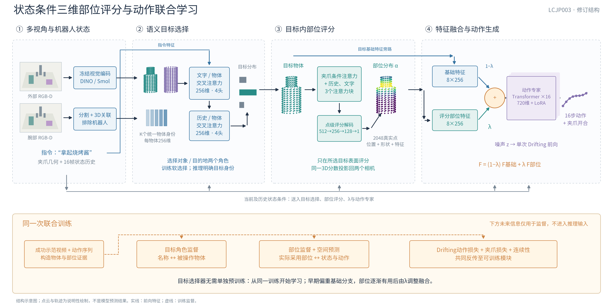

#### 01  冻结视觉编码器

灰色模块复用已有权重；输入尺寸按本图固定。B=batch，V=2视角。

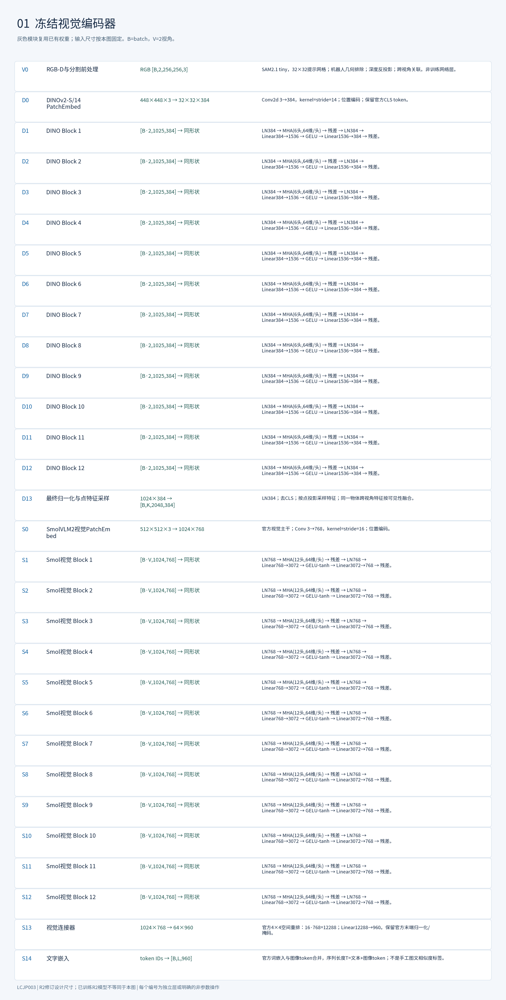

| 编号 | 层 | 输入→输出 | 内部操作 |
|---|---|---|---|
| V0 | RGB-D与分割前处理 | RGB [B,2,256,256,3] | SAM2.1 tiny，32×32提示网格；机器人几何排除；深度反投影；跨视角关联。非训练网络层。 |
| D0 | DINOv2-S/14 PatchEmbed | 448×448×3 → 32×32×384 | Conv2d 3→384，kernel=stride=14；位置编码；保留官方CLS token。 |
| D1 | DINO Block 1 | [B·2,1025,384] → 同形状 | LN384 → MHA(6头,64维/头) → 残差 → LN384 → Linear384→1536 → GELU → Linear1536→384 → 残差。 |
| D2 | DINO Block 2 | [B·2,1025,384] → 同形状 | LN384 → MHA(6头,64维/头) → 残差 → LN384 → Linear384→1536 → GELU → Linear1536→384 → 残差。 |
| D3 | DINO Block 3 | [B·2,1025,384] → 同形状 | LN384 → MHA(6头,64维/头) → 残差 → LN384 → Linear384→1536 → GELU → Linear1536→384 → 残差。 |
| D4 | DINO Block 4 | [B·2,1025,384] → 同形状 | LN384 → MHA(6头,64维/头) → 残差 → LN384 → Linear384→1536 → GELU → Linear1536→384 → 残差。 |
| D5 | DINO Block 5 | [B·2,1025,384] → 同形状 | LN384 → MHA(6头,64维/头) → 残差 → LN384 → Linear384→1536 → GELU → Linear1536→384 → 残差。 |
| D6 | DINO Block 6 | [B·2,1025,384] → 同形状 | LN384 → MHA(6头,64维/头) → 残差 → LN384 → Linear384→1536 → GELU → Linear1536→384 → 残差。 |
| D7 | DINO Block 7 | [B·2,1025,384] → 同形状 | LN384 → MHA(6头,64维/头) → 残差 → LN384 → Linear384→1536 → GELU → Linear1536→384 → 残差。 |
| D8 | DINO Block 8 | [B·2,1025,384] → 同形状 | LN384 → MHA(6头,64维/头) → 残差 → LN384 → Linear384→1536 → GELU → Linear1536→384 → 残差。 |
| D9 | DINO Block 9 | [B·2,1025,384] → 同形状 | LN384 → MHA(6头,64维/头) → 残差 → LN384 → Linear384→1536 → GELU → Linear1536→384 → 残差。 |
| D10 | DINO Block 10 | [B·2,1025,384] → 同形状 | LN384 → MHA(6头,64维/头) → 残差 → LN384 → Linear384→1536 → GELU → Linear1536→384 → 残差。 |
| D11 | DINO Block 11 | [B·2,1025,384] → 同形状 | LN384 → MHA(6头,64维/头) → 残差 → LN384 → Linear384→1536 → GELU → Linear1536→384 → 残差。 |
| D12 | DINO Block 12 | [B·2,1025,384] → 同形状 | LN384 → MHA(6头,64维/头) → 残差 → LN384 → Linear384→1536 → GELU → Linear1536→384 → 残差。 |
| D13 | 最终归一化与点特征采样 | 1024×384 → [B,K,2048,384] | LN384；去CLS；按点投影采样特征；同一物体跨视角特征按可见性融合。 |
| S0 | SmolVLM2视觉PatchEmbed | 512×512×3 → 1024×768 | 官方视觉主干；Conv 3→768，kernel=stride=16；位置编码。 |
| S1 | Smol视觉 Block 1 | [B·V,1024,768] → 同形状 | LN768 → MHA(12头,64维/头) → 残差 → LN768 → Linear768→3072 → GELU-tanh → Linear3072→768 → 残差。 |
| S2 | Smol视觉 Block 2 | [B·V,1024,768] → 同形状 | LN768 → MHA(12头,64维/头) → 残差 → LN768 → Linear768→3072 → GELU-tanh → Linear3072→768 → 残差。 |
| S3 | Smol视觉 Block 3 | [B·V,1024,768] → 同形状 | LN768 → MHA(12头,64维/头) → 残差 → LN768 → Linear768→3072 → GELU-tanh → Linear3072→768 → 残差。 |
| S4 | Smol视觉 Block 4 | [B·V,1024,768] → 同形状 | LN768 → MHA(12头,64维/头) → 残差 → LN768 → Linear768→3072 → GELU-tanh → Linear3072→768 → 残差。 |
| S5 | Smol视觉 Block 5 | [B·V,1024,768] → 同形状 | LN768 → MHA(12头,64维/头) → 残差 → LN768 → Linear768→3072 → GELU-tanh → Linear3072→768 → 残差。 |
| S6 | Smol视觉 Block 6 | [B·V,1024,768] → 同形状 | LN768 → MHA(12头,64维/头) → 残差 → LN768 → Linear768→3072 → GELU-tanh → Linear3072→768 → 残差。 |
| S7 | Smol视觉 Block 7 | [B·V,1024,768] → 同形状 | LN768 → MHA(12头,64维/头) → 残差 → LN768 → Linear768→3072 → GELU-tanh → Linear3072→768 → 残差。 |
| S8 | Smol视觉 Block 8 | [B·V,1024,768] → 同形状 | LN768 → MHA(12头,64维/头) → 残差 → LN768 → Linear768→3072 → GELU-tanh → Linear3072→768 → 残差。 |
| S9 | Smol视觉 Block 9 | [B·V,1024,768] → 同形状 | LN768 → MHA(12头,64维/头) → 残差 → LN768 → Linear768→3072 → GELU-tanh → Linear3072→768 → 残差。 |
| S10 | Smol视觉 Block 10 | [B·V,1024,768] → 同形状 | LN768 → MHA(12头,64维/头) → 残差 → LN768 → Linear768→3072 → GELU-tanh → Linear3072→768 → 残差。 |
| S11 | Smol视觉 Block 11 | [B·V,1024,768] → 同形状 | LN768 → MHA(12头,64维/头) → 残差 → LN768 → Linear768→3072 → GELU-tanh → Linear3072→768 → 残差。 |
| S12 | Smol视觉 Block 12 | [B·V,1024,768] → 同形状 | LN768 → MHA(12头,64维/头) → 残差 → LN768 → Linear768→3072 → GELU-tanh → Linear3072→768 → 残差。 |
| S13 | 视觉连接器 | 1024×768 → 64×960 | 官方4×4空间重排：16·768=12288；Linear12288→960。保留官方末端归一化/掩码。 |
| S14 | 文字嵌入 | token IDs → [B,L,960] | 官方词嵌入与图像token合并，序列长度T=文本+图像token；不是手工图文相似度标签。 |

#### 02  语言特征与状态编码

冻结Smol语言前16层；新增的匹配层、点编码器、历史编码器参与训练。K=当前物体数。

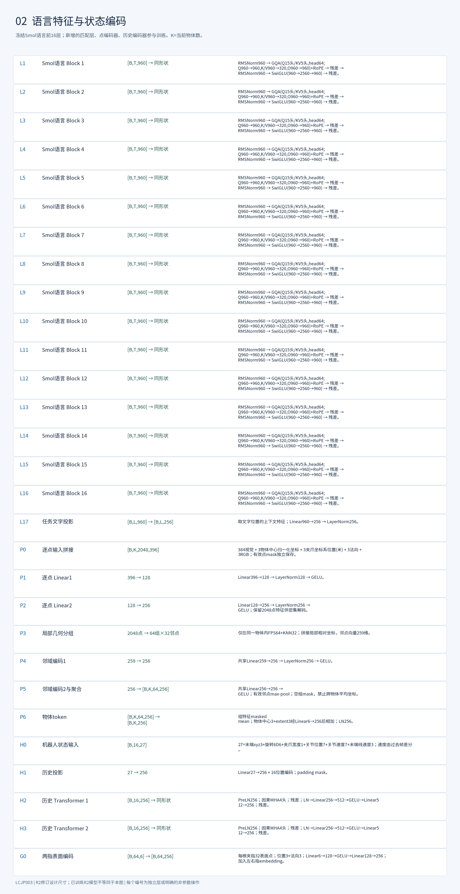

| 编号 | 层 | 输入→输出 | 内部操作 |
|---|---|---|---|
| L1 | Smol语言 Block 1 | [B,T,960] → 同形状 | RMSNorm960 → GQA(Q15头/KV5头,head64; Q960→960,K/V960→320,O960→960)+RoPE → 残差 → RMSNorm960 → SwiGLU(960→2560→960) → 残差。 |
| L2 | Smol语言 Block 2 | [B,T,960] → 同形状 | RMSNorm960 → GQA(Q15头/KV5头,head64; Q960→960,K/V960→320,O960→960)+RoPE → 残差 → RMSNorm960 → SwiGLU(960→2560→960) → 残差。 |
| L3 | Smol语言 Block 3 | [B,T,960] → 同形状 | RMSNorm960 → GQA(Q15头/KV5头,head64; Q960→960,K/V960→320,O960→960)+RoPE → 残差 → RMSNorm960 → SwiGLU(960→2560→960) → 残差。 |
| L4 | Smol语言 Block 4 | [B,T,960] → 同形状 | RMSNorm960 → GQA(Q15头/KV5头,head64; Q960→960,K/V960→320,O960→960)+RoPE → 残差 → RMSNorm960 → SwiGLU(960→2560→960) → 残差。 |
| L5 | Smol语言 Block 5 | [B,T,960] → 同形状 | RMSNorm960 → GQA(Q15头/KV5头,head64; Q960→960,K/V960→320,O960→960)+RoPE → 残差 → RMSNorm960 → SwiGLU(960→2560→960) → 残差。 |
| L6 | Smol语言 Block 6 | [B,T,960] → 同形状 | RMSNorm960 → GQA(Q15头/KV5头,head64; Q960→960,K/V960→320,O960→960)+RoPE → 残差 → RMSNorm960 → SwiGLU(960→2560→960) → 残差。 |
| L7 | Smol语言 Block 7 | [B,T,960] → 同形状 | RMSNorm960 → GQA(Q15头/KV5头,head64; Q960→960,K/V960→320,O960→960)+RoPE → 残差 → RMSNorm960 → SwiGLU(960→2560→960) → 残差。 |
| L8 | Smol语言 Block 8 | [B,T,960] → 同形状 | RMSNorm960 → GQA(Q15头/KV5头,head64; Q960→960,K/V960→320,O960→960)+RoPE → 残差 → RMSNorm960 → SwiGLU(960→2560→960) → 残差。 |
| L9 | Smol语言 Block 9 | [B,T,960] → 同形状 | RMSNorm960 → GQA(Q15头/KV5头,head64; Q960→960,K/V960→320,O960→960)+RoPE → 残差 → RMSNorm960 → SwiGLU(960→2560→960) → 残差。 |
| L10 | Smol语言 Block 10 | [B,T,960] → 同形状 | RMSNorm960 → GQA(Q15头/KV5头,head64; Q960→960,K/V960→320,O960→960)+RoPE → 残差 → RMSNorm960 → SwiGLU(960→2560→960) → 残差。 |
| L11 | Smol语言 Block 11 | [B,T,960] → 同形状 | RMSNorm960 → GQA(Q15头/KV5头,head64; Q960→960,K/V960→320,O960→960)+RoPE → 残差 → RMSNorm960 → SwiGLU(960→2560→960) → 残差。 |
| L12 | Smol语言 Block 12 | [B,T,960] → 同形状 | RMSNorm960 → GQA(Q15头/KV5头,head64; Q960→960,K/V960→320,O960→960)+RoPE → 残差 → RMSNorm960 → SwiGLU(960→2560→960) → 残差。 |
| L13 | Smol语言 Block 13 | [B,T,960] → 同形状 | RMSNorm960 → GQA(Q15头/KV5头,head64; Q960→960,K/V960→320,O960→960)+RoPE → 残差 → RMSNorm960 → SwiGLU(960→2560→960) → 残差。 |
| L14 | Smol语言 Block 14 | [B,T,960] → 同形状 | RMSNorm960 → GQA(Q15头/KV5头,head64; Q960→960,K/V960→320,O960→960)+RoPE → 残差 → RMSNorm960 → SwiGLU(960→2560→960) → 残差。 |
| L15 | Smol语言 Block 15 | [B,T,960] → 同形状 | RMSNorm960 → GQA(Q15头/KV5头,head64; Q960→960,K/V960→320,O960→960)+RoPE → 残差 → RMSNorm960 → SwiGLU(960→2560→960) → 残差。 |
| L16 | Smol语言 Block 16 | [B,T,960] → 同形状 | RMSNorm960 → GQA(Q15头/KV5头,head64; Q960→960,K/V960→320,O960→960)+RoPE → 残差 → RMSNorm960 → SwiGLU(960→2560→960) → 残差。 |
| L17 | 任务文字投影 | [B,L,960] → [B,L,256] | 取文字位置的上下文特征；Linear960→256 → LayerNorm256。 |
| P0 | 逐点输入拼接 | [B,K,2048,396] | 384视觉 + 3物体中心归一化坐标 + 3夹爪坐标系位置(米) + 3法向 + 3RGB；有效点mask独立保存。 |
| P1 | 逐点 Linear1 | 396 → 128 | Linear396→128 → LayerNorm128 → GELU。 |
| P2 | 逐点 Linear2 | 128 → 256 | Linear128→256 → LayerNorm256 → GELU；保留2048点特征供密集解码。 |
| P3 | 局部几何分组 | 2048点 → 64组×32邻点 | 仅在同一物体内FPS64+KNN32；拼接局部相对坐标，邻点向量259维。 |
| P4 | 邻域编码1 | 259 → 256 | 共享Linear259→256 → LayerNorm256 → GELU。 |
| P5 | 邻域编码2与聚合 | 256 → [B,K,64,256] | 共享Linear256→256 → GELU；有效邻点max-pool；空组mask，禁止跨物体平均坐标。 |
| P6 | 物体token | [B,K,64,256] → [B,K,256] | 组特征masked mean；物体中心3+extent3经Linear6→256后相加；LN256。 |
| H0 | 机器人状态输入 | [B,16,27] | 27=末端xyz3+旋转6D6+夹爪宽度1+关节位置7+关节速度7+末端线速度3；速度由过去帧差分。 |
| H1 | 历史投影 | 27 → 256 | Linear27→256 + 16位置编码；padding mask。 |
| H2 | 历史 Transformer 1 | [B,16,256] → 同形状 | PreLN256；因果MHA4头；残差；LN→Linear256→512→GELU→Linear512→256；残差。 |
| H3 | 历史 Transformer 2 | [B,16,256] → 同形状 | PreLN256；因果MHA4头；残差；LN→Linear256→512→GELU→Linear512→256；残差。 |
| G0 | 两指表面编码 | [B,64,6] → [B,64,256] | 每根夹指32表面点；位置3+法向3；Linear6→128→GELU→Linear128→256；加入左右指embedding。 |

#### 03  目标选择与密集部位评分

双视角属于同一物体身份；训练期可计算多候选损失，推理期只有选定物体进入部位分支。

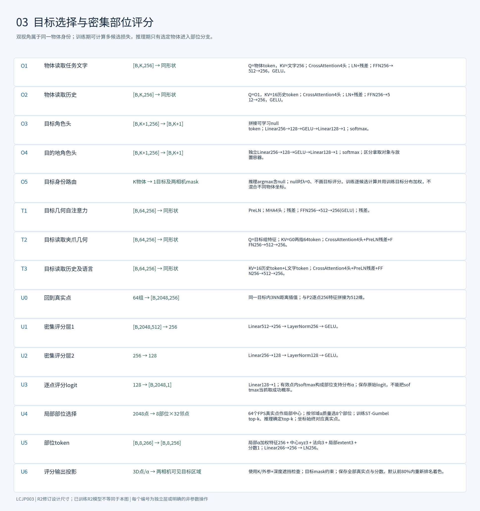

| 编号 | 层 | 输入→输出 | 内部操作 |
|---|---|---|---|
| O1 | 物体读取任务文字 | [B,K,256] → 同形状 | Q=物体token，KV=文字256；CrossAttention4头；LN+残差；FFN256→512→256，GELU。 |
| O2 | 物体读取历史 | [B,K,256] → 同形状 | Q=O1，KV=16历史token；CrossAttention4头；LN+残差；FFN256→512→256，GELU。 |
| O3 | 目标角色头 | [B,K+1,256] → [B,K+1] | 拼接可学习null token；Linear256→128→GELU→Linear128→1；softmax。 |
| O4 | 目的地角色头 | [B,K+1,256] → [B,K+1] | 独立Linear256→128→GELU→Linear128→1；softmax；区分拿取对象与放置容器。 |
| O5 | 目标身份路由 | K物体 → 1目标及两相机mask | 推理argmax含null；null时λ=0、不画目标评分。训练逐候选计算并用训练目标分布加权，不混合不同物体坐标。 |
| T1 | 目标几何自注意力 | [B,64,256] → 同形状 | PreLN；MHA4头；残差；FFN256→512→256(GELU)；残差。 |
| T2 | 目标读取夹爪几何 | [B,64,256] → 同形状 | Q=目标组特征；KV=G0两指64token；CrossAttention4头+PreLN残差+FFN256→512→256。 |
| T3 | 目标读取历史及语言 | [B,64,256] → 同形状 | KV=16历史token+L文字token；CrossAttention4头+PreLN残差+FFN256→512→256。 |
| U0 | 回到真实点 | 64组 → [B,2048,256] | 同一目标内3NN距离插值；与P2逐点256特征拼接为512维。 |
| U1 | 密集评分层1 | [B,2048,512] → 256 | Linear512→256 → LayerNorm256 → GELU。 |
| U2 | 密集评分层2 | 256 → 128 | Linear256→128 → LayerNorm128 → GELU。 |
| U3 | 逐点评分logit | 128 → [B,2048,1] | Linear128→1；有效点内softmax构成部位支持分布α；保存原始logit，不能把softmax当抓取成功概率。 |
| U4 | 局部部位选择 | 2048点 → 8部位×32邻点 | 64个FPS真实点作局部中心；按邻域α质量选8个部位；训练ST-Gumbel top-k、推理确定top-k；坐标始终对应真实点。 |
| U5 | 部位token | [B,8,266] → [B,8,256] | 局部α加权特征256 + 中心xyz3 + 法向3 + 局部extent3 + 分数1；Linear266→256 → LN256。 |
| U6 | 评分输出投影 | 3D点/α → 两相机可见目标区域 | 使用K/外参+深度遮挡检查；目标mask约束；保存全部真实点与分数。默认前80%内重新排名着色。 |

#### 04  融合与动作条件

基础和部位分支用同一组8个查询定义token槽位；λ可学习，但其数值不是评分有效性的证据。

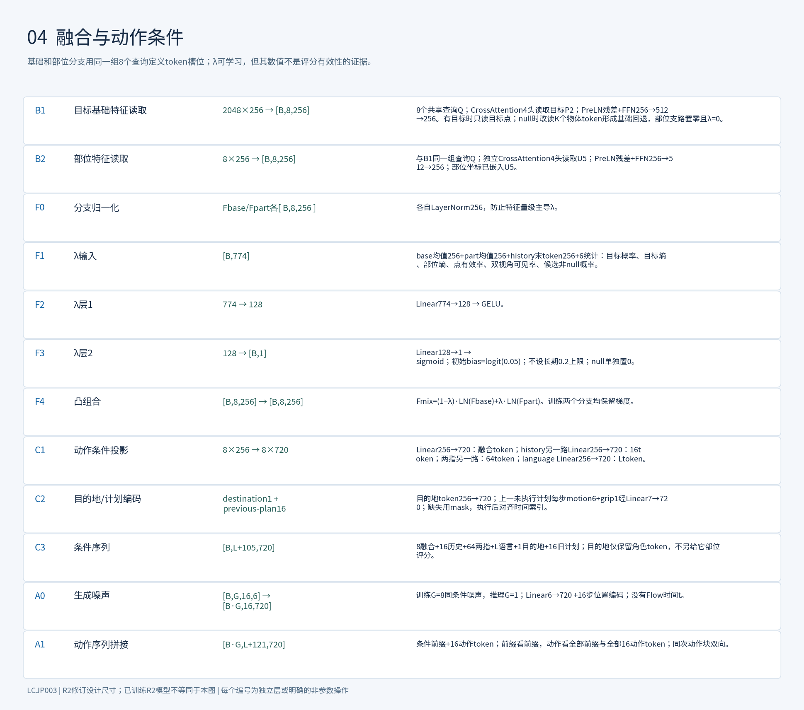

| 编号 | 层 | 输入→输出 | 内部操作 |
|---|---|---|---|
| B1 | 目标基础特征读取 | 2048×256 → [B,8,256] | 8个共享查询Q；CrossAttention4头读取目标P2；PreLN残差+FFN256→512→256。有目标时只读目标点；null时改读K个物体token形成基础回退，部位支路置零且λ=0。 |
| B2 | 部位特征读取 | 8×256 → [B,8,256] | 与B1同一组查询Q；独立CrossAttention4头读取U5；PreLN残差+FFN256→512→256；部位坐标已嵌入U5。 |
| F0 | 分支归一化 | Fbase/Fpart各[ B,8,256 ] | 各自LayerNorm256，防止特征量级主导λ。 |
| F1 | λ输入 | [B,774] | base均值256+part均值256+history末token256+6统计：目标概率、目标熵、部位熵、点有效率、双视角可见率、候选非null概率。 |
| F2 | λ层1 | 774 → 128 | Linear774→128 → GELU。 |
| F3 | λ层2 | 128 → [B,1] | Linear128→1 → sigmoid；初始bias=logit(0.05)；不设长期0.2上限；null单独置0。 |
| F4 | 凸组合 | [B,8,256] → [B,8,256] | Fmix=(1−λ)·LN(Fbase)+λ·LN(Fpart)。训练两个分支均保留梯度。 |
| C1 | 动作条件投影 | 8×256 → 8×720 | Linear256→720：融合token；history另一路Linear256→720：16token；两指另一路：64token；language Linear256→720：Ltoken。 |
| C2 | 目的地/计划编码 | destination1 + previous-plan16 | 目的地token256→720；上一未执行计划每步motion6+grip1经Linear7→720；缺失用mask，执行后对齐时间索引。 |
| C3 | 条件序列 | [B,L+105,720] | 8融合+16历史+64两指+L语言+1目的地+16旧计划；目的地仅保留角色token，不另给它部位评分。 |
| A0 | 生成噪声 | [B,G,16,6] → [B·G,16,720] | 训练G=8同条件噪声，推理G=1；Linear6→720 +16步位置编码；没有Flow时间t。 |
| A1 | 动作序列拼接 | [B·G,L+121,720] | 条件前缀+16动作token；前缀看前缀，动作看全部前缀与全部16动作token；同次动作块双向。 |

#### 05  16层动作专家与输出

复用已核对的SmolVLA专家层尺寸；下列为新的prefix调用约定，需要实现适配。Drifting使用一次前向生成动作。

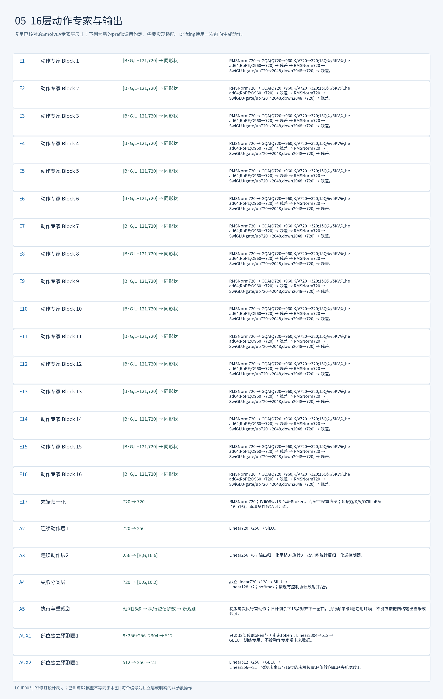

| 编号 | 层 | 输入→输出 | 内部操作 |
|---|---|---|---|
| E1 | 动作专家 Block 1 | [B·G,L+121,720] → 同形状 | RMSNorm720 → GQA(Q720→960,K/V720→320;15Q头/5KV头,head64;RoPE;O960→720) → 残差 → RMSNorm720 → SwiGLU(gate/up720→2048,down2048→720) → 残差。 |
| E2 | 动作专家 Block 2 | [B·G,L+121,720] → 同形状 | RMSNorm720 → GQA(Q720→960,K/V720→320;15Q头/5KV头,head64;RoPE;O960→720) → 残差 → RMSNorm720 → SwiGLU(gate/up720→2048,down2048→720) → 残差。 |
| E3 | 动作专家 Block 3 | [B·G,L+121,720] → 同形状 | RMSNorm720 → GQA(Q720→960,K/V720→320;15Q头/5KV头,head64;RoPE;O960→720) → 残差 → RMSNorm720 → SwiGLU(gate/up720→2048,down2048→720) → 残差。 |
| E4 | 动作专家 Block 4 | [B·G,L+121,720] → 同形状 | RMSNorm720 → GQA(Q720→960,K/V720→320;15Q头/5KV头,head64;RoPE;O960→720) → 残差 → RMSNorm720 → SwiGLU(gate/up720→2048,down2048→720) → 残差。 |
| E5 | 动作专家 Block 5 | [B·G,L+121,720] → 同形状 | RMSNorm720 → GQA(Q720→960,K/V720→320;15Q头/5KV头,head64;RoPE;O960→720) → 残差 → RMSNorm720 → SwiGLU(gate/up720→2048,down2048→720) → 残差。 |
| E6 | 动作专家 Block 6 | [B·G,L+121,720] → 同形状 | RMSNorm720 → GQA(Q720→960,K/V720→320;15Q头/5KV头,head64;RoPE;O960→720) → 残差 → RMSNorm720 → SwiGLU(gate/up720→2048,down2048→720) → 残差。 |
| E7 | 动作专家 Block 7 | [B·G,L+121,720] → 同形状 | RMSNorm720 → GQA(Q720→960,K/V720→320;15Q头/5KV头,head64;RoPE;O960→720) → 残差 → RMSNorm720 → SwiGLU(gate/up720→2048,down2048→720) → 残差。 |
| E8 | 动作专家 Block 8 | [B·G,L+121,720] → 同形状 | RMSNorm720 → GQA(Q720→960,K/V720→320;15Q头/5KV头,head64;RoPE;O960→720) → 残差 → RMSNorm720 → SwiGLU(gate/up720→2048,down2048→720) → 残差。 |
| E9 | 动作专家 Block 9 | [B·G,L+121,720] → 同形状 | RMSNorm720 → GQA(Q720→960,K/V720→320;15Q头/5KV头,head64;RoPE;O960→720) → 残差 → RMSNorm720 → SwiGLU(gate/up720→2048,down2048→720) → 残差。 |
| E10 | 动作专家 Block 10 | [B·G,L+121,720] → 同形状 | RMSNorm720 → GQA(Q720→960,K/V720→320;15Q头/5KV头,head64;RoPE;O960→720) → 残差 → RMSNorm720 → SwiGLU(gate/up720→2048,down2048→720) → 残差。 |
| E11 | 动作专家 Block 11 | [B·G,L+121,720] → 同形状 | RMSNorm720 → GQA(Q720→960,K/V720→320;15Q头/5KV头,head64;RoPE;O960→720) → 残差 → RMSNorm720 → SwiGLU(gate/up720→2048,down2048→720) → 残差。 |
| E12 | 动作专家 Block 12 | [B·G,L+121,720] → 同形状 | RMSNorm720 → GQA(Q720→960,K/V720→320;15Q头/5KV头,head64;RoPE;O960→720) → 残差 → RMSNorm720 → SwiGLU(gate/up720→2048,down2048→720) → 残差。 |
| E13 | 动作专家 Block 13 | [B·G,L+121,720] → 同形状 | RMSNorm720 → GQA(Q720→960,K/V720→320;15Q头/5KV头,head64;RoPE;O960→720) → 残差 → RMSNorm720 → SwiGLU(gate/up720→2048,down2048→720) → 残差。 |
| E14 | 动作专家 Block 14 | [B·G,L+121,720] → 同形状 | RMSNorm720 → GQA(Q720→960,K/V720→320;15Q头/5KV头,head64;RoPE;O960→720) → 残差 → RMSNorm720 → SwiGLU(gate/up720→2048,down2048→720) → 残差。 |
| E15 | 动作专家 Block 15 | [B·G,L+121,720] → 同形状 | RMSNorm720 → GQA(Q720→960,K/V720→320;15Q头/5KV头,head64;RoPE;O960→720) → 残差 → RMSNorm720 → SwiGLU(gate/up720→2048,down2048→720) → 残差。 |
| E16 | 动作专家 Block 16 | [B·G,L+121,720] → 同形状 | RMSNorm720 → GQA(Q720→960,K/V720→320;15Q头/5KV头,head64;RoPE;O960→720) → 残差 → RMSNorm720 → SwiGLU(gate/up720→2048,down2048→720) → 残差。 |
| E17 | 末端归一化 | 720 → 720 | RMSNorm720；仅取最后16个动作token。专家主权重冻结；每层Q/K/V/O加LoRA(r16,α16)，新增条件投影可训练。 |
| A2 | 连续动作层1 | 720 → 256 | Linear720→256 → SiLU。 |
| A3 | 连续动作层2 | 256 → [B,G,16,6] | Linear256→6；输出归一化平移3+旋转3；按训练统计反归一化送控制器。 |
| A4 | 夹爪分类层 | 720 → [B,G,16,2] | 独立Linear720→128 → SiLU → Linear128→2；softmax；按现有控制协议映射开/合。 |
| A5 | 执行与重规划 | 预测16步 → 执行登记步数 → 新观测 | 初版每次执行首动作；旧计划余下15步对齐下一窗口。执行频率/限幅沿用环境，不能直接把网络输出当米或弧度。 |
| AUX1 | 部位独立预测层1 | 8·256+256=2304 → 512 | 只读B2部位8token与历史末token；Linear2304→512 → GELU。训练专用，不给动作专家喂未来数据。 |
| AUX2 | 部位独立预测层2 | 512 → 256 → 21 | Linear512→256 → GELU → Linear256→21；预测未来1/4/16步的末端位置3+旋转向量3+夹爪宽度1。 |

#### 06  训练信号与梯度路线

以下是训练计算图，不是额外预训练接触网络。旧R2权重不自动成为新网络的已验证权重。

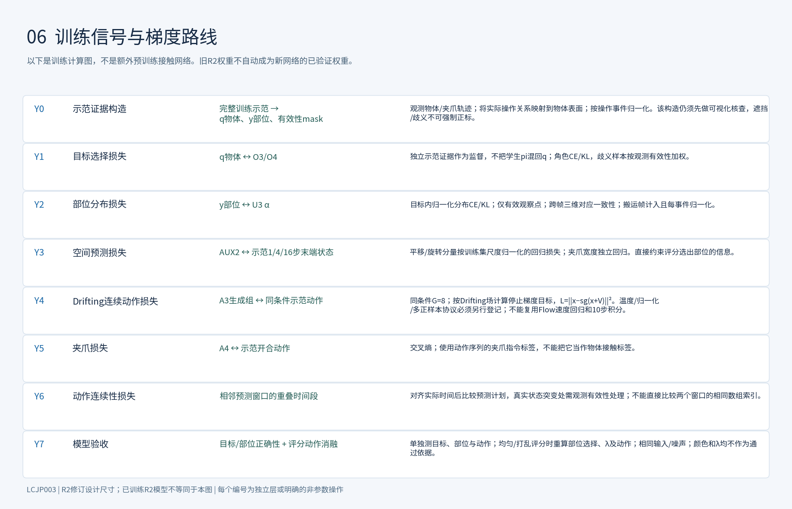

| 编号 | 层 | 输入→输出 | 内部操作 |
|---|---|---|---|
| Y0 | 示范证据构造 | 完整训练示范 → q物体、y部位、有效性mask | 观测物体/夹爪轨迹；将实际操作关系映射到物体表面；按操作事件归一化。该构造仍须先做可视化核查，遮挡/歧义不可强制正标。 |
| Y1 | 目标选择损失 | q物体 ↔ O3/O4 | 独立示范证据作为监督，不把学生pi混回q；角色CE/KL，歧义样本按观测有效性加权。 |
| Y2 | 部位分布损失 | y部位 ↔ U3 α | 目标内归一化分布CE/KL；仅有效观察点；跨帧三维对应一致性；搬运帧计入且每事件归一化。 |
| Y3 | 空间预测损失 | AUX2 ↔ 示范1/4/16步末端状态 | 平移/旋转分量按训练集尺度归一化的回归损失；夹爪宽度独立回归。直接约束评分选出部位的信息。 |
| Y4 | Drifting连续动作损失 | A3生成组 ↔ 同条件示范动作 | 同条件G=8；按Drifting场计算停止梯度目标，L=//x−sg(x+V)//²。温度/归一化/多正样本协议必须另行登记；不能复用Flow速度回归和10步积分。 |
| Y5 | 夹爪损失 | A4 ↔ 示范开合动作 | 交叉熵；使用动作序列的夹爪指令标签，不能把它当作物体接触标签。 |
| Y6 | 动作连续性损失 | 相邻预测窗口的重叠时间段 | 对齐实际时间后比较预测计划，真实状态突变处需观测有效性处理；不能直接比较两个窗口的相同数组索引。 |
| Y7 | 模型验收 | 目标/部位正确性 + 评分动作消融 | 单独测目标、部位与动作；均匀/打乱评分时重算部位选择、λ及动作；相同输入/噪声；颜色和λ均不作为通过依据。 |

### 2026-10-28 13:21:31 论文式结构图与联合训练含义更正

此前方案写成了先训练目标选择、再部位学习、最后接入动作的串行安排，偏离了边训练边使用的约定；现撤回该安排，改为同一网络、同一次联合训练中的检查顺序。可训练目标选择、部位评分、融合门控和动作适配模块从训练开始共同更新；目标证据损失、部位损失、辅助空间预测与动作损失共同作用。无需用户另外预训练接触网络或先完成独立目标选择器训练。早期基础分支权重较大，λ随学习调整，不能承诺固定50步就锁定目标。

网络主图改为论文式特征流、点云、分支与联合监督结构；逐层规格移入折叠工程附录。图中点云与轨迹是说明性示意，不是实测结果。PNG、SVG、PDF均保存在远程。文字最小9pt，碰撞审计0失败0警告；单绘图区对齐检查不适用。主图为大尺寸阅读版，非特定期刊最终版面；PNG而非TIFF用于网页预览。

### 2026-10-28T13:32:59.633806+08:00 R3联合训练实现登记

用户授权按论文式结构图修改网络并重新训练。以后网络主图沿用该画法，逐层尺寸仅作附录。主图已嵌入本方案，不另建方案文档。新run为experiments/lcjp003/r3/joint/v001；旧R2权重与结果保留，禁止覆盖。沿用R2的80训练示范与20开发示范划分和训练集动作归一化；3000更新、有效批量8、第250更新评估。

两路RGB-D均分割：复用已有32×32 SAM观测，再剔除机器人像素及对应点；跨视角同一物体建立三维身份，目标内评分后按深度遮挡投影到两相机，不把腕部身份直接当外部掩膜编号。目标和部位监督从示范观测/机器人轨迹独立构造，不引用旧pi、评分或模型自身预测。模糊证据降权，监督可视化通过前不启动正式优化。

根据最新讨论，B1基础支路修订为物体级摘要，撤销读取全部2048个精细点token的捷径；精细坐标/局部形状主要经评分选择的部位支路进入动作。所有可训练模块从第1次更新共同训练，无独立目标选择器预训练。保留目标/部位/空间辅助监督，并加入均匀、打乱、错误部位动作对照；λ、梯度非零、相对色图不构成通过证据。

连续动作使用Drifting单次前向：按官方drift_loss.py核对尺度与双向亲和核，不沿用R2的10步Flow Matching。https://github.com/lambertae/drifting/blob/main/drift_loss.py 。监督协议、输入实现和梯度检查锁定后才进行正式训练；工程验证不计入3000更新。

### 2026-10-28T13:40:28.774920+08:00 用户指定的遮挡参考规则
同一三维部位若一路被遮挡，以另一路当前可见观测为评分依据；遮挡路的融合权重为0。两路可见时按几何观测一致性归一化融合；两路都不可见则标记当前不可见，历史可供时序状态使用，但不得把历史分数画为当前可见。可见性逐点判断，依据当前深度、相机参数和机器人遮挡，禁止按整路相机一刀切。显示仅投影到当前可见目标表面，禁止画到前景夹爪。

### 2026-10-28T13:40:52.816436+08:00 正式更新前的接口修复
接口检查发现Smol专家奇数层实际K/V输入320维、偶数层720维；原逐层附录把16层统一写成720维不准确。新条件token为720维，因此在奇数层K/V前加入可训练720→320适配，保留官方320→320投影；适配以相邻偶数层官方投影初始化。工程测试报RuntimeError，尚无正式优化更新；旧训练完全未改。正式训练前再次核对梯度和张量接口。

### 2026-10-28T13:41:39.173706+08:00 当前可见视角融合实现
实际点的DINO与RGB特征改为按当前深度可见权重融合，遮挡视角特征不进入模型。对应门控原固定DINO余弦0.65在真实同物体跨视角下不可靠（已见0.25附近但毫米级空间重合）；改为双向空间重叠至少0.20、6mm观测容差、相互最优，视觉相似度仅软排序。双向覆盖避免背景大mask包住小物体造成单向假匹配。这是观测身份关联标准，不是接触/抓取判定；需通过负配对与可视核对，不自行宣称身份正确。

### 2026-10-28T13:44:05.319344+08:00 独立示范监督构造初版登记
角色/部位监督使用观测物体轨迹、两指表面距离与物体-夹爪位移对应，不引用学生预测、不使用仿真物体位姿/力/接触。跟踪采用3D刚体拟合与描述子配对；连续观测尺度：3D拟合残差15mm、指面邻域30mm、部位支持邻域25mm、未来衰减48帧。它们定义软证据带宽，不是声称接触成立的阈值。物体位移与夹爪位移一致程度、运动强度、轨迹质量共同加权；搬运过程计入并按可用记录平均，缺证据窗口角色/部位监督权重为0，不能强行标为负样本。该初版先验证跨视角身份一致及监督可视化，未通过不启动正式训练。

### 2026-10-28T13:51:59.481463+08:00 输入完整性检查
首个训练示范存在127个训练张量、113个分割观测文件；例如118帧张量存在但对应分割观测缺失。监督试查改在该示范已有完整观测的5帧进行，复用已完成轨迹缓存；这不改变正式训练采样范围。正式启动前须补齐缺失观测到新run目录并验证，不能静默丢弃这些训练帧。

### 2026-10-28T13:58:11.006501+08:00 接近阶段监督错误根因与修复
首个训练示范可视核查：13/38帧最高监督落在旁边盒子，抓取中期才转回被操作罐体，因此该监督未通过、禁止用于正式训练。根因是逐帧SAM候选碎片的短轨迹频繁断裂，真实操作轨迹在52/64/69/85帧被切成多个身份，接近阶段无法得到后续支持。保留失败代码与5帧证据。改用已缓存冻结CoTracker跨全示范点轨迹，将当前候选掩膜绑定到稳定点轨迹，再从点的世界坐标运动与两指关系构造支持；不读取seed_object_id作标签、不恢复旧接触实验、不读取物体真值。仅角色和部位监督改用稳定点对应，当前推理仍使用当前/历史观测。正式更新仍为0。

### 2026-10-28T14:01:15.345739+08:00 缺失观测补齐与联合目标实现
缺失观测仅按原R2的32×32分割配置重建到新run/recovered_observations，不改原缓存、不重做已有帧；旧区域文字先验构造在观测保存后被截断，新训练不读旧先验。训练动作分支使用每窗口从独立目标分布q抽取一个物体作为逐候选损失期望的无偏估计，绝不平均不同物体坐标；目标/部位/辅助损失仍对全部候选计算。动作Drifting温度0.02/0.05/0.2，G=8，同条件唯一示范动作作正样本，不将其他场景动作混为正样本；独立夹爪CE。基础/部位/目标/动作从第1更新联合学习。相邻真实窗口计划重叠采用t+1前15步对齐t后15步，上一计划来自模型且50%丢弃；连续性权重0.02。

### 2026-10-28T14:05:11.054450+08:00 观测文件定位更正
此前“缺失分割观测”的判断不完整：原目录同时保留逐帧observations_N.h5和合并observations.h5；118等帧已在合并文件中。已停止我方补算worker，保留其已生成文件作为过程证据；正式输入优先读取原逐帧/合并缓存，不使用无必要重算结果。全量核对为10174窗口，其中合并文件959窗口，实际缺失0。取消此前约2.7小时补算估计。

### 2026-10-28T14:07:32.267818+08:00 合并候选中的异物分离
稳定点轨迹纠正了接近阶段目标，但核查发现某些SAM掩膜本身含两个空间分离物体：13帧[9,16]合并候选包含相距约25cm的两个主要点簇，不能直接作为单物体。增加三维连通分量检查：8mm图连接；仅当至少两个主要分量各占5%以上且分量中心距离大于其半对角尺度之和+1cm时分离身份，剩余点按最近主要分量保留归属，原完整观测不删除。此为候选观测几何修复，不是接触判据，不改变SAM32×32。稳定轨迹绑定同时要求当前3D位置与候选表面相容，避免一个大掩膜把其他物体的轨迹算进来。正式训练仍未启动。

### 2026-10-28T14:13:19.236144+08:00 同一表面候选去重与输入预取
三维分离后，对互相覆盖同一表面的候选归并：6mm距离下双向覆盖较小者至少0.5、较大者至少0.85，防止同一物体三个候选把目标分布分成三份；该条件只处理观测重复身份。4线程预取输入，80训练示范的只读点轨迹按示范缓存，避免反复加载。所有正式训练与评估入口保留STOP检查；不会自动启动闭环。

### 2026-10-28 14:22:22（北京时间）R3 可见视角融合与启动前检查

按用户要求逐点判断可见性：一路遮挡时只采用另一路当前可见特征；两路可见时归一化融合；两路均不可见标为未知。评分属于统一三维物体点，投影时再次做深度和机器人遮挡检查，不把隐藏物体的分数画在遮挡物上。

真实训练示范第13/38/67/91/117帧的几何检查通过：单路可见点均存在，被屏蔽一路特征任意扰动对融合输出差为0；当前可见点权重和为1；机器人遮挡投影违规0。两路全遮挡的合成测试输出未知。5帧监督图已逐帧检查，早期、抓持、搬运及放置均对应同一罐体；这是局部监督来源检查，不是全数据目标准确率或模型结果。

真实动作与独立监督的联合反向通过，目标、目的地、部位评分、融合门及辅助头梯度均有限且非零。恢复一致性参数与损失差为0；正式Drifting参考损失差0、梯度最大差1.1362e-7。输入完整性10174窗口可直接复用，不再重做分割。

实现尺寸勘误：基础分支仅接收物体级摘要，细粒度几何从所选部位分支进入；部位选择采用确定性top-k前向和soft直通梯度；官方动作专家偶数层K/V输入720，奇数层原始K/V输入320，新增720→320桥接后保留官方投影及LoRA。以上实际实现取代早先逐层附表中基础分支读取全点、统一K/V维度及Gumbel的表述。训练配置与源码随后锁定，3000次新联合更新，不继承旧R2训练权重。

### 2026-10-28 14:23:48（北京时间）R3 新联合训练启动

已锁定配置与源码并启动 experiments/lcjp003/r3/joint/v001/src/train.py，实际进程PID3820637。初始step0000检查点已生成，先计算固定80窗口初始化基线，再连续保留3000次正式更新；正式20/50次更新后按实际吞吐给出ETA。旧R2权重及已完成缓存保持只读，旧闭环与旧训练不恢复。

### 2026-10-28 15:02:29（北京时间）R3第250次固定窗口评估

固定80窗口与固定噪声。训练运动MAE 0.590825，较初始化下降24.83%；开发MAE 0.500404，下降36.18%。夹爪分类错误率训练7.50%、开发4.53%。目标最大权重均值训练0.6969、开发0.6837，不能当目标准确率。λ均值训练0.1828、开发0.1730。

评分作用未获正向证据：训练原评分/均匀/打乱MAE为0.590825/0.587131/0.587663；开发0.500404/0.498697/0.499682。原评分略差，不能把λ增大或梯度非零称评分有效。继续原锁定3000次训练，不按该结果悄改网络或损失。

### 2026-10-28 15:44:21（北京时间）第500次评估

固定80窗口：训练MAE0.502041，开发0.486067；夹爪错误率9.21875%/7.8125%，较250次有所回升。目标所选权重均值0.7580/0.8019，不等于识别准确率。λ均值回落到0.1214/0.1276。原评分仍未稳定优于均匀或打乱：训练原/均匀/打乱0.502041/0.501978/0.498165，开发0.486067/0.484678/0.486405。评分正向作用仍未证明。继续锁定训练。

### 2026-10-28 15:53:49（北京时间）第500次链路诊断，保持训练

CPU独立加载step0500，不改锁定源码/配置。诊断8窗口，含4个夹爪退步最大窗口和4个固定窗口，非随机总体准确率估计。数值摘要见diagnostics/chain500_summary.json，逐项干预见chain500_complete.json。

监督：若干目标内teacher分布归一化熵接近1（均匀）；固定25mm空间扩散和同物体共同运动可能使小物体几乎整体获得支持。学生亦接近均匀，排序缺乏明确部位差异。251–500次样本约19.25% role_weight<0.1、9.15%<0.01；不能据此说所有样本监督无效。部位权重先归一化再乘role_weight，不能把单个part_weight乘role_weight误称最终平方衰减。

部位选择与动作：黄油demo0/frame45均匀替换后所选8组与原评分无交集，动作归一化平均变化仅0.007526。关闭整个部位分支变化0.023217，说明分支有作用而评分排序效益不足。历史/夹爪/文本/基础物体摘要仍直接进入动作专家，细粒度评分不是唯一信息入口。强制lambda=1部分窗口更好、部分更差，不足以直接修改融合系数。

目标链路：训练动作从独立teacher的role分布采样离散目标，评估使用student argmax；动作损失不能通过离散索引直接纠正目标头，训练推理存在差异。奶油奶酪demo0/frame36换teacher目标后MAE0.543606→0.432609、夹爪错误4/16→0/16，teacher非人工真值。

夹爪：80窗口250→500，训练4退步1改善，开发4退步3改善。奶油奶酪demo45/frame36从0/16错到13/16，黄油demo45/frame47从0/16错到11/16；目标与teacher一致，均匀或打乱评分没有修复，表现为序列中提前预测另一开合类别。不是全体退化，也不能仅归因目标错误。完整统计与反事实保留，尚未证明类别切换误判的全部优化成因。

### 2026-10-28 16:54:40（北京时间）第750次评估

固定80窗口：训练MAE0.477781、开发0.457988；夹爪错误率7.50%/7.96875%。原评分/均匀/打乱，训练0.477781/0.477612/0.476645，开发0.457988/0.449402/0.454560。动作继续改善，但原评分仍未优于对照，开发集与均匀评分差距扩大。目标权重均值0.7610/0.8396不是识别准确率；λ均值0.1400/0.1552。锁定训练继续，未改网络或损失。

### 2026-10-28 17:08:25（北京时间）FPS工程优化登记

用户授权继续优化。单窗口CPU剖析确认45次FPS占输入准备2.82/3.42秒，热读仍慢。保留原始NumPy初始中心，原FPS循环以Numba编译（fastmath关闭、nogil开启），不改变采样规则、32×32分割、网络、损失。首个完整窗口输入与监督逐张量相等；3.382→1.042秒，局部3.25倍。进一步验证8窗口及重复点/填充边界；通过后在完整更新边界保存全部状态，由独立工程入口接续，原src与原锁不覆盖，保留旧权重与优化器/RNG。正式加速以接续后实测为准。

### 2026-10-28 17:10:45（北京时间）FPS优化接续结果

8窗口、重复点与填充边界输入/监督完全一致。第913次完整更新后保存模型/优化器/全部RNG，并从原恢复入口接续，原源码与配置哈希不变，更新数连续。优化前20次均值10.685秒，优化后暂计10次均值5.126秒；输入阶段5.141→2.276秒。共享GPU负载同时变化，此为短段观察，不归因全部速度收益于FPS。原始第913次完整快照另备份；后续以稳定实测更新ETA。

### 2026-10-28 18:49:36（北京时间）第2500次评估

固定80窗口训练MAE0.354176、开发0.419527，夹爪错误率3.59375%/4.21875%。原/均匀/打乱评分训练0.354176/0.360216/0.359388，开发0.419527/0.416698/0.416832。训练侧原评分开始优于两种对照，开发仍无收益；不能据此宣称评分泛化有效。目标平均权重0.8518/0.9065不是识别准确率；λ0.2267/0.2521。运行到2549次，最近50次均值2.272秒，保持原锁定协议继续至3000。

### 2026-10-28 19:18:14（北京时间）R3 3000次训练完成

3000更新连续，step3000已保存，未自动闭环。固定80窗口训练/开发运动MAE0.352468/0.421507，夹爪分类错误率3.75%/4.53125%。原评分优于均匀及打乱：训练均匀0.367773、打乱0.358178；开发均匀0.424700、打乱0.423580。开发收益较小且此前检查点不稳定，不称评分泛化或闭环通过。完整点云/分数/候选/动作保存在eval_assets/step3000，待可视化验收。

checkpoint SHA256：9a84bf5b21c6437f567c1208e3f876e61a32d73e53c5475a155b712ece7b8446。

### 2026-10-28T19:24:15.297357+08:00 第3000次页面验收

已生成docs/LCJP003_R3_训练后验收.html，包含固定80窗口，默认开发40窗口。中文任务；两路原图/模型所选候选掩膜/目标评分三列对照。所有点坐标、有效标志、帧号和候选ID与保存的第3000次输出一致，未按任务名称人工纠正目标。只给选中候选的当前可见真实点上色，最高80%点内再按95/90/80/60百分位分色，保留原评分范围与全部原数据。浏览器检查朝向和任务筛选正常。抽看字母汤罐与黄油：仍存在小碎片候选等异常，不能宣布模型验收通过；未启动闭环。

### 2026-10-28 19:35:05 R3 LIBERO-Object 闭环成功率评测准备
用户授权测试成功率。冻结step3000（SHA256 9a84bf5b21c6437f567c1208e3f876e61a32d73e53c5475a155b712ece7b8446），不重新训练。官方Object含10任务，每任务50个固定初始状态；先按每任务索引0–4做50次小规模评测。独立接入R3实时双视角32×32观测和因果历史，先验证输入与动作控制契约，再运行。不得读取示范未来动作或启动旧执行器；报告逐任务和总体环境成功率，不称未见形状泛化。原LIBERO配置路径过期，使用已存在的vendor资源路径，不修改共享配置。

2026-10-28 19:43:01：R3实时输入接入完成。同一训练初始状态下13个策略输入字段（包括19个物体候选、2048点、16×27历史、文字、两指）与缓存torch.equal全部成立；同噪声20配对预测及重复预测检查通过，重复最大差0。复用历史代码仅作渲染/DINO/因果历史工具，R3分割固定32×32；旧候选构造结果和其编号断言不进入R3，R3使用原geometry候选与部位网络。去除区域先验、未来目标及监督构造，不读取专家未来动作。执行协议采用官方默认600步、5步零动作稳定，逐步重新观测；预测序列移位后作为下一步历史计划输入。先50次，不生成视频、不重启训练。

2026-10-28 19:46:19：用户确认仅先做50次，结果低则不扩展，执行器50次后自动停止。接入官方新初始状态时历史工具的世界坐标一致性断言拦截执行（尚无模型动作执行，非模型失败）；根因为旧辅助函数内部硬编码示范缓存路径。修复只在独立实时适配器内克隆函数，将RGB-D/机器人历史路径替换为当前闭环目录，并完全移除未来专家动作读取；增加推理期间原始示范HDF5读取禁令。保留旧失败证据，不修改训练网络与权重。

2026-10-28 19:48:33：首个动作执行后，新观测和因果历史读取通过；第二步触发历史计划张量维度错误。网络generate接口内部添加批维，执行器传入16×7即可，原执行器多加了一个批维。仅修复执行器调用，不改网络。该接入中断不计模型成功/失败，保留首动作记录并从同一初始状态、同一seed重跑正式trial0。

2026-10-28 19:49:47：50次Object闭环试验已正式运行。首个试验已执行16个真实预测→环境动作→新观测循环；4步连续执行检查通过，推理期专家示范读取为0。执行器PID262357（仅启动线索），结果与失败保存在R3 closed_loop_object；50次结束自动停止，不自动扩至500次。当前尚无完整试验成功率。

### 2026-10-28 20:04:04 用户停止闭环测试，重新审视感知前端
已通过STOP在trial0第244步控制边界停止，核实PID262357退出。无完整试验结果，不报告0%成功率，不自动恢复50次或扩展。保留已执行轨迹。历史200张同图SAM密度对照：8×8平均4.295候选、0.202882秒/图；32×32平均8.54候选、2.200231秒/图。这是当时硬件负载下的测时，非当前完整前端消融。32×32仅提高候选搜索密度，不增加评分网络训练更新，不提供语义/接触/成功标签；原32网格可视复核仍存在22视角漏检、5片段、20遮挡或不确定（共200视角），非像素准确率。后续优先研究离线高覆盖候选监督与在线低成本目标分割/跟踪解耦；尚未验证实时速度，不修改已训练权重，不恢复闭环。

## R4｜直接目标分割与部位门控动作网络

**迭代日期：2026-10-28；版本：LCJP003-R4-design-v1。** 本节是当前网络设计入口，替代旧章节中的推理候选搜索、单点评分与局部特征融合设计；旧章节及 R3 实验记录保留用于追溯。状态：R4网络实现与工程检查已完成，独立联合训练已启动；进度与修复记录见R4.7。R3闭环保持停止。

### R4.1 网络总图

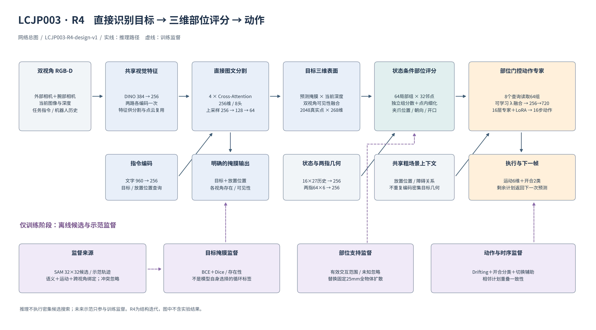

图 R4-1：实线为推理数据流，虚线为训练监督。输入为当前双视角 RGB-D、指令及因果机器人历史。图中尺寸是 R4 模块接口；不是新增实验结果。深度用于真实点云恢复，指令直接参与目标掩膜预测。SAM 32×32 仅用于离线生成监督候选，不进入必经推理链路。目标掩膜、放置位置及可见性分开输出。

### R4.2 部位评分如何真正进入动作

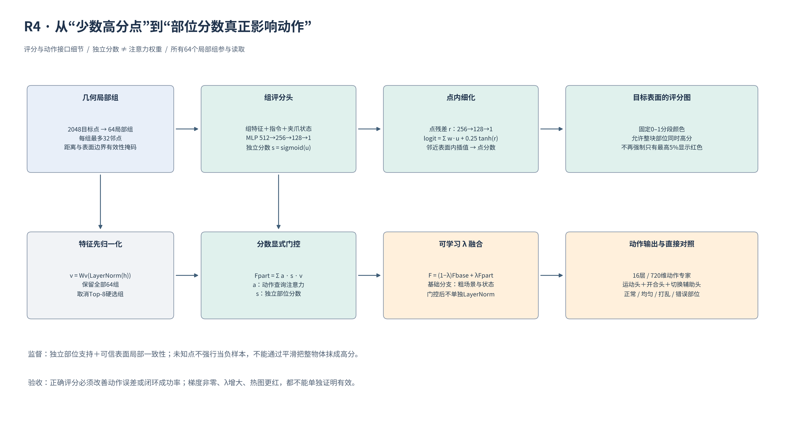

图 R4-2：每个局部组产生独立分数，点分数由部位分数与有界残差共同形成。64 个组均可参与动作读取，取消原 Top-8 硬选组。特征先归一化，再由分数门控；门控后的部位分支不再单独归一化。颜色不代表实测评分。

### R4.3 模块替换与张量接口

省略批维，V=2，N=2048，J=64，D=256；Hf/Wf 为视觉编码器实际输出网格，掩膜统一对齐原图 256×256。

| 模块 | R3 实现 | R4 修改 |
|---|---|---|
| 目标识别输入 | SAM 的 K 个候选物体 | 两路完整图像与任务指令 |
| 视觉/语言投影 | 候选点 DINO 特征；文本 960→256 | 共享 DINO 图像特征 384→256；文本 960→256，供掩膜解码与点特征复用 |
| 目标选择 | role 对 K+null 分类 | 目标/放置位置查询；4 层图文交叉注意力，D=256、8 头、FFN=512 |
| 直接分割 | 无可训练密集分割头 | 两级卷积上采样 256→128→64，1×1 输出两个掩膜 logit 通道，插值对齐原图；另设每视角目标存在/可见性头 |
| 点输入 | K×2048×396 | 目标点 2048×268：共享视觉投影 256 维＋保留的 12 维局部几何/RGB描述；Point MLP 268→128→256 |
| 几何局部组 | 64 FPS 组、每组32邻点 | 保留64组及32邻点上限，增加距离/表面边界有效性掩码；不跨独立表面传播 |
| 状态条件 | 历史16×27、两指64×6 | 保留历史投影27→256＋2层时序Transformer；两指6→128→256；局部组与状态、文本交叉注意力 |
| 部位评分 | 点logit归一化后竞争 | 组特征/状态条件拼接512→256→128→1，独立Sigmoid；点细化256→128→1，残差幅度由0.25·tanh限制 |
| 动作局部输入 | Top-8组＋归一化 | 64组全部可参与8个动作查询读取；分数显式门控归一化后的value，另传分数统计、部位坐标和范围 |
| 基础/部位融合 | 对齐查询后凸融合 | 保留可学习lambda凸融合；基础分支只保留粗场景与状态，避免密集目标几何旁路 |
| 动作专家 | 16层、720维、rank16 LoRA | 保留专家接口，prefix 256→720；历史计划16×7、噪声16×6；不把仅换前端说成权重可直接兼容 |
| 输出 | 运动720→256→256→6；开合720→128→2 | 保留运动与开合头；增加开合切换辅助头720→64→1 |

目标和放置位置掩膜分别为独立 logit，不要求两者覆盖整幅图，也不将所有未知像素强行判为背景。训练前期用可信监督点与预测区域的并集提供点云支持，同时保持预测掩膜权重；后期必须转为预测掩膜输入完成验收，防止训练/推理目标来源不一致。硬采样不被假称为天然可微：分割头依靠独立分割损失学习，动作到分割的梯度路线需实现时明确检查。

### R4.4 问题：解决方案

**问题1：模型只能在候选中选择，不能直接识别并分割目标。**

**解决方案：** 以直接图文分割头替换候选分类器。模型输入整张图像和指令，直接输出目标掩膜；跟踪仅是后续可选加速，不是识别前提。目标与放置位置使用不同查询，避免抓取对象和篮子混淆。与评分和动作联合训练，不另行要求预训练接触网络。

**问题2：分割头缺乏独立、可靠的目标监督。**

**解决方案：** 离线结合指令语义匹配、示范物体与夹爪运动对应、跨视角与时间身份一致性绑定候选。保留置信权重和忽略区域；当前模型自己的选择不能直接成为它的正确标签。SAM 候选不是接触或物体真值，冲突样本不强行监督。训练初期分割损失独立约束掩膜，阻断动作损失利用掩膜形状编码动作的捷径。人工可视核查用于独立验收，不进入接触监督。

**问题3：每个控制步进行32×32密集搜索，完整推理约3.3秒。**

**解决方案：** 在线采用共享图像编码＋轻量直接分割头，取消必经的全图密集候选生成。深度、点云、评分均使用当前观测；先删重复编码和未使用的候选计算，减少CPU/GPU往返与中间文件读取。可选时间记忆只帮助身份稳定和遮挡恢复，不能代替直接预测。20Hz逐步重规划的端到端预算约50ms；先报告完整链路P50/P95、首次启动和恢复延迟，不能用动作网络23ms代替系统速度。未达到预算不宣称实时；任何异步/动作分块执行协议必须单独登记，不能混用旧600步评测结论。

历史同图200视角对照：8×8平均4.295候选、0.202882秒/图；32×32平均8.54候选、2.200231秒/图。该结果是历史负载下的候选搜索对照，不证明目标识别准确率，也不是当前端到端速度。32×32的价值是提高离线候选覆盖，不是增加网络认识物体的能力。

**问题4：整块抓取部位不突出，只有零星红点。**

**解决方案：** 分为独立部位分数和有界点内细化：

    u_j = MLP(局部组特征, 任务, 夹爪相对状态)
    s_i = sigmoid(sum_j w_ij * u_j + 0.25 * tanh(r_i))

w_ij只在邻近可信表面插值，并归一化；不跨明显几何边界。整块局部表面可共同高分，不在所有点之间争夺固定总分。局部组不是预先命名的“头部/中部”，不能把局部几何监督冒称完整语义部位标注；部位范围是否符合抓取要实际验收。

当前R3网页先保留最高80%的点，再将其中最高5%涂红，因而红点预算约为全部有效点的4%，且投影遮挡可进一步减少。R4默认显示独立原始分数：0–.2蓝、.2–.4绿、.4–.6黄、.6–.8橙、.8–1红；未知独立灰色。排名显示仅作辅助切换，不每帧拉伸。默认可保留最高80%展示预算，但完整点分数全部保存。旧R3 Softmax数值不能直接套用R4的独立分数色段。

**问题5：固定25mm扩散与整物体运动让部位监督过宽。**

**解决方案：** 物体运动用于绑定操作对象，不用于给所有刚体随动点赋高分。部位支持来自示范夹爪相对轨迹、两指实际几何、有效持握和搬运阶段；按物体尺度及表面范围建支持，替换固定25mm全局扩散。抓空与后续成功尝试分开；未知和未观察到接触不是负例。失败少不会自动变成位置低分，必须在相近状态条件下区分有效与失败尝试。不引入固定抬升、闭合或连续五帧的人工接触门槛。

**问题6：评分差异小，动作也可能绕过评分。**

**解决方案：** 取消Top-8硬选组，64组都保留学习与读取机会。显式门控如下：

    v_j = Wv(LayerNorm(h_j))
    F_part = sum_j a_j * s_j * v_j
    F = (1-lambda) * F_base + lambda * F_part

a_j是动作查询的注意力权重；s_j是独立部位分数，两者分开。门控后的F_part不单独LayerNorm，避免幅度被消除；保留独立分数和覆盖程度作为显式输入。lambda由目标可靠性与当前状态学习，初期限制影响、随后放开；最终不能靠调大lambda证明有效。基础分支限为粗上下文，局部精细目标几何主要走部位分支。绝不人为拉开分数或刻意训练对照分支变差。

**问题7：夹爪开合错误、提前闭合或释放。**

**解决方案：** 独立开合分类头＋切换辅助头。分类标签、切换时刻直接来自已有示范动作序列；平衡开闭类别及切换附近样本，分别统计提前/延迟闭合与提前释放。切换头训练阶段参与辅助损失；推理仍由开合头输出，未验证前不增加手工否决规则。

**问题8：相邻动作跳变，重复采样改变计划。**

**解决方案：** 显式输入上一段剩余计划，约束相邻预测重叠的运动序列；对开合真实切换允许变化。复用/关联噪声的策略需单独锁定并评估，不能在现有结果中静默变更。连续性验收看动作跳变、开合抖动及执行成功，不只看平滑损失。

**问题9：双视角遮挡、机器人点污染及同类泛化。**

**解决方案：** 两视角共享目标身份，当前深度和标定建立对应；只在实际可见表面融合，一侧遮挡依靠可见侧，两侧都遮挡保留未知，不能在遮挡前景画历史点。保留机器人几何排除。点云用相对夹爪几何表达并保留真实尺度；外观、点云缺失、位姿增强与动作标签同步变换。后续用独立实例和摆放测试，当前Object同资产初始状态成功率不称同类新形状泛化。

### R4.5 损失与训练路线

联合目标包含：目标/放置位置掩膜损失（BCE＋Dice，按有效监督掩码加权）、目标存在性、跨视角身份一致性、部位支持与可信表面局部一致性、Drifting运动损失、平衡开合分类、切换辅助损失、重叠动作连续性损失。未来示范只参与训练监督，不进入推理输入。不得仅为了漂亮热图增加无依据的全局高低分分离损失。

保持现有10任务demo0–7训练、45–46开发作为首轮可比范围；demo40–44和LIBERO-PRO继续隔离。新建R4运行版本，不覆盖R3权重/配置。共享预训练编码器和动作专家作为初始化；新增分割、部位和门控模块联合学习。可继承哪些R3张量需按shape及语义逐项核对，不将部分继承说成完整续训。损失权重、预热/掩膜混合长度、精度、噪声协议在正式更新前登记并冻结。

### R4.6 验收顺序与通过依据

| 关口 | 实际检查 | 不能用来替代的证据 |
|---|---|---|
| 直接识别分割 | 独立核查帧上的目标正确性、可见区域覆盖、夹爪污染；有独立像素标注才报告IoU | 模型置信度、与自身伪标签一致 |
| 部位评分 | 原始分数范围/熵、支持范围、同物体不同夹爪关系的响应、失败尝试分布 | 百分位颜色好看、红点多 |
| 动作利用 | 同目标、同状态、同噪声的正常/均匀/打乱/错误部位配对误差，后续配对闭环收益 | 梯度非零、lambda变大、动作仅发生变化 |
| 开合与连续性 | 分阶段错误、切换时刻偏差、运动跳变、持握稳定性 | 总平均MAE或单一平滑损失 |
| 运行速度 | 双视角完整端到端P50/P95、启动、遮挡恢复；CPU/GPU阶段时间 | 只报动作网络23ms |
| 闭环 | 前述关口通过并获得继续授权后做小规模Object成功率 | 离线误差下降、对已停止试验宣称成功率 |
| 泛化 | 后续独立同类实例与摆放，不参与调参 | 同资产的初始状态变化 |

R3实测及暂停状态保持原记录；R4现已进入训练，尚无训练后验收结果或在线速度达标结论。识别/部位监督质量是实现前必须解决的依赖，不以新增网络层数替代验证。

参考设计依据：[CLIPSeg：文字条件密集分割](https://openaccess.thecvf.com/content/CVPR2022/html/Luddecke_Image_Segmentation_Using_Text_and_Image_Prompts_CVPR_2022_paper.html)；[SAM2：图像与视频分割](https://arxiv.org/abs/2408.00714)。本节模块组合、尺寸及验证路线为本项目R4设计。

登记时间：2026-10-28 20:44:55（北京时间）。

### R4.7 实现与训练启动登记

2026-10-28 20:56:10（北京时间）：用户授权修改模型并训练。建立 experiments/lcjp003/r4/joint/v001 独立运行。保持10任务×8训练/2开发示范、3000更新、有效批量8、G8、16帧历史/动作。官方冻结视觉/语言与动作专家初始化；不继承R3训练权重。新增整图分割、独立部位评分、归一化后分数门控及开合切换头。前250更新提供可信监督与预测区域并集；第251起仅预测掩膜进入动作。学习率1e-4、FP32/TF32关闭。损失权重与实现接口记录config.json，正式启动前锁定源和输入。完整测试暂停状态保持，不自动闭环。

2026-10-28 21:08:22：R4工程验证中首次恢复重放未逐位一致，正式训练未开始。保留失败记录，先量化差异并检查CUDA归约/采样确定性；不放宽恢复断言。

2026-10-28 21:12:29：R4真实训练/开发输入前向反向通过，可训练参数12,496,848。启用PyTorch确定性算法、固定cuBLAS工作区并关闭cuDNN benchmark后，同输入重复预测最大差0、恢复并重做AdamW更新最大参数差0；首次失败记录保留。零/一分数干预动作平均变化0.00070294，仅证明分数路径连通，不证明有效收益。分割/评分/运动/开合/切换头梯度均有限非零，机器人点检查为0。输入按完整训练manifest固定采样；离线缓存后台生成，训练按该固定采样等待缺失输入，不偏向先完成缓存的样本。

2026-10-28 21:19:13：坐标差异根因为新反投影遗漏既有P0登记的MuJoCo MSAA深度采样偏移(0.375,0.875)像素；旧缓存点重投影偏移恒定且深度误差约1e-7m，排除坐标轴翻转。R4反投影补回该偏移，投影采样相应减去偏移；属于沿用原标定协议，不拟合目标或放宽1e-4m断言。缓存无需重算，正式更新仍为0。

2026-10-28 21:20:33：修正采样偏移后，80固定窗口、10任务RGB-D反投影与缓存点最大差8.20e-8m，保持1e-4m通过标准；网络/梯度/确定性恢复复验通过。弱监督目标80窗口都有可见像素，但置信度最低7.12e-6、平均0.334，低置信样本按权重处理；不把弱监督一致性当目标识别准确率。开合类别统计只用80训练示范：负5592/正6384，切换180/11896，类别/切换权重已入config。

2026-10-28 21:20:33：R4输入与梯度/恢复检查通过，锁定config、source、采样日程及监督协议，启动正式训练进程。先保存step0000并完成80固定窗口预测掩膜基线，随后3000次联合更新；第20/50次保留进度并测时，每250次评估。未启动闭环。正式启动PID 398081。

2026-10-28 21:24:02：初始化评估发现开发集仅缓存4个固定窗口/示范，其前一帧并不一定有冻结观测。修正评估加载器：80个固定窗口作为独立起始窗口，不虚构上一计划，均使用零计划；训练仍在可用相邻观测上使用本模型生成的上一计划，无相邻观测时按计划重置处理并计数，绝不拿未来/专家计划替代。正式更新0，保留第一次step0000及失败记录；重新验证后同seed启动，不损失训练进度。

2026-10-28 21:24:54：R4输入与梯度/恢复检查通过，锁定config、source、采样日程及监督协议，启动正式训练进程。先保存step0000并完成80固定窗口预测掩膜基线，随后3000次联合更新；第20/50次保留进度并测时，每250次评估。未启动闭环。正式启动PID 403593。

2026-10-28 21:27:47：正式前10次测时显示前向约0.26–0.34秒、反向约0.44–0.47秒/更新，等待相邻帧缓存约1.8–4.5秒。增加独立4进程相邻帧预取，沿用锁定prepare_one、每帧文件锁与固定采样日程；训练源、参数、损失、已完成更新均不修改。总32CPU，预取进程每进程BLAS2线程。

2026-10-28 21:30:00：R4已实际完成74/3000次更新；step0020、step0050独立检查点已保存，前50次进度保留。第50次实测最近20次平均3.842秒/更新，含取数等待；250次评估预计2026-10-28 21:41:32，3000次完成预计2026-10-29 00:38:57。ETA随缓存与共享负载变化，包含周期离线评估估计、不含闭环；未据此宣称在线推理速度。旧闭环仍暂停。

2026-10-28 21:34:07：效率核查：GPU仅R4训练PID403593约2624MiB，无其他GPU训练占用，不执行抢占。32CPU、负载约9.6；近期每更新3.286秒，其中取数等待2.507秒(76.3%)。将独立相邻帧预取由4进程提高到12进程，同一prepare_one、线程环境、每帧锁和固定采样顺序不变。仅接替本方已核实预取进程，训练PID与全部状态保持运行；记录优化前后正式时间，不把低GPU瞬时利用率解释为显存不足。

2026-10-28 21:38:46：相邻帧预取12进程已运行，训练PID403593未中断。相同训练阶段对比：更新136–155平均2.4838秒/次，更新231–250平均1.1855秒/次，实测约2.095倍；取数等待1.6613→0.000717秒。缓存逐步变热也参与收益，不把不同批次测时称严格硬件基准。训练/开发各1帧全输入及标签重算与缓存逐数组最大差0，source_lock所有文件hash未变。GPU无其他计算进程，无需抢占。第250次评估已完成，继续原3000更新计划；后续记录见engineering/prefetch_v2_result.json。

### 2026-10-28 22:38:08 R4 50次Object闭环评测登记
用户授权R4最终3000步权重测试50次：10任务各官方初始状态0–4，环境check_success为成功依据，最多600控制步，5步零动作稳定；每步执行预测首动作，上一预测序列移位进入下一步。禁止专家未来动作和留出示范读取。新在线入口仅DINO图像特征、任务文本、实时RGB-D和机器人历史，R4直接分割目标，无SAM密集搜索。先输入/动作一致性与短闭环工程验证，通过后运行50次并保留失败，页面按结果选取成功/失败视频。旧R3执行器保持停止，不扩展到500次。

2026-10-28T22:39:31.477213+08:00 闭环适配修复：旧渲染模块顶层重复set_num_interop_threads，已由R4 runtime.setup初始化，提取渲染类时跳过该顶层配置。保留原文件与失败记录，不改策略计算。

2026-10-28T22:41:30.885694+08:00 输入检查发现：RGB/深度/相机/机器人历史/文字完全一致；夹指差异来自提取漏掉原几何函数末尾世界至夹爪坐标旋转，补齐两条变换。DINO特征差异另行核对冻结特征精度/注意力后端；不放宽一致性标准。

2026-10-28T22:47:04.111377+08:00 冻结DINO一致性根因验证：原观测使用deterministic_algorithms=False、cuDNN deterministic=False/TF32=True、matmul TF32=False。恢复该作用域后与训练缓存最大差0；确定性卷积路径最大差0.091796875。仅冻结特征作用域恢复原配置，随后全部恢复R4策略确定性FP32设置，不改变权重/阈值。

2026-10-28T22:50:10.313415+08:00 R4闭环入口验证通过：12项输入逐元素最大差0，5配对同噪声动作完全一致，20次真实预测执行观测循环通过，约0.05秒/步（尚不含完整视频与评分落盘）。开始50次正式Object测试；训练20项源hash保持一致。

2026-10-28T22:51:49.307228+08:00 视频启动修复：服务器无系统ffmpeg命令，使用既有imageio_ffmpeg内置可执行文件；全帧解码计数改为同一ffmpeg的progress输出。首试验尚未执行任何策略动作，初始化目录归档保留后重启。输入门控与模型不变。

2026-10-28T22:57:06.495163+08:00 首批正式闭环页面已生成，浏览器实播首条30秒视频到结尾，无解码错误，双视角及中文任务名/相对排名图例可见；首批4次均失败（同一字母汤任务），不得外推全部50次。页面随每个完整试验更新；测试继续。

### 2026-10-28T23:03:04.917687+08:00 用户停止R4 Object50闭环测试
已写STOP标记，保留10个完整试验（0成功）和第11个部分轨迹。此次停止优先于所有旧监控指令，禁止自动接续或重启。转为只读分析目标掩膜、评分引导与抓空补救。

### 2026-10-28T23:09:58.905390+08:00 R4停止后原因审计
1. 当前目标只是全图概率>0.5像素集合，无唯一实例与跨帧身份锁。第1试验首帧原目标掩膜4292/7405像素，其中3733/6575落在机器人排除区域；评分输入已排除已知机器人掩膜（抽查20帧有效点重叠0），但剩余错误岛仍可打分。网页白轮廓画的是排除前原预测，不能视为锁定结果。
2. mask_weight为0的区域不计损失/开发IoU，91%弱教师IoU非全图识别准确率。
3. 配置selected_parts=8，但实际8个learned query对64组attention混合；网页point_score含局部残差，动作主要使用group_score。全图coarse基础分支及history/finger/text/previous_plan均可绕过评分，开发lambda均值0.03903。
4. 评分标签对当前/未来夹指轨迹支持取最大，不统计尝试成功频率；动作监督无抓空质量区分。16帧历史不含显式物体运动结果，switch头输出未被闭环使用。训练前一计划从前一专家观测零计划起点单次预测，闭环长期递归自己计划，存在分布不一致。
5. 只读回放前三条已存轨迹前101步，原动作重现最大差2.98e-8；12固定观测同噪声同原前一计划干预：均匀/打乱评分运动平均变化约0.000442/0.000446，夹爪首步与全预测序列无类别翻转；反转评分平均运动变化0.006417，最大0.020917，也无开合类别翻转。该结果不支持评分是前三条空抓的直接主要原因，但不是完整反事实闭环，不能排除累积作用。没有证据证明复刻某条抓空示范。
6. 未修改权重、损失或启动新仿真试验；STOP保留，禁止自动接续。

### 2026-10-29T00:00:28.784413+08:00 R5 网络实现与训练准备登记

用户授权按R5设计实现并在验证通过后启动训练。新run为experiments/lcjp003/r5/joint/v001；继承R4的80段训练/20段开发划分、训练归一化与固定评估窗口，冻结观测只读复用。R5部位监督必须重新构造，旧future-max标签不得进入R5正式更新；旧run停止状态保留。先验证网络接口、目标预测历史、评分梯度与恢复一致性，再锁定源码启动3000次训练。

### 2026-10-29 00:06:52 R5模块实现与检查结果

已实现InstanceFront、R5Parts、确定性硬Top-8及可微软排序梯度、可学习逐槽融合、同源表面评分、无previous-plan的动作接口和响应监督汇总函数；13项模块级检查通过。源码位于experiments/lcjp003/r5/joint/v001/src。检查使用受控输入，不代表真实RGB-D全链路或完整训练验收。尚需真实几何接线、新响应监督物化、模型预测目标历史、完整联合损失、官方动作专家前后向与精确恢复检查；当前正式更新0，未启动训练进程。禁止复用R4旧future-max标签冒充R5监督。

### 2026-10-29 00:45:30 R5 实现接续与训练、无视频评估授权

用户再次要求立即完成训练接入，训练完成后统计50次 LIBERO-Object 闭环成功率，不生成视频。当前仅13项模块检查通过、正式更新0；禁止把模块检查当成训练启动。接续工作包括独立运动响应均值监督、当前预测目标的点云/多尺度部位与因果历史、官方动作专家联合损失、恢复与完整梯度验证。旧R4失败权重不用于初始化，旧闭环STOP保留。新测试采用10任务各5个官方初始状态，不读取留出示范40–44或LIBERO-PRO。

### 2026-10-29 00:52:26 R5 缓存覆盖根因与修复

原R4缓存仅保存既定训练/开发窗口，非原始视频所有帧：100段均有未缓存帧，共4892帧（含末尾不足预测长度的帧及未抽取帧）。准备器误把整段长度当成缓存窗口长度。修复为保留原窗口集合，独立运动响应从原RGB-D机器人几何和原示范动作读取完整时间序列；历史图像缺失必须显式标记未知，不能用未来帧填充。完整机器人历史仍来自原输入。原始示范只读，新标签单独写入R5。

### 2026-10-29 00:56:31 R5 完整集成导入冲突修复

首次完整集成失败类型ImportError，io_runtime.py:28。根因是继承的官方专家装载器修改Python搜索路径并加载旧同名model模块；R5采用唯一模块名并在装载后恢复原搜索路径，避免错误导入旧网络。正式更新仍为0。

### 2026-10-29 00:58:54 R5 初始化空目标与工程检查分离

实际初始化第13帧选择null（索引16），有效点/部位均0，因此评分动作梯度0是空目标保护的结果。实际训练保留当前预测目标，不用教师目标强行喂给动作。完整检查分为实际输入的目标/动作损失反向，以及仅用于工程测试的已知非空目标几何下评分→动作梯度检查；工程测试权重不进入正式初始化。新监督准备纯CPU，32核主机当前负载约5.6、可用内存约146GB，工作进程由2增至8，已有逐帧原子缓存保留。

### 2026-10-29 01:00:38 R5 恢复与输入调度修复

非空目标下评分→动作、所有模块有限非零梯度检查已通过；恢复检查发现torch.load映射到GPU后CUDA RNG字节状态也被搬到GPU，set_rng_state要求CPU ByteTensor。修复为仅RNG状态显式转CPU后恢复。输入准备采用同一固定3000更新采样表，优先准备前50次更新及80固定评估窗口，共470个不同窗口；正式训练严格按原固定顺序等所需缓存就绪，不按先完成数据改采样。

### 2026-10-29 01:11:03 R5 正式训练启动登记

3000次更新、有效批量8、G=8，官方动作专家初始化与新R5模块；独立运动响应均值标签，当前学生预测目标，无旧训练权重。前20/50次实测耗时保留进度，每250次固定80窗口评估，训练后10个Object任务各5个官方初始状态共50次闭环，仅统计成功率、不生成视频。训练与测试分别文件锁/源哈希检查，旧R4测试STOP不变。正式启动由pipeline在完整集成与470个优先窗口通过后执行，不能将等待状态称为已更新。

### 2026-10-29 01:11:31 R5 无视频执行器路径修复

在线适配器工程检查报FileNotFoundError，adapter.py:92，原因是适配器迁移运行目录时，把用于提取原输入转换函数的R4源路径也改成了R5。修复为明确只读原输入函数源；R5训练入口与网络不变。测试构建锁将在适配器验证通过后重锁。

### 2026-10-29 01:13:15 R5 已进入正式更新，在线适配器已通过

实时状态：完成18/3000次更新，训练PID 725612。初始80窗口评估完成。非空工程路径评分对动作梯度L1=0.22813；正式第5次更新评分参数梯度L1=5.6453，但第6次因空目标为0，不能把已接通梯度当成已学会评分。在线适配器11项初始输入最大差异均0，因果历史缓存前缀/动作差异0，1次真实预测→环境步进→新观测通过；该检查不是正式成功率测试。已部署等待3000更新后的Object50，无视频。

### 2026-10-29 01:15:25 R5 历史输入缓存依赖修复登记

正式训练已进行35次更新。检查发现previous_encoding以历史帧teacher文件是否已生成作为可用条件，但时序比较实际只需历史观测和机器人输入，会使少量早期更新的时序项依赖预处理完成顺序。按完整更新边界保存全部状态后修复为仅依赖固定的原历史观测缓存，不改网络、损失权重或采样，不重置/丢弃已训练更新。早期受影响的时序项不追溯伪称完全一致，源锁登记继承；最终结果需注明这一工程修复。

### 2026-10-29 01:18:40 R5 已保存第50次正式更新

历史输入依赖修复后从46次完整状态接续，日志更新编号连续，独立step0050检查点已存在。当前完成50/3000，最近20次更新中位耗时4.762秒；前20次ETA约3.9小时，不含闭环且会随共享GPU负载变化。50次Object无视频测试等待执行器就绪。

### 2026-10-29 01:21:02 R5 固定采样顺序的输入优先填充

50次后等待尚未生成的下一批独立标签。增加2个纯CPU工作进程，调用同一已锁定prepare.episode函数，按训练采样表优先生成缺失窗口；临时目录独立，完成后以硬链接原子发布，不覆盖已有缓存。原8进程全量准备继续。网络、标签公式、采样顺序及已保存进度均不变。

### 2026-10-29 08:58:46 R5 状态核查：第74次非有限损失中断

训练于北京时间2026-10-29 01:24:02报FloatingPointError/nonfinite_objective，已执行73次更新，最近完整保存为70次；250次评估与50次闭环均未开始，不能称成功率0%。状态文件遗留training已纠正为failed_nonfinite_objective。100段、10174个窗口准备已完成。第74次8个输入标签张量均有限，正从70次完整状态独立重放71–74定位具体损失项；诊断不写正式权重。之前基于健康运行的ETA失效。

### 2026-10-29 09:02:49 非有限损失重放与诊断性接续

从70次完整检查点重放71–74：71、72、73各项损失与原日志差异均0，74全部8个微批量均有限，未复现01:24异常，根因仍未确认。原始故障证据保留，不用nan_to_num或跳过异常样本。正式接续增加异常时逐项损失与输入有限性记录，网络/损失/数据划分不变。从70次恢复完整optimizer/RNG；原71–73日志另存，重放后正式日志连续。

### 2026-10-29 09:14:57 R5 第74次故障根因与零协方差修复

正式路径隔离复现：历史几何摘要索引9/10/11（3个协方差特征值）非有限。该帧只有1个有效点，坐标有限，3×3协方差严格全0；GPU重复eigvalsh返回3个NaN，而CPU float64返回3个0。对单点或严格零协方差显式返回数学上正确的零特征值，普通非零协方差保持原GPU计算。历史摘要与局部部位均采用该处理，不修改网络维度、损失、标签或精度设置，不用nan_to_num屏蔽其他异常。修复后必须复现原74次完整路径并检查单点/重复点/普通点云，再从70次完整状态接续。

### 2026-10-29 09:18:23 零协方差修复验证通过并接续

空点、单点、重复点及2/3/16/32/2048普通点云均通过；普通非零协方差计算与原路径最大差异0。完整网络梯度/恢复检查通过；隔离正式异步输入与梯度累积路径从70重放至74全部有限，原故障批次通过。诊断没有写入正式权重。正式训练从70恢复完整状态，失败处理同步写failed状态，避免仍显示training。训练后仍为50次Object无视频成功率测试。

### 2026-10-29 09:48:37 R5 第250次更新

固定80窗口评估：{"train": {"motion_mae": 0.5526909790933132, "translation_raw_mae": 0.18677699975669385, "rotation_raw_mae": 0.023252636811230333, "grip_error": 0.0916015625, "target_null": 0.0, "valid_points": 1922.275, "score_mean": 0.1005979135632515, "score_std": 0.0004306767546950141, "score_min": 0.09992751944810152, "score_max": 0.10156133165583014, "lambda_mean": 0.5373198695480823, "windows": 40, "interventions": {"uniform": {"motion_delta": 0.00015502317319260328, "motion_mae": 0.5526912540197373, "grip_flip_rate": 0.0, "grip_error": 0.0916015625}, "reverse": {"motion_delta": 0.0408654558006674, "motion_mae": 0.5550126031041145, "grip_flip_rate": 0.0083984375, "grip_error": 0.1}, "shuffle": {"motion_delta": 7.606324178368595e-05, "motion_mae": 0.5526949748396873, "grip_flip_rate": 0.0, "grip_error": 0.0916015625}}}, "dev": {"motion_mae": 0.5065814457833767, "translation_raw_mae": 0.15668690148741007, "rotation_raw_mae": 0.022676733566913753, "grip_error": 0.038671875, "target_null": 0.0, "valid_points": 1917.675, "score_mean": 0.09303039088845252, "score_std": 0.00037512611625061253, "score_min": 0.092387021984905, "score_max": 0.09393192427232862, "lambda_mean": 0.5375923469662667, "windows": 40, "interventions": {"uniform": {"motion_delta": 0.0001213289578572585, "motion_mae": 0.5065897699445486, "grip_flip_rate": 0.0, "grip_error": 0.038671875}, "reverse": {"motion_delta": 0.0307454256224446, "motion_mae": 0.5039719805121422, "grip_flip_rate": 0.02421875, "grip_error": 0.05546875}, "shuffle": {"motion_delta": 5.945512830578537e-05, "motion_mae": 0.5065880846232176, "grip_flip_rate": 0.0, "grip_error": 0.038671875}}}}。以上为离线误差，闭环成功率待独立测试。

### 2026-10-29 09:59:49 R5 第250次评估解读与进度

当前完成351/3000。固定40训练/40开发窗口：动作MAE 0.552691/0.506581，较初始化下降26.47%/31.89%；夹爪开合错误率9.16%/3.87%。不选择目标比例均0仅代表不再输出null，不证明选对物体。开发部位分数均值0.09303、物体内标准差均值0.000375；统一或打乱评分后动作变化仅0.000121/0.0000595，尚无有效空间部位评分引导证据。反转评分改变总体强度，不能据此证明排序有效。闭环尚未开始，无成功率结果。最近30更新含保存平均耗时6.218秒，当前训练完成估计北京时间2026-10-29 14:39，不含闭环、受共享GPU负载影响。

### 2026-10-29 10:16:51 R5 训练工程提速验证登记
用户授权消除相邻窗口重复历史编码并测试批量编码。网络、损失、有效批量、FP32精度、数据划分不变；现有正式训练继续。候选实现独立置于 engineering/history_throughput；只在同一微批且权重不变时复用冻结梯度的历史摘要，更新后清空。比较相同检查点、输入、噪声的历史摘要、离散几何、动作、损失、梯度和一次AdamW更新；批量4/8/16交错实测，未通过者不部署。通过后保存完整检查点接续，不丢弃更新。

### 2026-10-29 10:16:54 R5 第500次更新

固定80窗口评估：{"train": {"motion_mae": 0.47962315008044243, "translation_raw_mae": 0.13353578131645918, "rotation_raw_mae": 0.022588883759453893, "grip_error": 0.087109375, "target_null": 0.0, "valid_points": 1839.95, "score_mean": 0.10231423623627052, "score_std": 0.0023940517895425727, "score_min": 0.09830443020910025, "score_max": 0.10652253046864643, "lambda_mean": 0.5284941017627716, "windows": 40, "interventions": {"uniform": {"motion_delta": 0.0005836362438458309, "motion_mae": 0.47949414923787115, "grip_flip_rate": 0.0001953125, "grip_error": 0.0869140625}, "reverse": {"motion_delta": 0.06112261614762247, "motion_mae": 0.4949377503246069, "grip_flip_rate": 0.0251953125, "grip_error": 0.0849609375}, "shuffle": {"motion_delta": 8.045365119571101e-05, "motion_mae": 0.47960969880223275, "grip_flip_rate": 0.0, "grip_error": 0.087109375}}}, "dev": {"motion_mae": 0.45959505811333656, "translation_raw_mae": 0.1302524301223457, "rotation_raw_mae": 0.02191911395639181, "grip_error": 0.0703125, "target_null": 0.0, "valid_points": 1856.275, "score_mean": 0.10537810164969415, "score_std": 0.0025682819549274426, "score_min": 0.10122110972879454, "score_max": 0.11012489716522396, "lambda_mean": 0.5291015662252903, "windows": 40, "interventions": {"uniform": {"motion_delta": 0.0003852461141832464, "motion_mae": 0.45961520858108995, "grip_flip_rate": 0.0001953125, "grip_error": 0.0705078125}, "reverse": {"motion_delta": 0.06207771115005016, "motion_mae": 0.473477179184556, "grip_flip_rate": 0.04453125, "grip_error": 0.046484375}, "shuffle": {"motion_delta": 8.867534039183055e-05, "motion_mae": 0.45959449335932734, "grip_flip_rate": 0.0, "grip_error": 0.0703125}}}}。以上为离线误差，闭环成功率待独立测试。

### 2026-10-29 10:26:56 R5 工程优化接续
两组各8窗口、固定第500次检查点的一致性核对：输入几何/历史摘要/动作/损失/梯度/一次AdamW后模型与优化器最大差异均为0；第二组Torch及CUDA随机状态相同。独立测试优化器状态曾因CPU步数张量共享导致比较器污染，已隔离副本重跑，原证据保留，正式训练未受影响。交错三次中位耗时：{"0": 6.292653832118958, "8": 5.343509569298476, "16": 5.4769101643469185}秒；选择历史批量8，网络、损失、有效批量8及FP32精度不变。现在请求正式训练在更新边界保存全状态再从该步接续。

### 2026-10-29 10:29:23 R5 历史编码优化正式接续结果
第637次更新完整保存模型/优化器/全部RNG后接续，首个新增更新为638；到683更新全部连续，优化后检查点680及优化器累计步数吻合。训练源锁及全部锁定文件hash、config均未变化；工程执行器独立锁定 engineering/history_throughput/deployment_lock.json，入口 resume_optimized.py。
历史摘要仅在同一微批内复用，参数更新后不跨步缓存；历史批量4→8，有效批量仍8，网络/损失/精度不变。交错3次中位耗时6.292654→5.343510秒，吞吐提升17.76%，单次耗时减少15.08%；16帧批量5.476910秒，未采用。两组16个窗口的损失、梯度、目标几何、历史摘要、动作、AdamW后参数及优化器最大差异为0，第二组Torch/CUDA RNG状态也相同。
正式接续46次更新平均2.6624秒/次；期间其他GPU作业已变化且独立基准程序已退出，不能把该整体变化全部归因于工程优化。训练后50次Object闭环无视频等待执行器正常保留。

### 2026-10-29 10:30:47 R5 第500次固定窗口评估与工程接续后ETA
固定80窗口同噪声：训练动作MAE 0.552691→0.479623（较初始化下降36.19%），开发0.506581→0.459595（较初始化下降38.20%）。训练夹爪错误率9.16%→8.71%，开发3.87%→7.03%，开发开合退步需继续跟踪。开发部位分数std 0.000375→0.002568，但均匀化/打乱动作变化仅0.000385/0.0000887；原开发MAE0.459595，均匀0.459615，打乱0.459594，尚无部位评分有效改善动作的证据。反转分数MAE0.473477同时改变绝对评分强度，不能独立证明空间排序有效。
10:30进度701/3000，最近50次含保存墙钟约2.73秒/次，含余下阶段评估估计12:20左右完成训练（北京时间），不含闭环测试；共享GPU负载变化会影响ETA。750次评估预计10:33左右。

### 2026-10-29 10:33:07 R5 第750次更新

固定80窗口评估：{"train": {"motion_mae": 0.44939997158944606, "translation_raw_mae": 0.1259220216423273, "rotation_raw_mae": 0.02119697958114557, "grip_error": 0.0658203125, "target_null": 0.0, "valid_points": 1761.575, "score_mean": 0.15443490961333736, "score_std": 0.03403800191772462, "score_min": 0.10874243588768877, "score_max": 0.2059033940313384, "lambda_mean": 0.5001434467732906, "windows": 40, "interventions": {"uniform": {"motion_delta": 0.004093905270565301, "motion_mae": 0.44938659146428106, "grip_flip_rate": 0.0001953125, "grip_error": 0.066015625}, "reverse": {"motion_delta": 0.06476031997590326, "motion_mae": 0.4565771993249655, "grip_flip_rate": 0.0041015625, "grip_error": 0.067578125}, "shuffle": {"motion_delta": 0.00119257455406796, "motion_mae": 0.44964528977870943, "grip_flip_rate": 0.0001953125, "grip_error": 0.065625}}}, "dev": {"motion_mae": 0.43847586438059805, "translation_raw_mae": 0.1095833226107061, "rotation_raw_mae": 0.022037378209643067, "grip_error": 0.0453125, "target_null": 0.0, "valid_points": 1759.55, "score_mean": 0.16328540086979046, "score_std": 0.04907633234342938, "score_min": 0.0882998108281754, "score_max": 0.21925635887309908, "lambda_mean": 0.4965297855436802, "windows": 40, "interventions": {"uniform": {"motion_delta": 0.0025034641081219887, "motion_mae": 0.43840731456875803, "grip_flip_rate": 0.0, "grip_error": 0.0453125}, "reverse": {"motion_delta": 0.05166435861028731, "motion_mae": 0.4549932096153498, "grip_flip_rate": 0.0, "grip_error": 0.0453125}, "shuffle": {"motion_delta": 0.001250336451450096, "motion_mae": 0.43841755874454974, "grip_flip_rate": 0.0, "grip_error": 0.0453125}}}}。以上为离线误差，闭环成功率待独立测试。

### 2026-10-29 10:46:06 R5 第1000次更新

固定80窗口评估：{"train": {"motion_mae": 0.4335829868912697, "translation_raw_mae": 0.12049601916223765, "rotation_raw_mae": 0.02041911402484402, "grip_error": 0.0693359375, "target_null": 0.0, "valid_points": 1522.275, "score_mean": 0.17895661207439845, "score_std": 0.07148987654990151, "score_min": 0.09154163128077926, "score_max": 0.26501015683716106, "lambda_mean": 0.4819482773542404, "windows": 40, "interventions": {"uniform": {"motion_delta": 0.009093705661871353, "motion_mae": 0.4352924045175314, "grip_flip_rate": 0.00078125, "grip_error": 0.0685546875}, "reverse": {"motion_delta": 0.06803775685839356, "motion_mae": 0.4560674823820591, "grip_flip_rate": 0.003515625, "grip_error": 0.0708984375}, "shuffle": {"motion_delta": 0.005552842480576104, "motion_mae": 0.4351783972233534, "grip_flip_rate": 0.0009765625, "grip_error": 0.068359375}}}, "dev": {"motion_mae": 0.437573435716331, "translation_raw_mae": 0.10679072374477983, "rotation_raw_mae": 0.022370915557257832, "grip_error": 0.0513671875, "target_null": 0.0, "valid_points": 1534.75, "score_mean": 0.18059369346738094, "score_std": 0.06610098667661077, "score_min": 0.08075348907004809, "score_max": 0.2541015646103915, "lambda_mean": 0.46158599108457565, "windows": 40, "interventions": {"uniform": {"motion_delta": 0.004940856557368534, "motion_mae": 0.43720954526215794, "grip_flip_rate": 0.000390625, "grip_error": 0.0517578125}, "reverse": {"motion_delta": 0.06039883538614958, "motion_mae": 0.45689967814832927, "grip_flip_rate": 0.0060546875, "grip_error": 0.054296875}, "shuffle": {"motion_delta": 0.003115307218775243, "motion_mae": 0.43712143078446386, "grip_flip_rate": 0.0001953125, "grip_error": 0.051171875}}}}。以上为离线误差，闭环成功率待独立测试。

### 2026-10-29 10:59:13 R5 第1250次更新

固定80窗口评估：{"train": {"motion_mae": 0.4093226607888937, "translation_raw_mae": 0.10886393571272493, "rotation_raw_mae": 0.019491462188307197, "grip_error": 0.066796875, "target_null": 0.0, "valid_points": 1753.475, "score_mean": 0.2377670195972314, "score_std": 0.05011524996389198, "score_min": 0.16714058440411464, "score_max": 0.3179704789246898, "lambda_mean": 0.461108535528183, "windows": 40, "interventions": {"uniform": {"motion_delta": 0.008464644972991663, "motion_mae": 0.41045304760336876, "grip_flip_rate": 0.00078125, "grip_error": 0.066015625}, "reverse": {"motion_delta": 0.05465752633172087, "motion_mae": 0.42296760305762293, "grip_flip_rate": 0.0029296875, "grip_error": 0.0642578125}, "shuffle": {"motion_delta": 0.007650789950903914, "motion_mae": 0.4113135294988751, "grip_flip_rate": 0.000390625, "grip_error": 0.06640625}}}, "dev": {"motion_mae": 0.43223738186061383, "translation_raw_mae": 0.10093847624957561, "rotation_raw_mae": 0.022319433419033884, "grip_error": 0.05078125, "target_null": 0.0, "valid_points": 1843.0, "score_mean": 0.22356352493807208, "score_std": 0.06093237575878448, "score_min": 0.13246436039626133, "score_max": 0.3059953545278404, "lambda_mean": 0.44788300395011904, "windows": 40, "interventions": {"uniform": {"motion_delta": 0.006859615661232965, "motion_mae": 0.4323412742465734, "grip_flip_rate": 0.0001953125, "grip_error": 0.0509765625}, "reverse": {"motion_delta": 0.05278920046985149, "motion_mae": 0.441774632781744, "grip_flip_rate": 0.01015625, "grip_error": 0.056640625}, "shuffle": {"motion_delta": 0.004291393650630937, "motion_mae": 0.432307668402791, "grip_flip_rate": 0.0, "grip_error": 0.05078125}}}}。以上为离线误差，闭环成功率待独立测试。

### 2026-10-29 11:11:49 R5 第1500次更新

固定80窗口评估：{"train": {"motion_mae": 0.4260625783354044, "translation_raw_mae": 0.12045517442747951, "rotation_raw_mae": 0.01963255195878446, "grip_error": 0.0638671875, "target_null": 0.0, "valid_points": 1656.95, "score_mean": 0.23679103270551422, "score_std": 0.06761327977296787, "score_min": 0.14320999016345012, "score_max": 0.32587082032841863, "lambda_mean": 0.45662414506077764, "windows": 40, "interventions": {"uniform": {"motion_delta": 0.008393530710236519, "motion_mae": 0.42585678249597547, "grip_flip_rate": 0.00078125, "grip_error": 0.0638671875}, "reverse": {"motion_delta": 0.053846123488619925, "motion_mae": 0.4375121533870697, "grip_flip_rate": 0.0037109375, "grip_error": 0.062890625}, "shuffle": {"motion_delta": 0.005980959919999762, "motion_mae": 0.42674158960580827, "grip_flip_rate": 0.0005859375, "grip_error": 0.0640625}}}, "dev": {"motion_mae": 0.4303159065544605, "translation_raw_mae": 0.10365051301196218, "rotation_raw_mae": 0.022101044224109502, "grip_error": 0.03984375, "target_null": 0.0, "valid_points": 1626.1, "score_mean": 0.190882448406046, "score_std": 0.0754566747697936, "score_min": 0.09267115813781857, "score_max": 0.29539694456398136, "lambda_mean": 0.4452566385269165, "windows": 40, "interventions": {"uniform": {"motion_delta": 0.006573280504380818, "motion_mae": 0.43025937750935556, "grip_flip_rate": 0.000390625, "grip_error": 0.03984375}, "reverse": {"motion_delta": 0.05186663607601076, "motion_mae": 0.43961263466626405, "grip_flip_rate": 0.01328125, "grip_error": 0.044140625}, "shuffle": {"motion_delta": 0.004619365669674025, "motion_mae": 0.4292795753106475, "grip_flip_rate": 0.000390625, "grip_error": 0.040234375}}}}。以上为离线误差，闭环成功率待独立测试。

### 2026-10-29 11:27:17 R5 第1750次更新

固定80窗口评估：{"train": {"motion_mae": 0.40389978922903536, "translation_raw_mae": 0.115785376355052, "rotation_raw_mae": 0.018734137481078505, "grip_error": 0.05390625, "target_null": 0.0, "valid_points": 1808.4, "score_mean": 0.18194938570704836, "score_std": 0.06675317304795954, "score_min": 0.0788244962808676, "score_max": 0.285578404851185, "lambda_mean": 0.43183688521385194, "windows": 40, "interventions": {"uniform": {"motion_delta": 0.009528786036935345, "motion_mae": 0.40426484793424605, "grip_flip_rate": 0.001171875, "grip_error": 0.054296875}, "reverse": {"motion_delta": 0.08283431567251683, "motion_mae": 0.39971938282251357, "grip_flip_rate": 0.0072265625, "grip_error": 0.0544921875}, "shuffle": {"motion_delta": 0.003738069938970234, "motion_mae": 0.40414748042821885, "grip_flip_rate": 0.000390625, "grip_error": 0.05390625}}}, "dev": {"motion_mae": 0.4173441555351019, "translation_raw_mae": 0.09715355010703206, "rotation_raw_mae": 0.021775147446896882, "grip_error": 0.0349609375, "target_null": 0.0, "valid_points": 1814.725, "score_mean": 0.16589222902366602, "score_std": 0.07852143550201163, "score_min": 0.058263666667699, "score_max": 0.2820663004251401, "lambda_mean": 0.4192548990249634, "windows": 40, "interventions": {"uniform": {"motion_delta": 0.006685400472997571, "motion_mae": 0.4176845621317625, "grip_flip_rate": 0.0005859375, "grip_error": 0.035546875}, "reverse": {"motion_delta": 0.059580969531089066, "motion_mae": 0.42745133079588415, "grip_flip_rate": 0.0107421875, "grip_error": 0.030078125}, "shuffle": {"motion_delta": 0.003035300527682594, "motion_mae": 0.41754541620612146, "grip_flip_rate": 0.0001953125, "grip_error": 0.034765625}}}}。以上为离线误差，闭环成功率待独立测试。

### 2026-10-29 11:41:29 R5 第2000次更新

固定80窗口评估：{"train": {"motion_mae": 0.3821879267692566, "translation_raw_mae": 0.09839442232623696, "rotation_raw_mae": 0.018419884890317918, "grip_error": 0.06328125, "target_null": 0.0, "valid_points": 1356.575, "score_mean": 0.2173791620938573, "score_std": 0.08133714886898816, "score_min": 0.09776795549842063, "score_max": 0.31730111325450705, "lambda_mean": 0.41507919803261756, "windows": 40, "interventions": {"uniform": {"motion_delta": 0.00829003293911228, "motion_mae": 0.38211775235831735, "grip_flip_rate": 0.0013671875, "grip_error": 0.0626953125}, "reverse": {"motion_delta": 0.04348971598083153, "motion_mae": 0.38879187740385535, "grip_flip_rate": 0.009375, "grip_error": 0.069140625}, "shuffle": {"motion_delta": 0.005725296777416134, "motion_mae": 0.3824179835617542, "grip_flip_rate": 0.0001953125, "grip_error": 0.0630859375}}}, "dev": {"motion_mae": 0.4518357075750828, "translation_raw_mae": 0.10354723297059536, "rotation_raw_mae": 0.023242256452795117, "grip_error": 0.0421875, "target_null": 0.0, "valid_points": 1648.0, "score_mean": 0.18225296921445988, "score_std": 0.09240979456953938, "score_min": 0.06046442862134427, "score_max": 0.2946744973771274, "lambda_mean": 0.41016403809189794, "windows": 40, "interventions": {"uniform": {"motion_delta": 0.008383910814882257, "motion_mae": 0.45013972856104373, "grip_flip_rate": 0.0005859375, "grip_error": 0.0427734375}, "reverse": {"motion_delta": 0.06350051052868366, "motion_mae": 0.46811732575297355, "grip_flip_rate": 0.0068359375, "grip_error": 0.0388671875}, "shuffle": {"motion_delta": 0.005658361356745445, "motion_mae": 0.45098028630018233, "grip_flip_rate": 0.0001953125, "grip_error": 0.0419921875}}}}。以上为离线误差，闭环成功率待独立测试。

### 2026-10-29 11:47:13 R5共享GPU竞争导致明显延迟
训练进程1477820仍持续更新，无failure。近期10次更新均值23.706秒，较之前50次均值2.965秒明显变慢；前一时刻编码1.315→12.082秒、当前编码0.574→7.046秒。GPU总利用率92%，用户yja的三个worker（1666418、1666419、1666420）各占约19.2GB显存且持续占用计算；采样中本训练GPU利用率低。证据支持共享计算竞争为主要嫌疑，未把显存占用直接等同计算占用。未修改模型/损失/精度或终止他人进程，保持进度继续训练。此前12:20 ETA失效，按约24秒/次剩余约6.4小时，但取决于其他任务持续时间；不作固定完成时间保证。

### 2026-10-29 12:21:25 用户要求核查GPU慢速
确认单张RTX PRO 6000 Blackwell，yja并行worker PID1666418/1666419/1666420各约19.2GB显存并持续占用SM；本训练1477820约3.34GB。最近10更新26.497秒，其中前历史编码13.750秒、当前编码8.107秒。CPU32核负载约4.3，可用内存约140GiB，CPU/内存pressure为0，训练VmSwap为0，未发现系统内存或CPU瓶颈。工程哈希及检查点历史批量8仍匹配，优化未丢失。保存检查点2100，实际进度2107，模型/优化器/RNG保持，未重启训练、未改网络损失，未处理他人进程。恢复资源需协调其他GPU作业并发；无第二张GPU可迁移。

### 2026-10-29 12:33:09 R5关键部位泛化目标与监督/动作链路审查
用户明确目标：由示范学习深度点云上的关键抓取部位，并迁移到同类新实例和不同摆放位置。此次只读核查，不改变或中断当前训练。
已核实：prepare.py的实际响应监督比较观测点轨迹与自由匀速预测、夹爪刚体跟随预测的残差，质量由跟踪有效性、运动激励、残差尺度决定；同段未来窗口加权汇总。该证据可帮助定位被作用物体，但刚体被带动时远离夹指的点也符合跟随预测，单独不足以辨识局部抓取部位。losses含drift/grip/target/part/surface/temporal/view；未发现跨实例语义部位对应损失。不能将响应值解释为局部抓取成功频率。
已核实：融合是(1-lambda)基础特征+lambda部位特征，gate输入base/part/history，没有独立的评分可靠性监督或无评分到有评分的可靠性切换条件。base含目标全局视觉及几何统计；动作prefix还包含历史/文字/状态/目的地。部位特征Top8选择前经过部位间自注意力，单个选中token可含其他部位信息。由此存在不依赖空间评分排序的预测通路，但不能据此断言动作完全绕过所有部位几何。
第1750→2000：训练MAE .403900→.382188，开发 .417344→.451836；支持拟合与开发收益脱钩风险，不能仅据单次反弹断言持续过拟合。第2000开发正常/均匀/打乱评分MAE .451836/.450140/.450980；评分能改变动作，但目前排序净收益未成立。
GenDP原论文强调多视角RGB-D三维描述场与参考语义描述子的对应，而非仅增加深度通道：https://proceedings.mlr.press/v270/wang25m.html 。后续设计需要区分可跨实例对应的物体部位语义与依夹爪状态变化的可操作性；保留局部坐标形状及语义身份，避免仅用全物体共动当局部抓取监督。此处为审查结论及待验证修改方向，未实施新的网络或训练变更。

### 2026-10-29 13:09:03 北京时间｜GPU竞争进程变化
只读核对：原yja训练进程1666418、1666419已不在GPU计算进程列表，1666420仍在；新增nlk的8个s733_stagea_collect.py进程（1818574/1818576/1818578/1818579/1818581/1818583/1818584/1818585），pmon确认存在GPU计算活动。R5优化训练PID1477820持续运行，step2201/2202分别耗时58.234/52.887秒，释放部分显存后尚未恢复吞吐。未修改网络、损失、有效批量或恢复入口，未停止任何他人进程。

### 20261029_131743 北京时间｜用户授权清理旧实验派生缓存
删除范围仅为旧contact_joint_object/cache/engineering_inputs与cache/online。已核对当前训练/测试依赖、工程锁、项目引用、软链接与可读进程文件句柄。保留原始示范、RGB-D/观测缓存、当前R5所有训练数据及检查点、历史代码、模型、报告与结果。逐文件大小、时间、inode及保护锁记录在 audits/cleanup_unused_cache_20261029_131743/manifest.json。预计释放 90.553 GB。

清理完成：删除2213个派生缓存文件，释放约90.553GB，当前源/config/工程/测试锁哈希不变；训练持续进行，检查时为2246/3000，无新增故障。明细见同审计目录result.json。

### 2026-10-29 13:22:42 R5 第2250次更新

固定80窗口评估：{"train": {"motion_mae": 0.38671216256916524, "translation_raw_mae": 0.10451916917227208, "rotation_raw_mae": 0.018087937484961004, "grip_error": 0.0521484375, "target_null": 0.0, "valid_points": 1678.825, "score_mean": 0.21522022561039195, "score_std": 0.060184466469127076, "score_min": 0.10620535232956171, "score_max": 0.2947064227613737, "lambda_mean": 0.4097557909786701, "windows": 40, "interventions": {"uniform": {"motion_delta": 0.007293644177116221, "motion_mae": 0.3867529211565852, "grip_flip_rate": 0.00546875, "grip_error": 0.0474609375}, "reverse": {"motion_delta": 0.06382824754691682, "motion_mae": 0.3924831861630082, "grip_flip_rate": 0.0138671875, "grip_error": 0.05390625}, "shuffle": {"motion_delta": 0.003487879680498196, "motion_mae": 0.38777527324855326, "grip_flip_rate": 0.002734375, "grip_error": 0.0498046875}}}, "dev": {"motion_mae": 0.4132571078836918, "translation_raw_mae": 0.09521944243460893, "rotation_raw_mae": 0.021883146127220244, "grip_error": 0.0392578125, "target_null": 0.0, "valid_points": 1613.625, "score_mean": 0.18389770012290682, "score_std": 0.07136944725407375, "score_min": 0.08327215820900165, "score_max": 0.2829782500950387, "lambda_mean": 0.3981883697211742, "windows": 40, "interventions": {"uniform": {"motion_delta": 0.006923606617783662, "motion_mae": 0.41175394393503667, "grip_flip_rate": 0.0001953125, "grip_error": 0.0390625}, "reverse": {"motion_delta": 0.044828941387822854, "motion_mae": 0.42128252908587455, "grip_flip_rate": 0.00625, "grip_error": 0.0396484375}, "shuffle": {"motion_delta": 0.0027010472360679215, "motion_mae": 0.41297775208950044, "grip_flip_rate": 0.0, "grip_error": 0.0392578125}}}}。以上为离线误差，闭环成功率待独立测试。

### 2026-10-29 13:23:12 北京时间｜R5第2250次固定80窗口评估
训练/开发各40窗口、同噪声。训练动作MAE 0.386712，开发0.413257；相比2000次训练误差上升1.18%，开发下降8.54%，本轮开发MAE为截至2250已评估检查点最低。训练夹爪错误5.2148%，开发3.9258%（2000次4.2188%，1750次3.4961%）。开发原尺度平移MAE 0.0952194、旋转0.0218831，属于动作尺度而非直接米/角度轨迹误差。开发正常/统一/打乱评分MAE分别0.413257/0.411754/0.412978，反转0.421283；正常评分仍无净改善证据。开发score_std 0.071369，lambda均值0.398188，均不能单独证明评分作用。完整评估262.926秒，训练已自动继续；闭环尚未开始，成功率未知。
